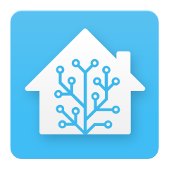
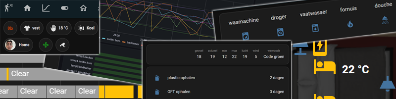

# Feed: Home Assistant - Many dashboard card examples

On my site I have placed all kinds of the best Home Assistant dashboard examples which you can use directly on your own dashboard:

* Interesting HACS integrations
* Templates
* Different layouts
* Custom formatting
* Many examples

 

And much more...

Find out more at [https://vdbrink.github.io/homeassistant/](/homeassistant/)
