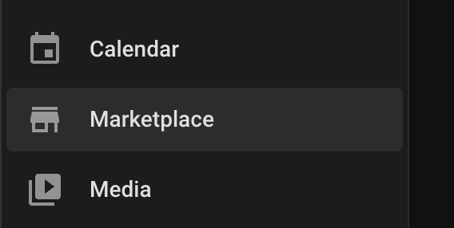
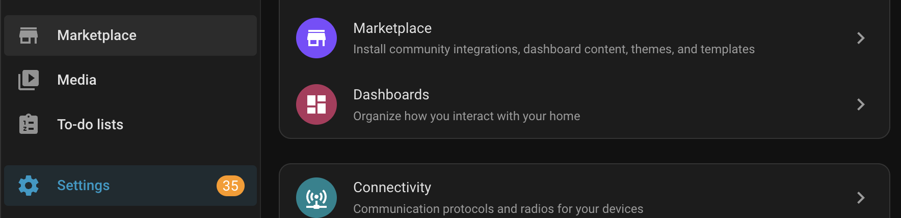
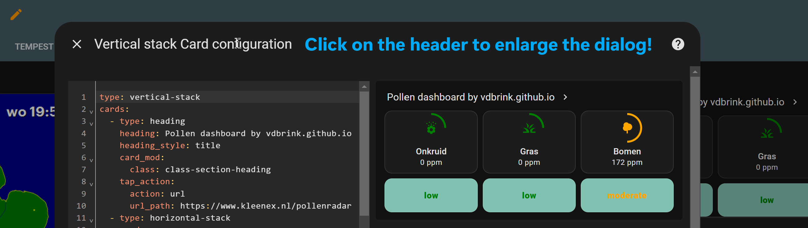
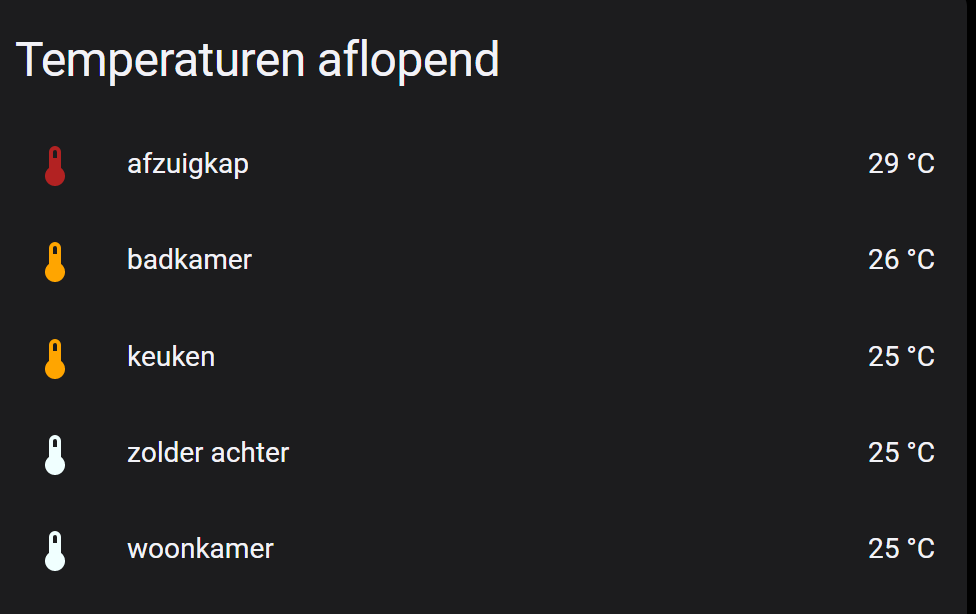
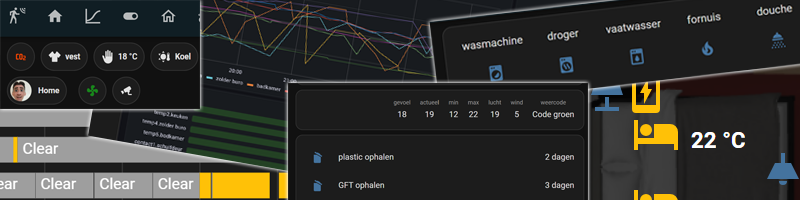
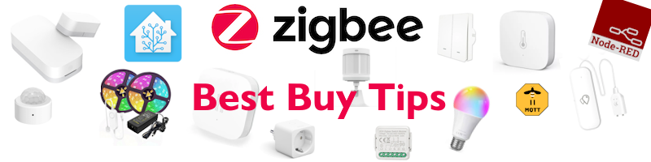

# Feed: Home Assistant Marketplace link in the sidebar


<em style="display:block; text-align:center">The Home Assistant Marketplace link back again in the side menu</em>

With the Home Assistant Marketplace, the replacement of HACS, the link is now moved away from the sidebar to the `Settings` menu. 

Maybe you still look in your sidebar to go to the HACS repositories?

To add it back in your sidebar add this to the root of the `configuration.yaml` file.

```yaml

# Source code by vdbrink.github.io
# Extra config in the root of configuration.yaml
# configuration.yaml
panel_custom:
  - name: ha-marketplace
    sidebar_title: Marketplace
    sidebar_icon: mdi:store
    url_path: marketplace/discover
    js_url: /api/hassio/app/entrypoint.js
    embed_iframe: true
    require_admin: true
  
```

## The result


<em style="display:block; text-align:center">Now the links to the Marketplace are available via the Settings AND via the sidebar!</em>

## Marketplace links to your HA

With these links you can direct to different sections of the Marketplace in your own Home Assistant.

[](https://my.home-assistant.io/redirect/marketplace_installed/?status=pending-upgrade)

[](https://my.home-assistant.io/redirect/marketplace_discover/)

[](https://my.home-assistant.io/redirect/marketplace_browse/)


## Remove HACS

Now you have the Marketplace, the old HACS can safely be removed.

---
## Related articles

Other related articles with even more interesting content.

<div class="hp-tiles hp-options hp-full">
<a class="hp-card hp-tile" href="/homeassistant/homeassistant_tips_tricks">

<div class="hp-tile-body"><span class="hp-chip">Home Assistant</span><strong>Home Assistant - Tips &amp; Tricks</strong><p>Useful and hidden tips in Home Assistant.</p></div>
</a>
<a class="hp-card hp-tile" href="/homeassistant/homeassistant_dashboard_hacs">

<div class="hp-tile-body"><span class="hp-chip">Home Assistant</span><strong>Awesome HA Marketplace custom elements</strong><p>Many custom integration cards for your dashboard, with install buttons and YAML examples.</p></div>
</a>
<a class="hp-card hp-tile" href="/homeassistant/">

<div class="hp-tile-body"><span class="hp-chip">Home Assistant</span><strong>Home Assistant - Many dashboard examples</strong><p>All Home Assistant pages with copy-paste code.</p></div>
</a>

<a class="hp-card hp-tile" href="/buy/smart_home_best_buy_tips">

<div class="hp-tile-body"><span class="hp-chip">Buy tips</span><strong>Smart home - Best Buy Tips</strong><p>Sensors and other devices I use and advise for your smart home.</p></div>
</a>
</div>
