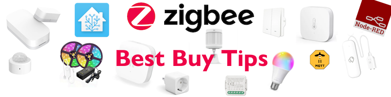

# Best Buy Tips

Building a smart home starts with picking the right hardware.
These are the devices I actually use, tested in my own home.

* [Zigbee Smart home - Best Buy Tips](smart_home_best_buy_tips) for creating a smart home.
* [Zigbee Outdoor - Best Buy Tips](smart_home_best_buy_tips#outdoor-sensors) for also a smart outdoor experience.
* [ESPHome DIY sensors - Best Buy Tips](esphome_diy) for all kinds or hardware buy tips to create your own sensors.
* [Batteries - Best Buy Tips](batteries) for all kinds of batteries to power your sensors.
