

# Home office: Accessories

 

[Overview](index) |
[Mood board](office_mood_board) |
[Virtual design with AI](office_virtual_design_with_ai) |
[Room decoration](office_room_decoration) |
[Desk setup hardware](desk_setup_hardware) |
Accessories

 

On this page, you can read about the accessories I use to decorate my office and make working there a joy
for both myself and my cats, who like to keep me company during the day!

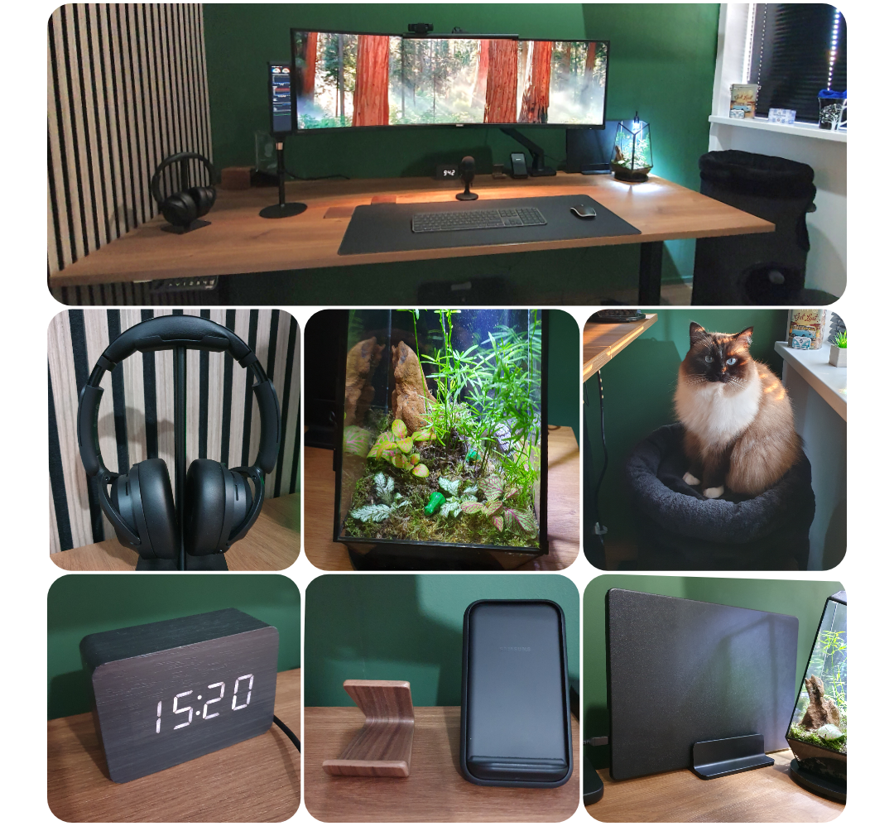
<em style="display:block; text-align:center">Accessories and my home-company-cat</em>

---
## Table of Contents
<!-- TOC -->
  * [Amazon shop list](#amazon-shop-list)
  * [Cable management](#cable-management)
  * [Monitor light](#monitor-light)
  * [Desk mat](#desk-mat)
  * [Headset](#headset)
  * [Laptop charger](#laptop-charger)
  * [Laptop stand](#laptop-stand)
  * [Laptop case](#laptop-case)
  * [Headphone stand](#headphone-stand)
  * [Desk clock](#desk-clock)
  * [Mug coaster](#mug-coaster)
  * [Wireless phone charger stand](#wireless-phone-charger-stand)
  * [Walnut phone stand](#walnut-phone-stand)
  * [Cat tower](#cat-tower)
  * [Camera](#camera)
  * [Microphone](#microphone)
  * [Smart notification light](#smart-notification-light)
  * [Stretch display](#stretch-display)
  * [Retractable USB charger](#retractable-usb-charger)
  * [Footrest](#footrest)
  * [Floor protection mat](#floor-protection-mat)
  * [Floor heated mat](#floor-heated-mat)
  * [Moss terrarium](#moss-terrarium)
  * [Shortcut keyboard](#shortcut-keyboard)
  * [Vacuum cleaner](#vacuum-cleaner)
<!-- TOC -->

> **_NOTE:_** Links on this page can be affiliate links. You pay the normal price and also support my blog.

---
## Amazon shop list

Products from this page that are available on Amazon are listed on
[(Amazon US)](https://amzn.to/4ukI1pQ#ad) and [Amazon NL](https://amzn.to/3OYGFBK#ad).
Not everything on this page is available through Amazon.
Some items, like the desk, monitor, and chair, are excluded because they have been replaced by newer models or were purchased somewhere else.
Where a newer version exists, I link to that instead.

---
## Cable management

For a clean desk cable needs to be hidden as much as possible.
Cable management is the solution to hide and guide the required cables under and behind the desk.

I use these types of guides to accomplish this.

&#10003;
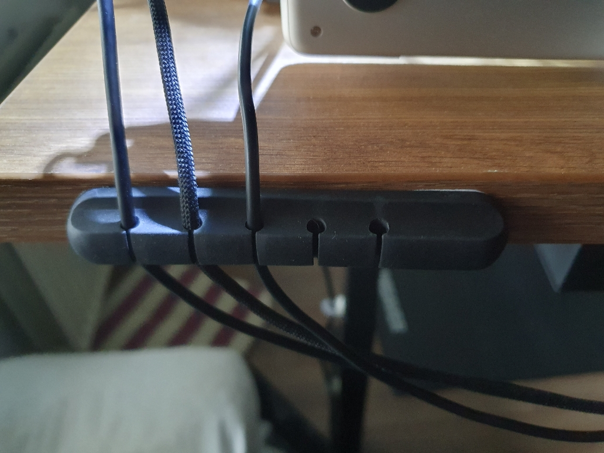

Cable management<strong>Multiple cable guide</strong>

Guide multiple cables to avoid falling behind the desk when not connected.

<a href="https://s.click.aliexpress.com/e/_c3mdNNA9" target="_blank">AliExpress</a> | <a href="https://amzn.to/4enAaCv#ad" target="_blank">Amazon US</a> | <a href="https://amzn.to/4vvsWmg#ad" target="_blank">Amazon NL</a>

&#10003;
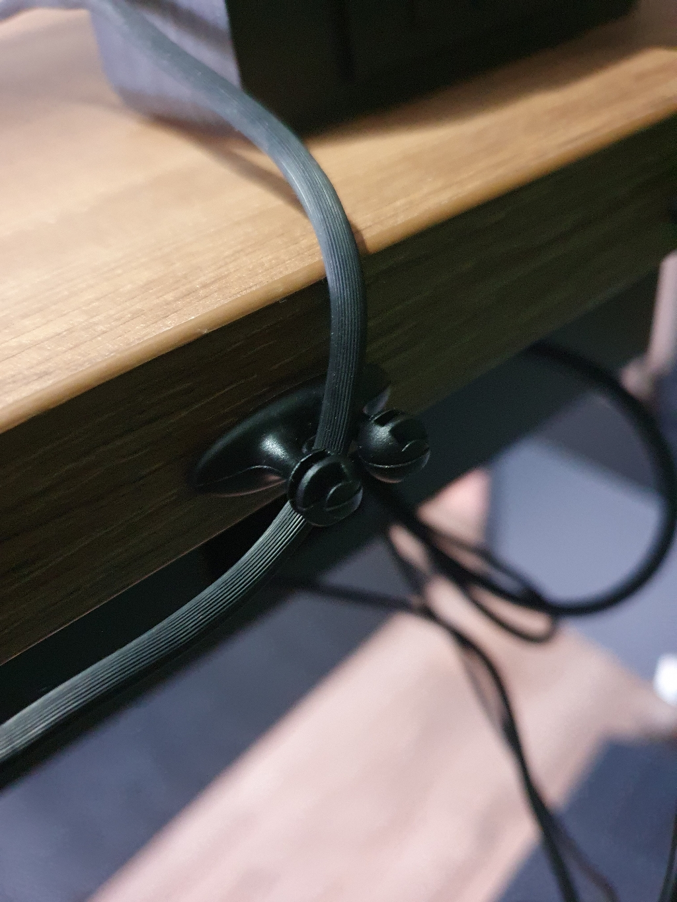

Cable management<strong>Single cable clip holder</strong>

Guide cables to a fixed place.

<a href="https://s.click.aliexpress.com/e/_c3kfMbFX" target="_blank">AliExpress</a> | <a href="https://amzn.to/4uQMxfr#ad" target="_blank">Amazon US</a>

---
## Monitor light

To get enough light on my desk, I use a monitor light bar that shines in front of the screen on the desk and keyboard and doesn't reflect in my eyes.

&#10003;

Monitor light<strong>Xiaomi Mijia monitor light desk bar</strong>

This bright light has a remote knob to dim the light, and it attaches easily to the monitor with counterweights.

<a href="https://s.click.aliexpress.com/e/_c39rwqId" target="_blank">AliExpress</a> | <a href="https://amzn.to/4gy6P9O#ad" target="_blank">Amazon US</a> | <a href="https://amzn.to/4xBYwjl#ad" target="_blank">Amazon NL</a>

---
## Desk mat

A very large mouse mat under my keyboard and mouse.

&#10003;

Desk mat<strong>Large anti-slip mouse mat</strong>

The top material of this mat is soft with a smooth surface for sliding the mouse, and the bottom is rubber to keep it in place. I have the fully black version without distracting artwork. Size: 90 x 40 x 0.3 cm (31.5" x 15.7"). Available in many sizes and border colors.

<a href="https://s.click.aliexpress.com/e/_c4lkc8mT" target="_blank">AliExpress</a> | <a href="https://amzn.to/3QbZkeg#ad" target="_blank">Amazon US</a>

---
## Headset

For my new office, I looked for a newer and improved over-ear headset.
ANC keeps improving every year, and my daily three-year-old headset was ready for an upgrade.
I wanted to go for the overall best option, the Sony WH, but the price is very high for a headset.
That kept me looking further.
I heard and read good things about the QCY H3, and when I found out the improved 2026 H3S version had been released, I went for that one!
In the past, I already had a good experience with QCY in-ear earbuds for on-the-go use.

<a href="images/qcy_h3s_default.jpg">
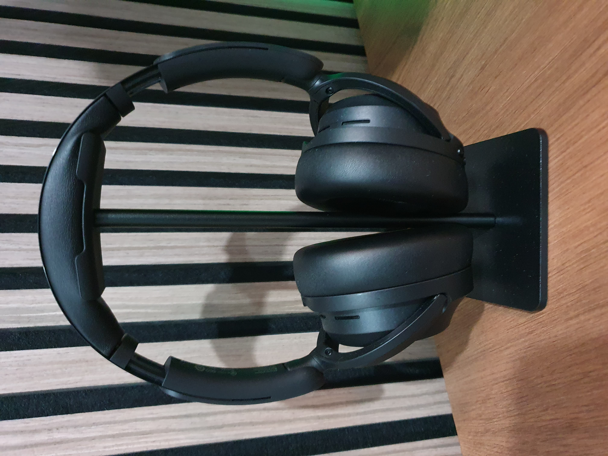
</a>

&nbsp;

<a href="images/qcy_h3s_buttons.jpg">
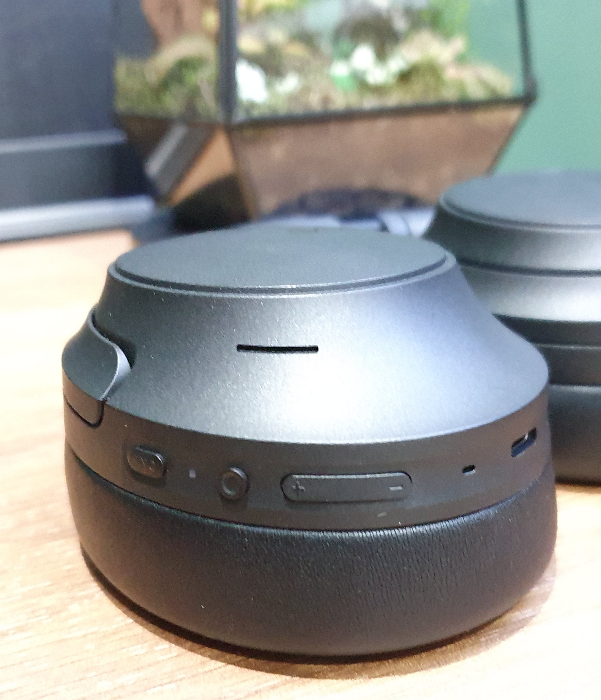
</a>

&nbsp;

<a href="images/qcy_h3s_case.jpg">
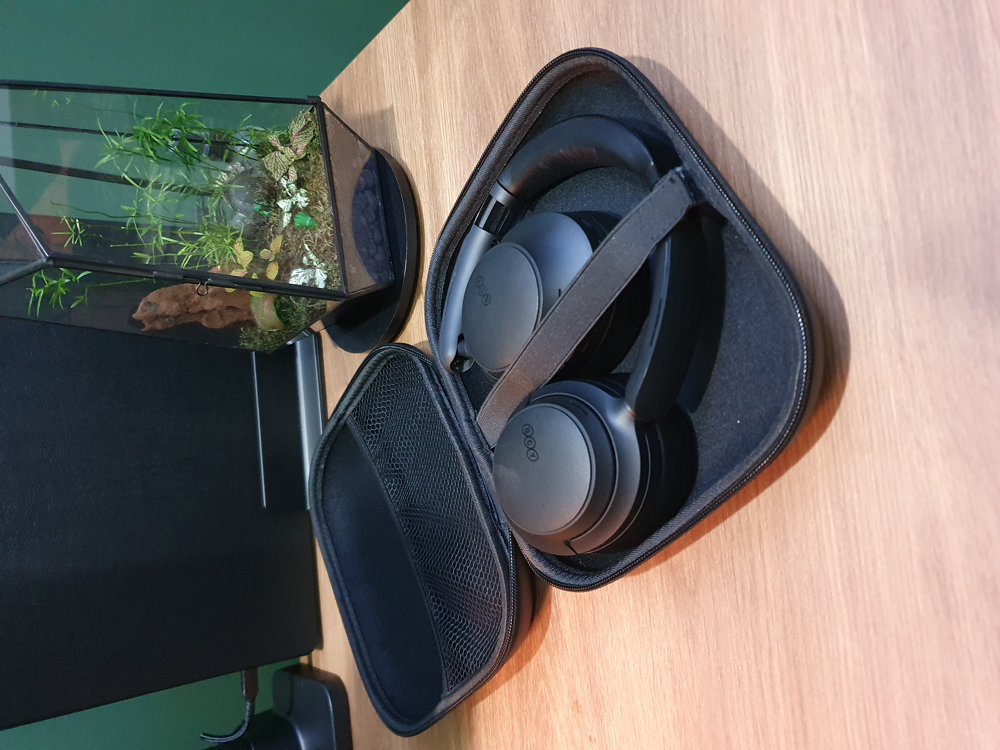
</a>

&#10003;
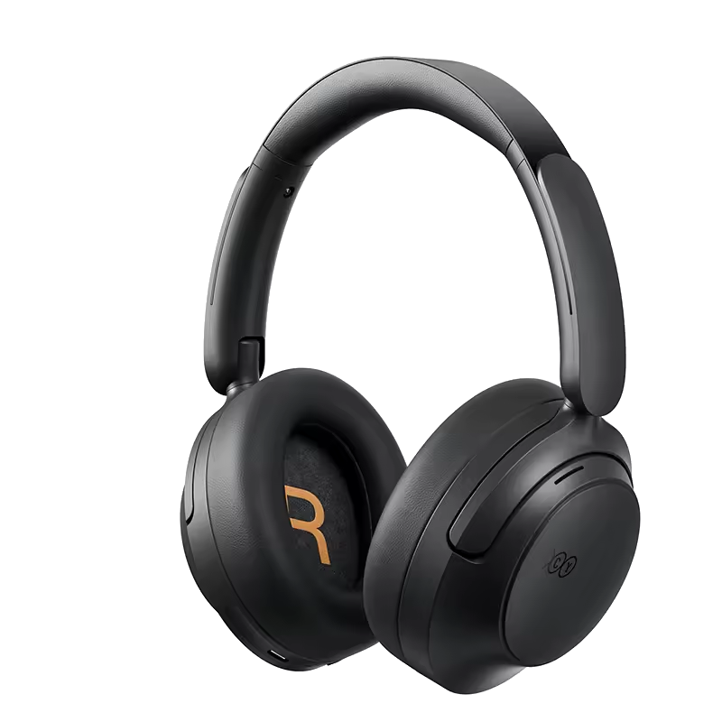

Headset<strong>ANC over-ear headset QCY H3S</strong>

Dual device connection (laptop and phone at the same time), a soft top with no hard plastic pressure on your head, and the QCY app to set custom sound settings and the level of noise cancellation. Bluetooth 6 for a long battery life, physical buttons to control ANC/sound/calls, and 5 adaptive ANC modes (Adaptive/Crowded/Commute/Indoor/Anti-Wind). Foldable with a hard case for traveling.

Just read the reviews! Available in black/white/gray.

<a href="https://s.click.aliexpress.com/e/_c4rmILlH" target="_blank">AliExpress</a> | <a href="https://amzn.to/3QdUDR9#ad" target="_blank">Amazon US</a> | <a href="https://amzn.to/3R7soEb#ad" target="_blank">Amazon NL</a>

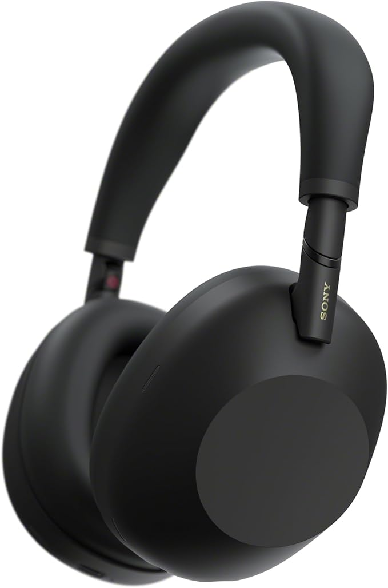

Alternative<strong>Sony WH-1000XM6</strong>

I'm also a fan of the Sony WH range, but the price is 10x the price of the QCY, and it isn't 10x better. For now, I stick to the QCY.

<a href="https://amzn.to/4vvtad6#ad" target="_blank">Amazon US</a> | <a href="https://amzn.to/3QxCUDG#ad" target="_blank">Amazon NL</a>

---
## Laptop charger

Keep your laptop charged.

&#10003;

Laptop charger<strong>Xiaomi 120W USB-C</strong>

A powerful USB-C charger with enough power to fast charge any new laptop.

<a href="https://s.click.aliexpress.com/e/_c34kENKH" target="_blank">AliExpress</a> | <a href="https://amzn.to/44r6Hla#ad" target="_blank">Amazon US</a> | <a href="https://amzn.to/4tInyuZ#ad" target="_blank">Amazon NL</a>

---
## Laptop stand

To keep the desk clean, I place my laptop upright in a black vertical laptop stand. It takes up less space on my desk surface, and I can easily detach it and replace it with my personal laptop.

&#10003;

Laptop stand<strong>Vertical laptop stand</strong>

Single vertical laptop holder, the width can be ajusted.

<a href="https://s.click.aliexpress.com/e/_c3YOP0VH" target="_blank">AliExpress</a> | <a href="https://amzn.to/4eVsZSd#ad" target="_blank">Amazon US</a> | <a href="https://amzn.to/3OEi9pF#ad" target="_blank">Amazon NL</a>

Laptop stand<strong>Vertical laptop stand for two laptops</strong>

Dual vertical laptop holder, the width can be ajusted.

<a href="https://s.click.aliexpress.com/e/_c4SxczDR" target="_blank">AliExpress</a> | <a href="https://amzn.to/4uZOXJ7#ad" target="_blank">Amazon US</a> | <a href="https://amzn.to/4vjM7iv#ad" target="_blank">Amazon NL</a>

Alternative<strong>Laptop side desk mount</strong>

Hide your laptop on the side of your desk.

<a href="https://s.click.aliexpress.com/e/_c4EqTSqf" target="_blank">AliExpress</a> | <a href="https://amzn.to/4tNoFca#ad" target="_blank">Amazon US</a> | <a href="https://amzn.to/3Sh8k2d#ad" target="_blank">Amazon NL</a>

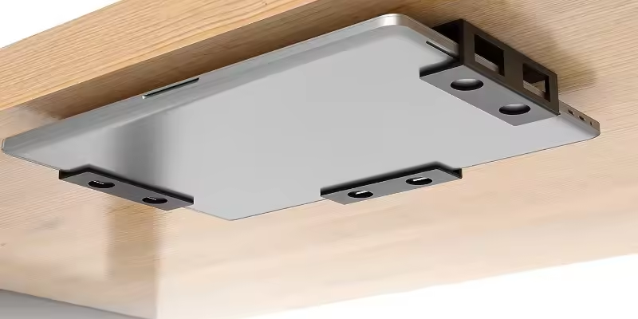

Alternative<strong>Laptop mount for under the desk</strong>

Hide your laptop under your desk.

<a href="https://s.click.aliexpress.com/e/_c4q2MMM9" target="_blank">AliExpress</a> | <a href="https://amzn.to/4tPqkOn#ad" target="_blank">Amazon US</a> | <a href="https://amzn.to/4xBiFWT#ad" target="_blank">Amazon NL</a>

## Laptop case

To avoid reflections from the nearby window and distractions from the silver laptop on my desk I looked for a cover.

&#10003;
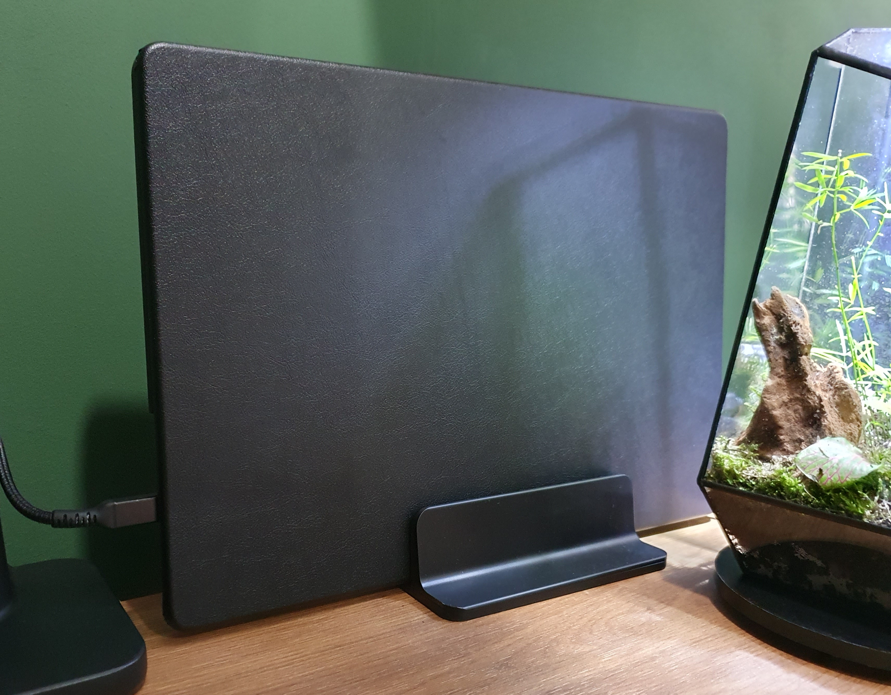

Laptop case<strong>Black MacBook cover</strong>

I found this black case for around my laptop. I chose walnut or black for all items below my monitor and on my desk to make it look calm.

<a href="https://s.click.aliexpress.com/e/_c4syE4fB" target="_blank">AliExpress</a> | <a href="https://amzn.to/42K2pos#ad" target="_blank">Amazon US</a> | <a href="https://amzn.to/4xyesn3#ad" target="_blank">Amazon NL</a>

---
## Headphone stand

To hang your headset on while you don't use it.

&#10003;

Headphone stand<strong>Headphone stand</strong>

A basic plastic headphone stand. It just does its job: holding the headphones!

<a href="https://s.click.aliexpress.com/e/_c2JOMKeL" target="_blank">AliExpress</a> | <a href="https://amzn.to/44L9m9N#ad" target="_blank">Amazon US</a> | <a href="https://amzn.to/4d2Gfm7#ad" target="_blank">Amazon NL</a>

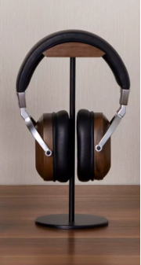

Alternative<strong>Walnut headphone stand</strong>

A more stylish wood and metal headphone stand

<a href="https://s.click.aliexpress.com/e/_c4S9Q9hf" target="_blank">AliExpress</a> | <a href="https://amzn.to/3Rl26xR#ad" target="_blank">Amazon US</a> | <a href="https://amzn.to/4eh9lzY#ad" target="_blank">Amazon NL</a>

---
## Desk clock

What time is it?

&#10003;
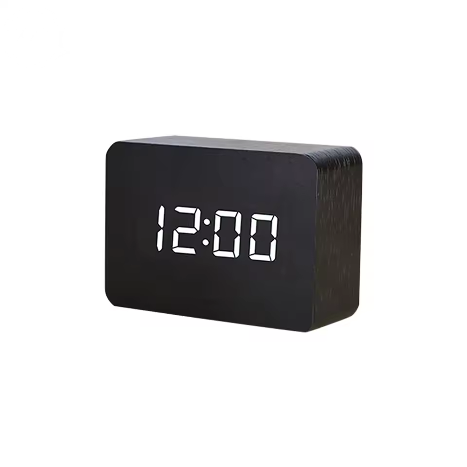

Desk clock<strong>Wooden clock</strong>

A basic wooden digital clock that doesn't attract more attention than needed.

<a href="https://s.click.aliexpress.com/e/_c3Uoskcv" target="_blank">AliExpress</a> | <a href="https://amzn.to/4oO0Yj2#ad" target="_blank">Amazon US</a> | <a href="https://amzn.to/3Qq2eMw#ad" target="_blank">Amazon NL</a>

Alternative<strong>Wood clock with other shapes or colors</strong>

Also wood-colored, with other shapes, other colors, or an additional temperature and humidity display.

<a href="https://s.click.aliexpress.com/e/_c4aiBLM9" target="_blank">AliExpress</a> | <a href="https://amzn.to/4w6O1Ds#ad" target="_blank">Amazon US</a>

Alternative<strong>Wood clock with a triangle shape</strong>

Also a wooden clock, but with a triangle shape

<a href="https://s.click.aliexpress.com/e/_c3JDrUNr" target="_blank">AliExpress</a> | <a href="https://amzn.to/44lvrv9#ad" target="_blank">Amazon US</a>

Alternative<strong>Wooden clock with wireless charger</strong>

Also a wooden clock, but with a wireless phone charger

<a href="https://s.click.aliexpress.com/e/_c4MB2Tlj" target="_blank">AliExpress</a> | <a href="https://amzn.to/43JGezd#ad" target="_blank">Amazon US</a>

---
## Mug coaster

Mug and glas coaster, it protects your desk from spills and stains.

&#10003;
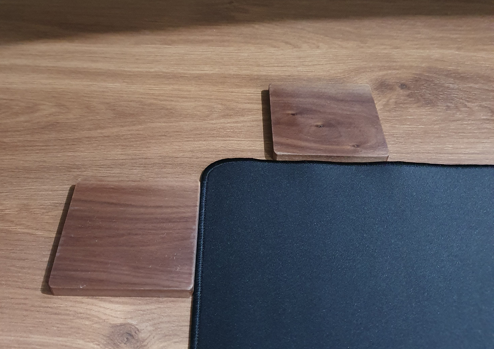

Mug coaster<strong>Personalized mug coasters</strong>

A personalized mug coaster (not in the photo due to business logos) that nobody else has is both fun and practical. This coaster has a walnut look. Upload your own image to create a coaster with your own design.

<a href="https://s.click.aliexpress.com/e/_c3xqCsX9" target="_blank">AliExpress</a>

---
## Wireless phone charger stand

Fewer wires make a desk look cleaner and more organized. If your phone supports wireless charging, place it on the charger and it starts charging, with no extra loos cable on your desk. 
It's also useful in other rooms, like the bedroom or kitchen. 
If your phone doesn't support wireless charging, consider a [retractable USB charger](#retractable-usb-charger).

&#10003;
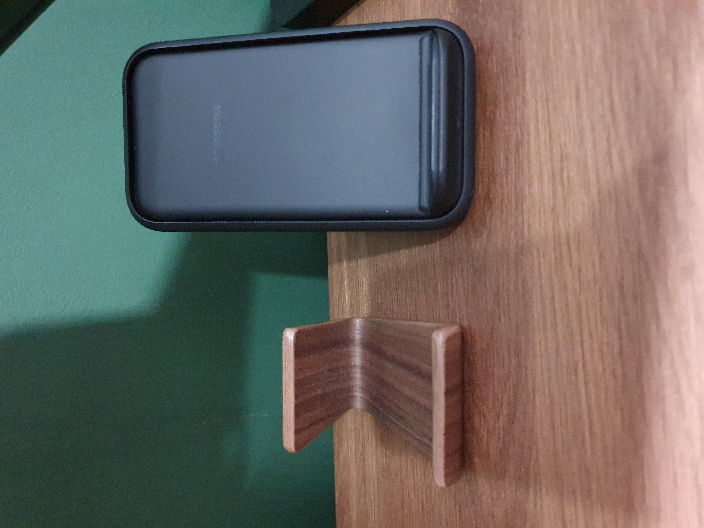

Wireless phone charger stand<strong>Wireless phone charger</strong>

Wireless phone charger, for a clean desk.

<a href="https://s.click.aliexpress.com/e/_c3qTRe0B" target="_blank">AliExpress</a> | <a href="https://amzn.to/4gy78Bu#ad" target="_blank">Amazon US</a> | <a href="https://amzn.to/42HesCL#ad" target="_blank">Amazon NL</a>

---
## Walnut phone stand

A basic phone stand in the same style as the desk and for easy view on it and easy to grab when needed.

&#10003;
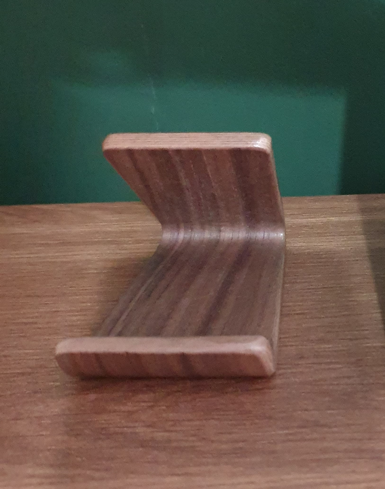

Walnut phone stand<strong>Walnut phone stand</strong>

A basic walnut-colored stand for my work phone, which is also walnut colored, so it fits perfectly with the rest of the accessories on my desk.

<a href="https://s.click.aliexpress.com/e/_c4UBgQzZ" target="_blank">AliExpress</a> | <a href="https://amzn.to/4fYOLFO#ad" target="_blank">Amazon US</a>

---
## Cat tower

When I am in the office, my cats like to stay nearby.

&#10003;
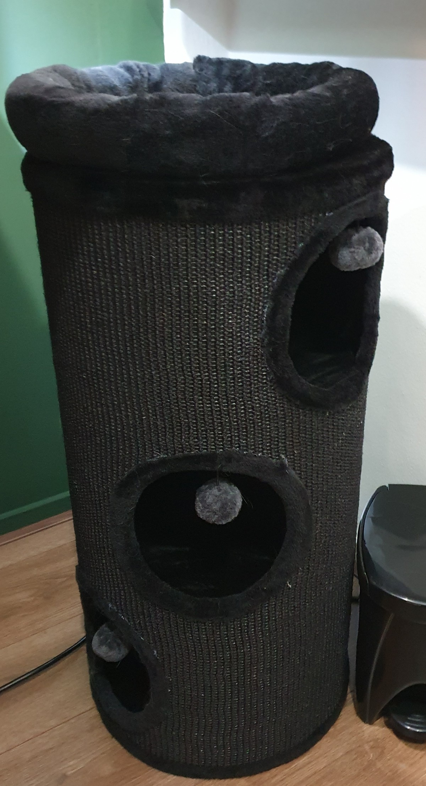

Cat tower<strong>Cat tower Diogenes L</strong>

At first, I used a spare chair, but it took too much space, and we could not see each other well while I was standing. I found a compact tower where they can lie inside or on top of it. It is available in three colors: black, beige, and gray.

<a href="https://www.bitiba.nl/shop/katten/krabpaal_krabmeubels/krabtonnen/554883?activeVariant=554883.1" target="_blank">Bitiba.nl</a>

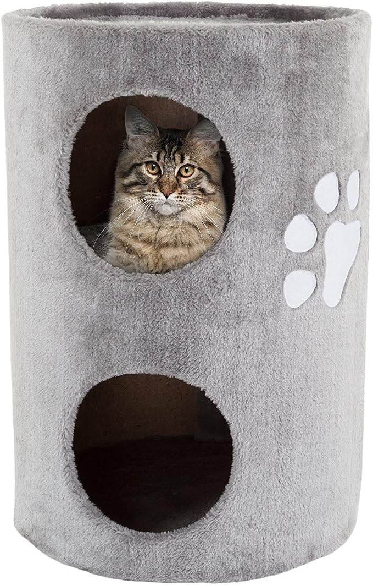

Alternative<strong>20.5-Inch Cat Condo</strong>
<b>Alternative in the same style, available in US.</b>

<a href="https://amzn.to/4tV4zgc#ad" target="_blank">Amazon US</a>

---
## Camera

Basic peripheral for video calls.

&#10003;
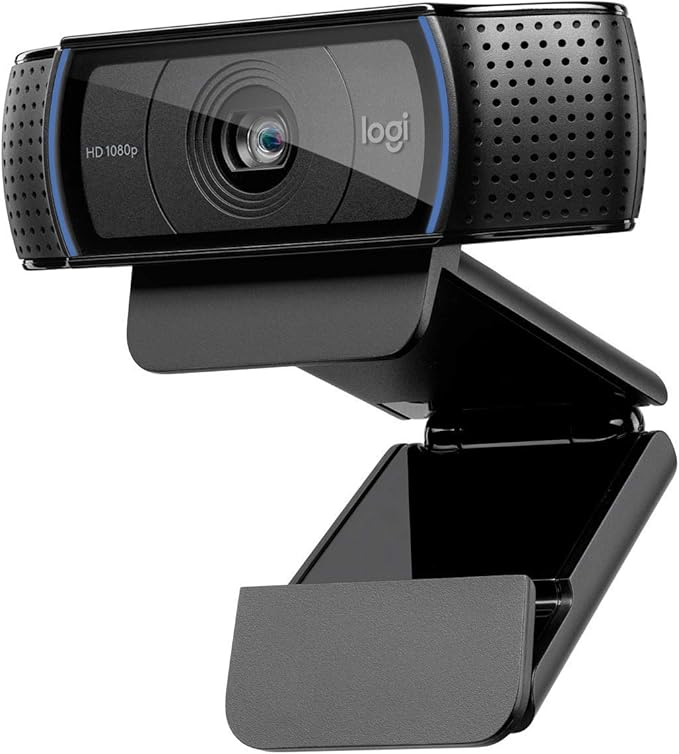

Camera<strong>Logitech C920 HD Pro Webcam</strong>

I chose this basic camera years ago because of its HD USB camera with a lens cover, 30 fps, light correction, good sound and microphone quality (now I use a separate microphone), and a mount with contra weight to place on top of a monitor. Back in the day, it was a perfect match for me, and it still works fine. But it could be upgraded to a newer one with 4K resolution and an auto-follow feature.

<a href="https://amzn.to/4hqFaIj#ad" target="_blank">Amazon US</a> | <a href="https://amzn.to/4kLNBO6#ad" target="_blank">Amazon NL</a>

 

> **_SUGGESTION?:_** I'm looking for a replacement [camera](/desk/desk_setup_hardware#camera), suggestions are welcome!

---
## Microphone

Basic peripheral for video calls.

&#10003;
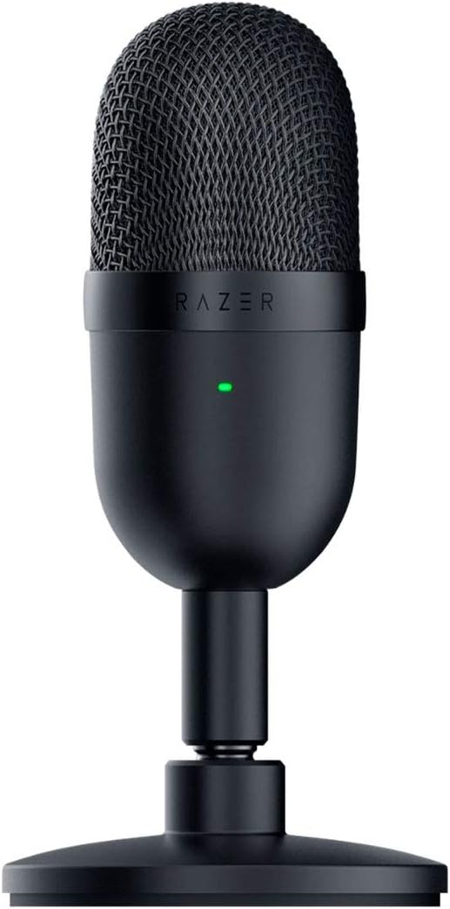

Microphone<strong>Razer Seiren Mini black</strong>

For an affordable basic microphone, I've chosen the Razer Seiren Mini black, a USB condenser microphone.

<a href="https://amzn.to/4nLZVQ8#ad" target="_blank">Amazon US</a> | <a href="https://amzn.to/4cwPg84#ad" target="_blank">Amazon NL</a>

---
## Smart notification light

A light indicator to alert you, in the style of the desk.

<a class="hp-card hp-tile hp-preferred" href="/projects/smart_notification_light">
&#10003;

Project<strong>Smart notification light</strong>

A walnut pencil holder with a GU10 full-color smart light hidden inside. It looks like a random walnut accessory when it is off. I use it as a CO2 warning light in my office, but it can also show focus time, calendar reminders, required AI user input, or anything else that works well as a color signal.

Read the article &rarr;

</a>

---
## Stretch display

A separated display with a Home Assistant display with home and room information.

<a class="hp-card hp-tile hp-preferred" href="/projects/stretch_display">
&#10003;

Project<strong>Stretch display</strong>

A small stretched display next to my main monitor that shows important office and home alerts. It is connected to a separate Raspberry Pi, displays a Home Assistant page, and boots together with the monitor. It visualizes room environment data such as office temperature, CO2 levels, and graphs for the last few hours, plus alerts like when someone is detected around the house.

Read the article &rarr;

</a>

---
## Retractable USB charger

Not everything can be charged wirelessly.
Sometimes you need a cable to charge headphones or a keyboard.
Most of the time, you do not need that cable and want to keep it out of sight.
But when you do need it, you do not want to dive under the desk or use loose hanging cables to connect one.

A nice solution is a retractable USB charging cable.\
You can pull it out when you need it, then it locks, pull again and it will automatically rolls back in when you are done.
The length of the cable is mostly 1m, enough range to different devices.

<a href="images/retractable_usb_charger_in_use.jpg">
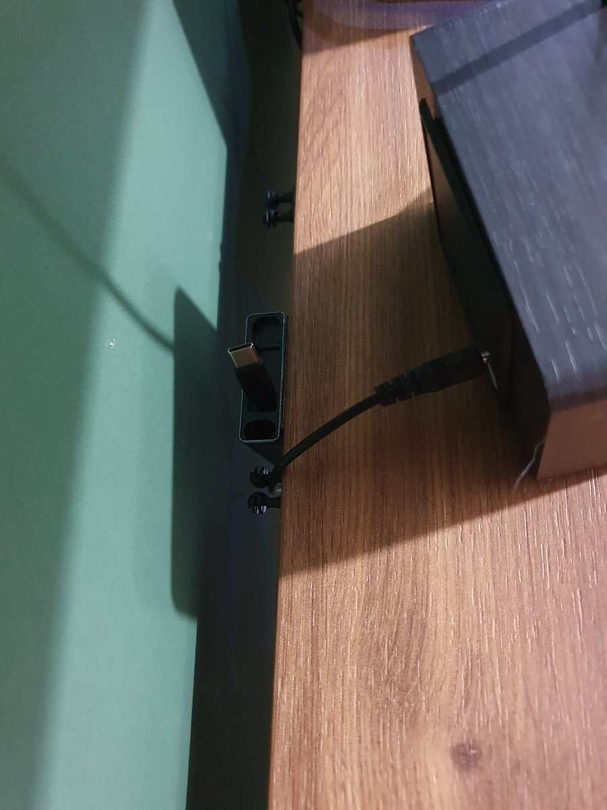
</a>
<em style="display:block; text-align:center">(Click to enlarge) Retractable USB charger, by default invisible and hidden behind my clock, but still reachable to pull the USB cable when needed to charge my keyboard or headphone.</em>

&#10003;

Retractable USB charger<strong>Retractable USB-C power cable</strong>

Pull it out when you need it, it's a 1m cable, and it rolls back in when you are done.

<a href="https://s.click.aliexpress.com/e/_c4092nFx" target="_blank">AliExpress</a>

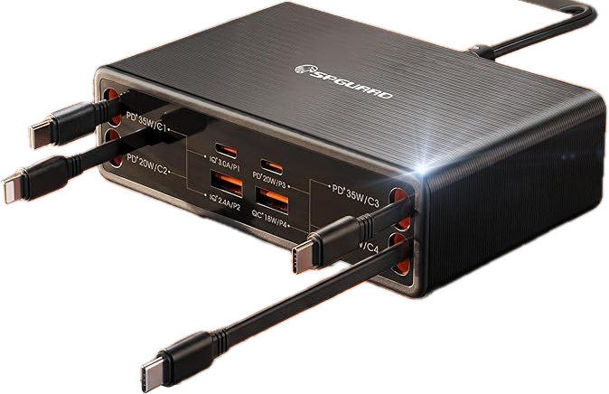

Alternative<strong>Advanced and powerful retractable power supply hub</strong>

Powerful charger.

<a href="https://amzn.to/4jifDC2#ad" target="_blank">Amazon US</a>

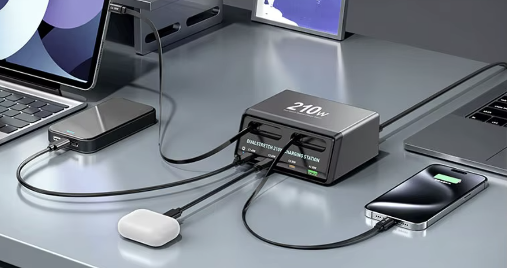

Alternative<strong>Black dual USB-C power hub</strong>

An other powerful charger.

<a href="https://s.click.aliexpress.com/e/_c4oe4KB1" target="_blank">AliExpress</a> | <a href="https://amzn.to/3SSHu0u#ad" target="_blank">Amazon US</a> | <a href="https://amzn.to/4enp1Sm#ad" target="_blank">Amazon NL</a>

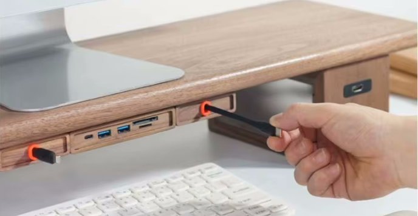

Alternative<strong>Walnut cable organizer</strong>

Nice design charger but with high shipping costs.

<a href="https://s.click.aliexpress.com/e/_c2ud4CQX" target="_blank">AliExpress</a>

---
## Footrest

To support my posture and stretch my legs while sitting, I use a footrest under my desk. It can be changed to different angles.

&#10003;
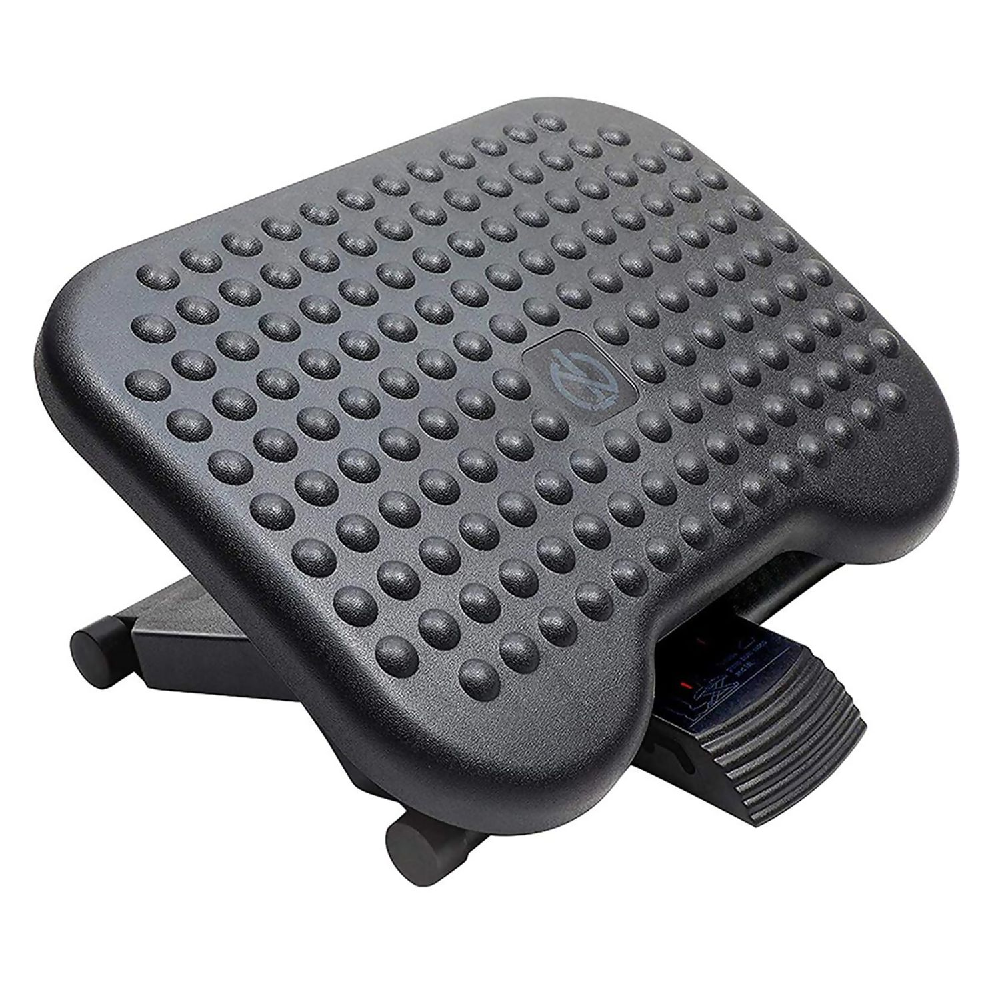

Footrest<strong>Footrest</strong>

Foot support.

<a href="https://s.click.aliexpress.com/e/_c2QayhIv" target="_blank">AliExpress</a> | <a href="https://amzn.to/4w1Zm7p#ad" target="_blank">Amazon US</a> | <a href="https://amzn.to/4aeh67k#ad" target="_blank">Amazon NL</a>

---
## Floor protection mat

To protect the floor from scratches and reduce chair-wheel noise, I placed a rubber protection mat underneath my chair.

&#10003;
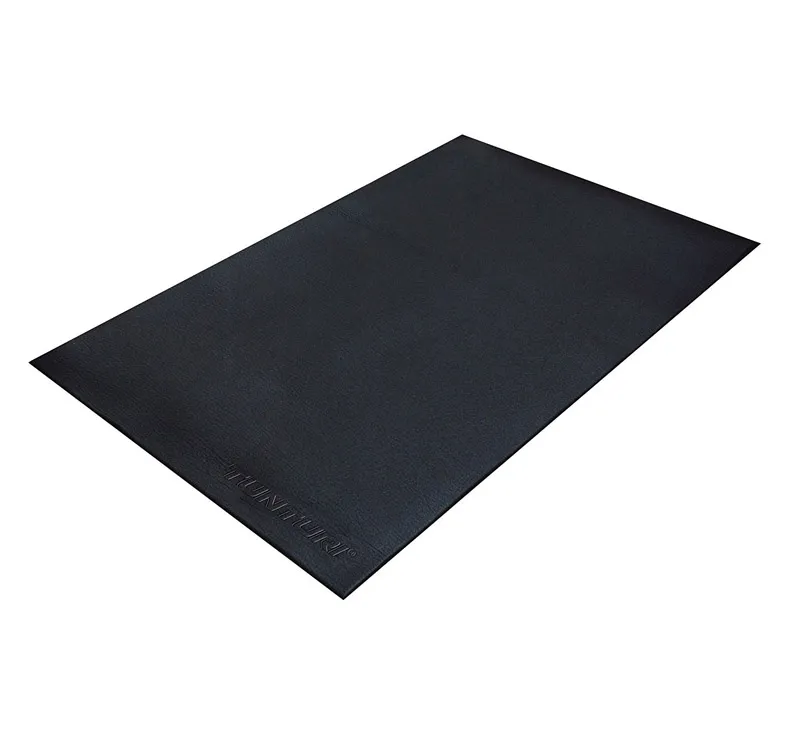

Floor protection mat<strong>Floor protection mat</strong>

A rubber or carpet version works perfectly against scratches and noises.

<a href="https://amzn.to/4odC4sM#ad" target="_blank">Amazon US</a> | <a href="https://amzn.to/4dUne72#ad" target="_blank">Amazon NL</a>

---
## Floor heated mat

To keep my feet warm during winter, I placed a heated floor mat under my desk where I stand. This way, I do not need to heat the whole room, and I avoid cold feet from the floor while standing at my desk.

&#10003;
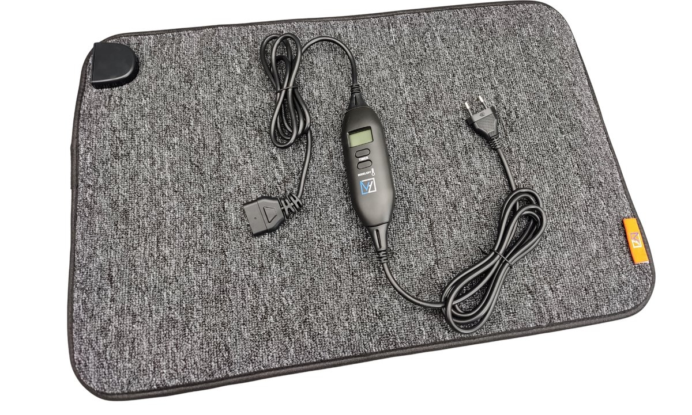

Floor heated mat<strong>VH Etna 40x60 cm</strong>

This mat has a power output of 110 watts and an inline remote with 4 levels; most of the time the 4th level is already too hot. The built-in timer shuts it off automatically. It has a three-meter power cable.

<a href="https://www.bol.com/nl/nl/p/vh-regelbare-warme-voeten-mat-etna-40-x-60-cm-lcd-controller-met-4-standen-timerfunctie-plug-heat-zuinig-in-gebruik/9300000017178095/" target="_blank">Bol.com</a>

Alternative<strong>Björn & Schiller, similar size</strong>

Less power and a shorter power cable.

<a href="https://amzn.to/4vW4R7D#ad" target="_blank">Amazon NL</a>

---
## Moss terrarium

While creating my [Pinterest mood board](office_mood_board), I found a lot of inspiration for moss terrariums (also known as mossariums), and I also wanted a small living environment like that on my desk.

Buying a fully decorated one was quite expensive, but I bought a glass myself and found a nice DIY plant kit that let me create my own moss terrarium for a reasonable price.\
Later, my local garden center also started selling moss terrariums, so it is worth checking there too.

<a href="images/mossarium_creation.jpg">
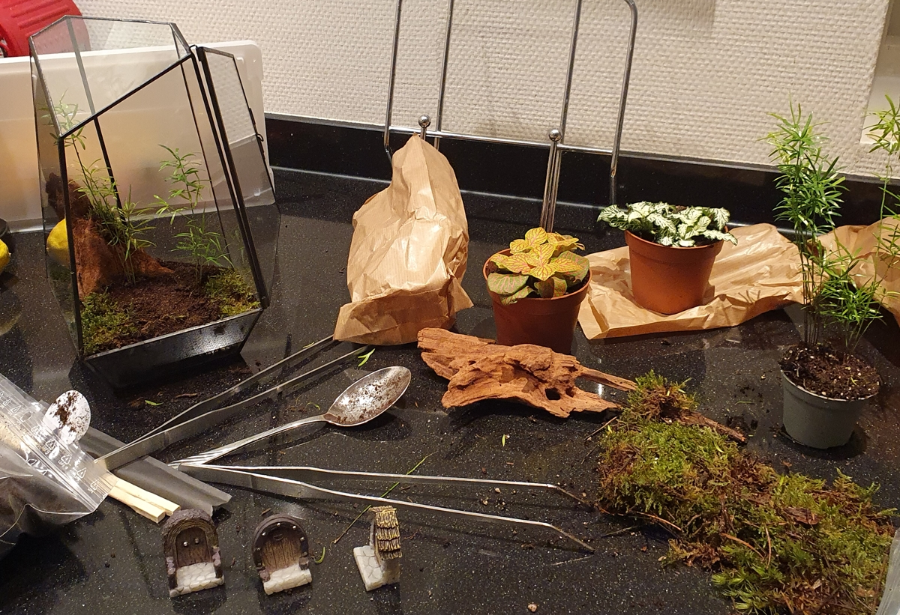
</a>
<a href="images/mossarium2.jpg">
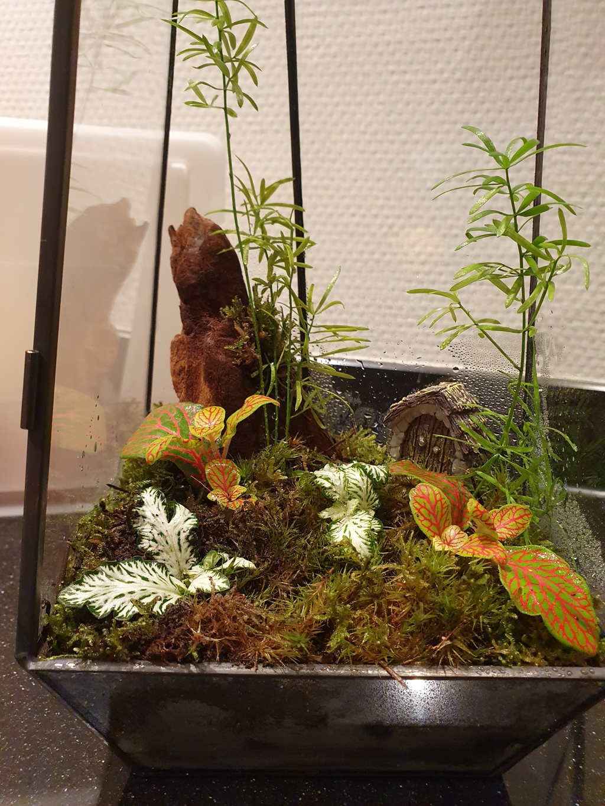
</a>

<a class="hp-card hp-tile hp-preferred" href="/projects/mossarium">
&#10003;

Project<strong>Mossarium: a small living ecosystem on my desk</strong>
How a moss terrarium works, where to buy one, how to make your own and how to take care of it.
Read the article &rarr;

</a>

---
## Shortcut keyboard

A desk keypad to direct trigger all kinds of actions.

&#10003;
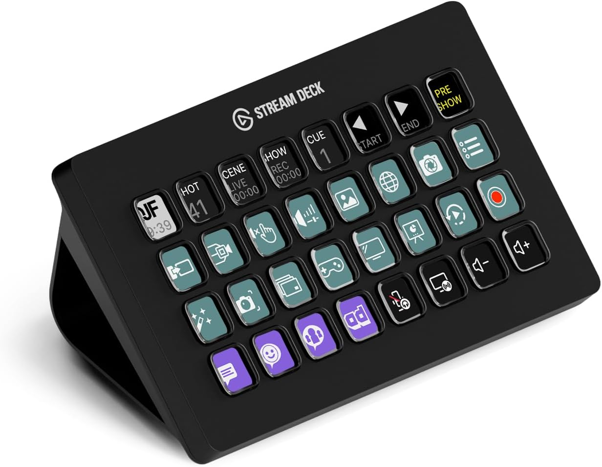

Shortcut keyboard<strong>Elgato Stream Deck XL</strong>

A macro keypad with 32 buttons to trigger all kinds of commands, scripts, apps, automations and other actions with a single click. You can search for custom icons from a library or upload your own, and a button can also be used as a small display for status updates, like current temperature or open issues.

<a href="https://amzn.to/4ycYcIe#ad" target="_blank">Amazon US</a> | <a href="https://amzn.to/4bqBe6F#ad" target="_blank">Amazon NL</a>

<a class="hp-card hp-tile" href="/elgato_stream_deck/">

Stream Deck<strong>Elgato Stream Deck for a software developer</strong>
How I use an Elgato Stream Deck as a software developer, with actions and scripts to download.
Read the article &rarr;

</a>

---
## Vacuum cleaner

With a portable vacuum cleaner for your desk (and keyboard), you can quickly remove small debris without scratching anything.

&#10003;

Vacuum cleaner<strong>Mini desk vacuum cleaner</strong>

This one is strong and it can be charged with a USB-C cable.

<a href="https://s.click.aliexpress.com/e/_c4KLKg8v" target="_blank">AliExpress</a>

## Related articles

<a class="hp-card hp-tile" href="/desk/desk_setup_hardware#future-improvements">

Home office<strong>Desk setup hardware: Future improvements</strong>
Products still on my wish list for my desk setup. Do you have good suggestions?
Read the article &rarr;

</a>

 

That it, thanks for your interrest. Have a nice day!

---

 

Home office:\
[Overview](index) |
[Mood board](office_mood_board) |
[Virtual design with AI](office_virtual_design_with_ai) |
[Room decoration](office_room_decoration) |
[Desk setup hardware](desk_setup_hardware) |
Accessories

 
