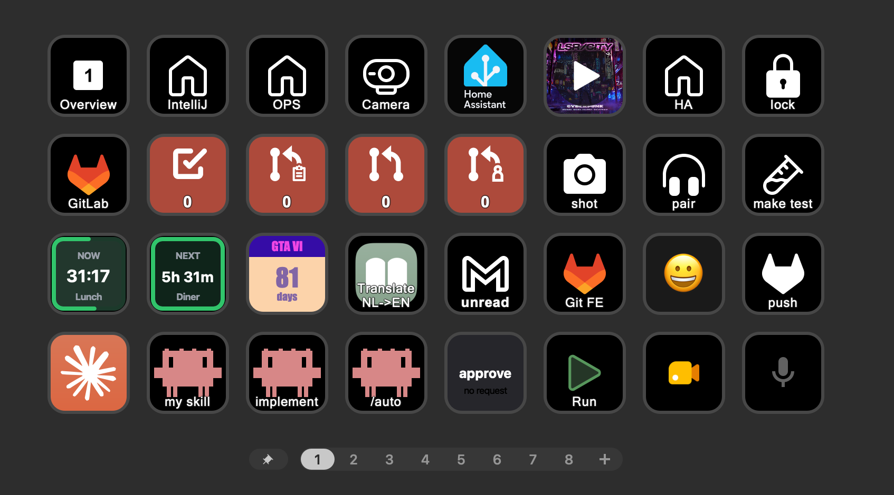

# Elgato Stream Deck - button action examples

*For a software developer*

On this page I share and explain the button actions I use on my [Stream Deck](/elgato_stream_deck),\
and how you can use them on your own Stream Deck to trigger tasks in your daily work as a developer as well.

Personally I use it for my OS actions, mail, Spotify, AI agents, video calls, IDE, calendar, GitHub, GitLab, Home Assistant and more...

I still have some actions on my [wishlist](#wishlist) myself. Maybe you can help me with them?
Or do you know any other cool and useful actions for macOS software developers yourself?
I'm always looking for new ones. Let me know via a comment on one of my social posts.

## How to use this page

* The button actions are grouped per application.
* Most button actions can be downloaded directly from here and imported into your own Stream Deck.
* Or use them as examples for all kinds of similar button actions.

 
Not every button works the same way:

* Some work out of the box with the predefined built-in actions in the Stream Deck app.
* Some need a plugin from the Elgato Marketplace.
* Some need a plugin that is installed manually.
* Some need an extra program or script to work correctly.

I describe for each one whether extra steps are needed first.

<em style="display:block; text-align:center">one of my pages with all kinds of actions and presented data on it</em>

> **_NOTE:_** All actions on this page are specific to **macOS**.
> The same solutions are probably also available on Windows, but sometimes you need different plugins for it.

> **_NOTE:_** This page is constantly updated with new plugins and integrations.\
> I've added placeholders for features I already have running and will describe in the coming months.
> Bookmark this page and come back after a while for extra possibilities.

## Example buttons

I have buttons on my Stream Deck for the below listed applications.
Click on them to see the corresponding actions, you can download them directly onto your own Stream Deck.
Or you can use them as examples and change them to fit the way you work.

 



## Related articles

<a class="hp-card hp-tile" href="/elgato_stream_deck">

Stream Deck<strong>Stream Deck</strong>
Read more about the Stream Deck

</a>
<a class="hp-card hp-tile" href="/elgato_stream_deck/stream_deck_home_assistant">

Home Assistant<strong>Elgato Stream Deck - Home Assistant integration</strong>
Control and visualize your Home Assistant entities with the Stream Deck.

</a>

