

# ESPHome CO2 sensor

*Based on the SCD40 sensor*

## Introduction

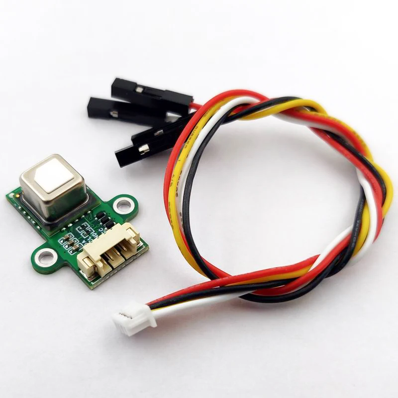

Affordable CO2 sensors do exist, but many of them are expensive.
You can also build one yourself with just a single sensor and an ESP board.
It is easy, practical, and a nice project to do yourself.\
You can even build this one **without soldering**.

Besides **CO2**, this sensor also measures the **temperature** and **humidity**.

<div style="display:flex; justify-content:left; gap:10px; flex-wrap:wrap;">
<div>
<a href="images_scd40/ha_esphome_device.png">
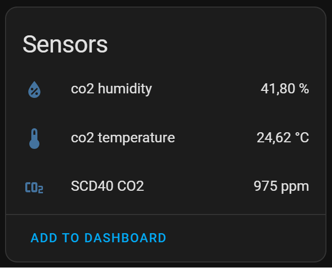
</a>
<em style="display:block; text-align:center">the CO2, temperature and humidity sensors in Home Assistant</em>
</div>
<div>
<a href="images_co2/home_assistant_co2_dashboard_mini-graph-card.png">
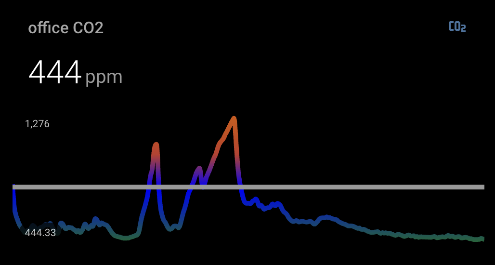
</a>
<em style="display:block; text-align:center">CO2 history on a dashboard with the mini-graph-card</em>
</div>
</div>

<br>

CO2 stands for carbon dioxide and is measured in parts per million (ppm).

If you are in a room with a ppm level that is too high, you can feel tired, start yawning, and get a headache.
For your health and your family's health, it is important to act when these values are too high.\
The value rises gradually, so you do not notice it directly.
That's why it's important to get notified about it.

The baseline value is what you measure outside and is around 400 ppm.

This table shows which action is required for each value.

| ppm        | condition | action                              |
|------------|-----------|-------------------------------------|
| 400 - 800  | good      | no action is required               |
| 800 - 1200 | medium    | open a window                       |
| 1200+      | bad       | limit has reached, open all windows |

<br>

In Home Assistant, you can visualize how the CO2 value changes over time.
With an automation, you can get notified when the value is too high.
Send the notification to your phone or make an announcement via a smart speaker.

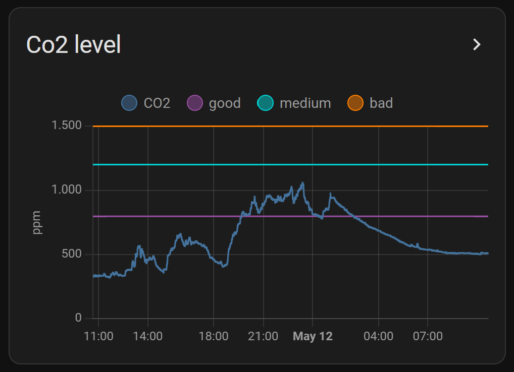

Read on to see how you can build this sensor yourself.

> **_TIP:_** If you prefer a ready-to-go CO2 sensor, you can also choose the Netatmo Healthy Home Coach.
 It is an all-in-one solution with CO2, decibel, temperature, and humidity sensors.
 You can find it here:
 {{imgBasket}}[(Amazon NL)](https://amzn.to/44wKKCE#ad)

---

## My solution

This project is one of the easiest ways to get started with ESPHome.\
No soldering is required.\
You only need to connect the wires to the ESP and flash the configuration to it.

<a href="images_scd40/hardware.jpg">
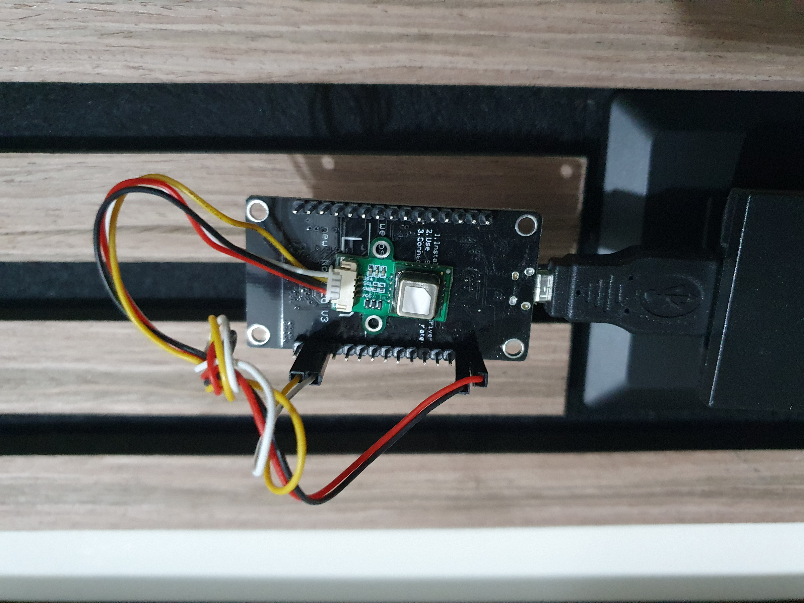
</a>
<em style="display:block; text-align:left">the test setup, sensor connected to the ESP</em>

Click on the photo to open it fullscreen.

These photos show how it works.
For the finishing touch, put the sensor in a case with holes. 
It looks better, and the holes let enough air reach the CO2 sensor.

<a href="/esphome/images_co2/holes_in_case.jpg">

</a>
<em style="display:block; text-align:center">the finished sensor in a case with holes, so air can reach the sensor</em>

The finished sensor is compact, practical, and easy to place anywhere in the room.
Everything fits inside this small case: the SCD40 sensor and an ESP board.

---

## Table of Contents
<!-- TOC -->
  * [My solution](#my-solution)
  * [Required hardware](#required-hardware)
  * [Connect the hardware](#connect-the-hardware)
  * [Required software](#required-software)
  * [Test if it works](#test-if-it-works)
  * [Home Assistant Dashboards](#home-assistant-dashboards)
  * [Automations](#automations)
<!-- TOC -->

---

## Required hardware

These are the hardware components I used for this project.

> **_NOTE:_** Affiliate links are used here. Same price, and you support this blog.

The required products, including the soldering version, are also bundled on these
[Amazon](https://amzn.to/4eQqLEn#ad) and
[Amazon NL](https://amzn.to/48GaTQU#ad) pages.

### SCD40 CO2 sensor

This small gas sensor measures **CO2** (in a range of 400 to 2000 ppm), **temperature** (-10 to 60 degrees), and **humidity** (0 to 100 percent).\
The [SCD40 datasheet](https://sensirion.com/media/documents/E0F04247/631EF271/CD_DS_SCD40_SCD41_Datasheet_D1.pdf) has all the technical details for this sensor.

> **_NOTE:_** The SCD41 can also be used here; the pins are the same. The difference between these two models is their range and power consumption.
> The SCD41 can reach up to 5000 ppm, compared to 2000 ppm for the SCD40, and it uses less power when you measure periodically every 5 minutes instead of continuously.

CO2 sensors with or without soldering:
<div class="hp-tiles hp-options">
<div class="hp-card hp-tile">
<a href="https://s.click.aliexpress.com/e/_DB01je7" target="_blank"></a>
<div class="hp-tile-body"><span class="hp-chip">SCD40 · No soldering</span><strong>GY-SCD40 CO2 sensor with cable</strong>
<p>This sensor with an I2C interface is useful if you do not want to solder.</p>
<p class="hp-store-links"><a href="https://s.click.aliexpress.com/e/_c4mXziGn" target="_blank">AliExpress 1</a> | <a href="https://s.click.aliexpress.com/e/_DB01je7" target="_blank">AliExpress 2</a></p></div>
</div>
<div class="hp-card hp-tile">
<a href="https://s.click.aliexpress.com/e/_okQAZSO" target="_blank"></a>
<div class="hp-tile-body"><span class="hp-chip">SCD40 · Soldering required</span><strong>SCD40 CO2 sensor with pins</strong>
<p>The cheaper version where you need to solder the pins.</p>
<p class="hp-store-links"><a href="https://s.click.aliexpress.com/e/_okQAZSO" target="_blank">AliExpress</a> | <a href="https://amzn.to/4ss4zEb#ad" target="_blank">Amazon US</a> | <a href="https://amzn.to/4dJXI30#ad" target="_blank">Amazon NL</a></p></div>
</div>
</div>


<div class="hp-tiles hp-options">
<div class="hp-card hp-tile">
<a href="https://s.click.aliexpress.com/e/_c3clEj8T" target="_blank"></a>
<div class="hp-tile-body"><span class="hp-chip">ESP board</span><strong>ESP8266 NodeMCU v3 (CH340)</strong>
<p>With pre-soldered pins. You can use any ESP board, like an <a href="../buy/esphome_diy#esp32">ESP32</a> or <a href="../buy/esphome_diy#esp-d1-mini">ESP D1 mini</a>, but on this page I use an ESP8266.</p>
<p class="hp-store-links"><a href="https://s.click.aliexpress.com/e/_c3clEj8T" target="_blank">AliExpress 1</a> | <a href="https://s.click.aliexpress.com/e/_c3YHyskJ" target="_blank">AliExpress 2</a> | <a href="https://amzn.to/4sTpEao#ad" target="_blank">Amazon US</a> | <a href="https://amzn.to/4qirq3i#ad" target="_blank">Amazon NL</a> | <a href="https://amzn.to/44uRwXM#ad" target="_blank">Amazon US (alt.)</a></p></div>
</div>
<div class="hp-card hp-tile">
<a href="https://s.click.aliexpress.com/e/_DDALbXD" target="_blank"></a>
<div class="hp-tile-body"><span class="hp-chip">Case</span><strong>Plastic DIY case</strong>
<p>A case with holes is the finishing touch: it looks better than the bare hardware. Almost any object with holes works, minimum 7 cm long, 3 cm wide and 3 cm high, as long as enough air can reach the sensor. A plastic box with drilled holes or a porous decorative statuette works too.</p>
<p class="hp-store-links">Black: <a href="https://s.click.aliexpress.com/e/_c3mTQROf" target="_blank">AliExpress</a></p>
<p class="hp-store-links">White: <a href="https://s.click.aliexpress.com/e/_c4t3bBiR" target="_blank">AliExpress</a></p>
<p class="hp-store-links">More sizes: <a href="https://s.click.aliexpress.com/e/_DDALbXD" target="_blank">AliExpress</a> | <a href="https://amzn.to/3G3EhVB#ad" target="_blank">Amazon US</a></p></div>
</div>
<div class="hp-card hp-tile">
<a href="https://s.click.aliexpress.com/e/_c32Nxdc7" target="_blank"></a>
<div class="hp-tile-body"><span class="hp-chip">Power</span><strong>Micro USB to USB-A cable</strong>
<p>A cable to power the ESP.</p>
<p class="hp-store-links"><a href="https://s.click.aliexpress.com/e/_c32Nxdc7" target="_blank">AliExpress</a> | <a href="https://amzn.to/4lqcvCK#ad" target="_blank">Amazon US</a></p></div>
</div>
<div class="hp-card hp-tile">
<a href="https://s.click.aliexpress.com/e/_c3r0c6Ot" target="_blank"></a>
<div class="hp-tile-body"><span class="hp-chip">Power</span><strong>5V USB EU power adapter</strong>
<p>A power adapter to power the ESP.</p>
<p class="hp-store-links"><a href="https://s.click.aliexpress.com/e/_c3r0c6Ot" target="_blank">AliExpress</a> | <a href="https://amzn.to/4j2wDcC#ad" target="_blank">Amazon US</a></p></div>
</div>
</div>

<br>

Found a dead link? [Please inform me](https://github.com/vdbrink/vdbrink.github.io/issues) or look at [ESPHome DIY sensors - Best Buy Tips](../buy/esphome_diy) for alternative links.

---

## Connect the hardware

I have made a diagram showing how to connect the GY-SCD40 to the ESP.\
This sensor uses an I2C bus interface to connect to the ESP.
That also makes it possible to connect multiple sensors to the same bus.\
The ESP has predefined pins for SDA (data) and SDL (clock).

| ESP pin | GPIO esp8266 pin | SCD40 pin   | color  |
|---------|------------------|-------------|--------|
| D2      | GPIO4            | SDA (data)  | white  |
| D1      | GPIO5            | SDL (clock) | yellow |
| G       | GND              | GND         | black  |
| 3V      | 3 V              | VCC         | red    |

### Connect the SCD40 to the ESP

Connect the four wires directly to the ESP8266 NodeMCU like this.

<a href="images_scd40/hardware.jpg">

</a>

Click on the photo to open it in fullscreen.

> **_NOTE:_** This photo only shows how it works. For the finishing touch, put it in a case with holes.

### Put it in a case

Place the sensor and the ESP together so they fit in a box.

You need to have holes in the box so the USB power cable can go through it and enough air to measure the CO2 value.

<a href="/esphome/images_co2/case_fit_co2_sensor.jpg">

</a>
<em style="display:block; text-align:center">example of a sensor and ESP that fit in the case (here with a SenseAir S8 sensor)</em>

---

## Required software

### ESPHome

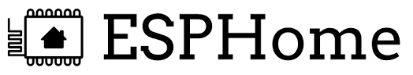

The only software you need is <a href="https://esphome.io/" target="_blank">ESPHome</a>.

This software is used to flash the configuration file to the ESP board.

Their website contains a lot of information about how to configure and calibrate all kinds of sensors.\
The relevant pages for this project are:
* [ESPHome SCD4X page](https://esphome.io/components/sensor/scd4x.html)
* [ESPHome I2C page](https://esphome.io/components/i2c.html)

### Flash the script

There are many ways to flash the configuration file with ESPHome to the board.\
Read [here](esphome_flashing) how to upload it.

Connect the ESP via USB to the computer.

One easy way is to run it from the command line:
> esphome "co2_scd40.yaml" run

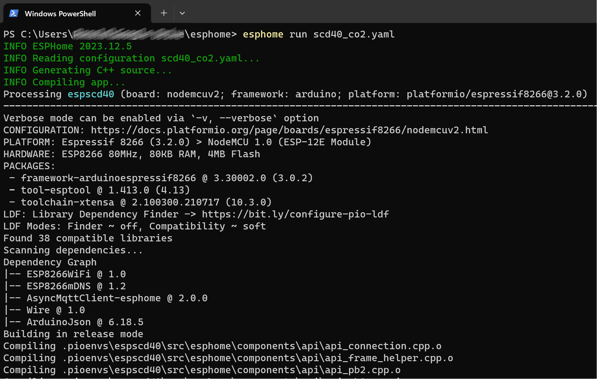

The `co2_scd40.yaml` YAML script:
```yaml
# Source code by vdbrink.github.io
esphome:
  name: espscd40
  comment: Room CO2 sensor
  platform: ESP8266
  board: nodemcuv2

wifi:
  ssid: "XXX"
  password: "XXX"
  fast_connect: true # only needed for hidden SSID

# Push the data also to MQTT topics:
# * CO2 espscd40/sensor/scd40_co2/state
# * Temperature espscd40/sensor/co2_temperature/state
# * Humidity espscd40/sensor/co2_humidity/state
mqtt:
  broker: 192.168.XXX.XXX
  port: 1883
  username: "XXXX"
  password: "XXXX"

# Enable logging to the console
logger:

# Home Assistant integration
api:

# Pins on an esp8266
i2c:
  sda: 4 # pin 21 for an ESP32
  scl: 5 # pin 22 for an ESP32

# Sensors definitions
sensor:
  - platform: scd4x
    co2:
      name: "SCD40 CO2"
    temperature:
      name: "CO2 temperature"
    humidity:
      name: "CO2 humidity"
```

---
## Test if it works

Now that the data is flashed, check whether the sensor pushes the CO2, temperature, and humidity data correctly.

### Via console

If you flash the ESP via the console and enable logging,
you will see the readings in the console immediately after the ESP is flashed.

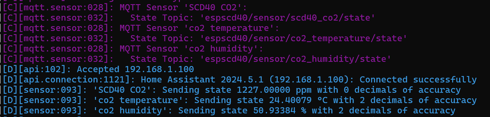

### Via Home Assistant

Once the ESP is online, it automatically registers itself in Home Assistant if you installed ESPHome.

You will see a new device with three entities: CO2, temperature, and humidity.

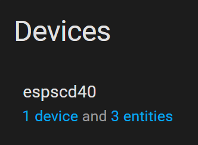


### Via MQTT

If you enabled MQTT in the config, you can also check for incoming messages.
On Windows, you can use the MQTT Explorer application.
The sensor sends its data to the topics `espscd40/sensor/scd40_co2/state`, `espscd40/sensor/co2_temperature/state`, and `espscd40/sensor/co2_humidity/state`.

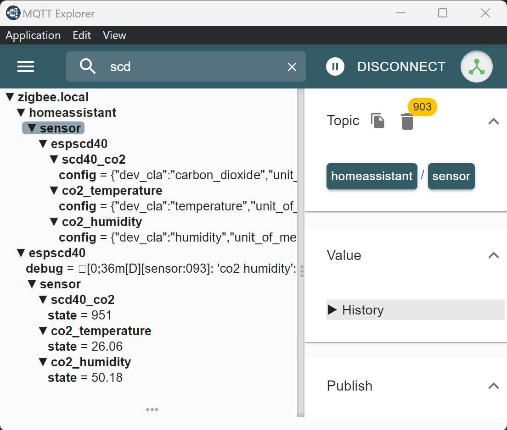

---

## Home Assistant Dashboards

Now that the data is available in Home Assistant, we can create dashboard elements to visualize it.

### Dashboard Gauge

In a gauge, you can immediately see whether the current CO2 value is in a healthy range.
I used different colors to show how serious the condition is, based on the values in the [Introduction](#introduction).

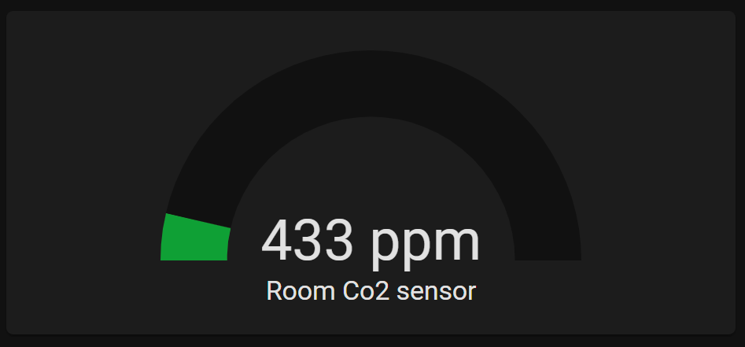

```yaml
# Source code by vdbrink.github.io
# Dashboard card code
type: gauge
severity:
  green: 400
  yellow: 800
  red: 1200
entity: sensor.scd40_co2_value
min: 350
max: 1500
name: Room CO2 sensor
```
### Dashboard Line Graphic

To show the history of the last X hours, you can use the line graph card.
It's a default presentation available in Home Assistant.

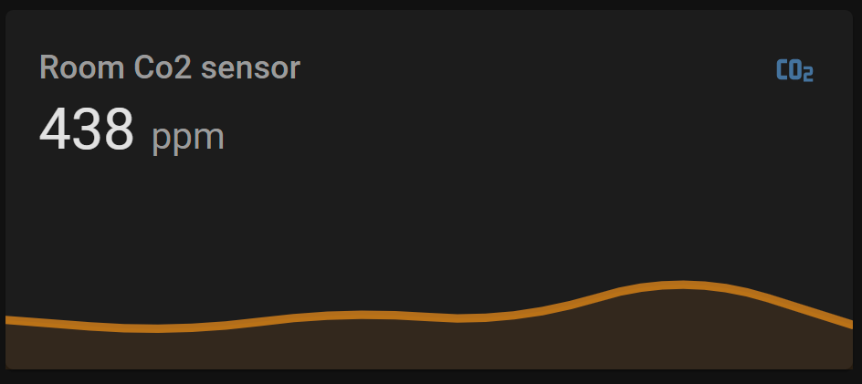

```yaml
# Source code by vdbrink.github.io
# Dashboard card code
type: sensor
graph: line
entity: sensor.scd40_co2_value
name: Room CO2 sensor
hours_to_show: 6
```

### Dashboard Mini Graph Card

With a Mini Graph Card you can create a color gradient graph line with the history of the CO2 readings.

With a fixed `sensor.co2_value_800` sensor I defined a visual threshold line for myself.
You can create it as described in [Dashboard Graphic with levels](#dashboard-graphic-with-levels).

This card requires the HACS integration `mini-graph-card`.
Install this integration via this button\
[](https://my.home-assistant.io/redirect/hacs_repository/?owner=kalkih&repository=mini-graph-card&category=integration)


```yaml
# Source code by vdbrink.github.io
# Dashboard card code
type: custom:mini-graph-card
entities:
  - entity: sensor.scd40_co2_value
  - entity: sensor.co2_value_800
    show_fill: false
    color: "#999999"
    show_legend: false
show:
  labels: true
hours_to_show: 12
points_per_hour: 24
height: 150
color_thresholds:
  - value: 400
    color: "#008000"
  - value: 800
    color: "#0000FF"
  - value: 1000
    color: "#f39c12"
  - value: 1200
    color: "#d35400"
  - value: 2000
    color: "#c0392b"
```

### Dashboard Graphic

To show the history of the last 6 hours, you can use the history graph card, or a line card for a simpler version.

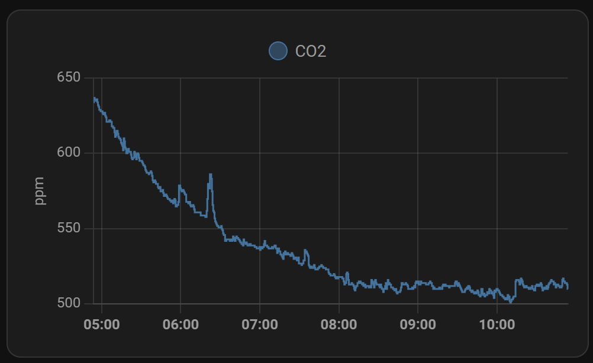

The corresponding dashboard YAML code:
```yaml
# Source code by vdbrink.github.io
# Dashboard card code
type: history-graph
entities:
  - entity: sensor.scd40_co2_value
hours_to_show: 6
```

#### Dashboard Graphic with levels


You can also show baseline values in the graph by creating a few extra custom sensors with fixed values.\
This makes it easy to see at a glance whether the current value is still in range.

```yaml
# Source code by vdbrink.github.io
# Dashboard card code
type: history-graph
entities:
  - entity: sensor.scd40_co2_value
  - entity: sensor.co2_value_800
  - entity: sensor.co2_value_1200
  - entity: sensor.co2_value_1500
hours_to_show: 24
```

This is how you create three custom lines in the graph to show the threshold values.
Add this section to your `configuration.yaml` to create the three static helper sensors:

```yaml

# Source code by vdbrink.github.io
# configuration.yaml
template:
  - sensor:
      - name: "Co2 value 800"
        unique_id: co2_value_800
        state: 800
        unit_of_measurement: 'ppm'
      - name: "Co2 value 1200"
        unique_id: co2_value_1200
        state: 1200
        unit_of_measurement: 'ppm'
      - name: "Co2 value 1500"
        unique_id: co2_value_1500
        state: 1500
        unit_of_measurement: 'ppm'

```

### Dashboard condition text

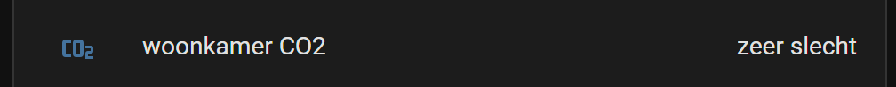

This creates a new sensor that shows a text representation of the current condition.

```yaml

# Source code by vdbrink.github.io
# configuration.yaml
template:
  - sensor:
      - name: "Scd40 co2 value text"
        unique_id: scd40_co2_value_text
        icon: "mdi:molecule-co2"
        state: >-
          
          good
          medium
          bad
          very bad
          unknown

```

### Dashboard bad condition text

In my dashboard, I have a section for important messages. You only see it when action is needed.
There is also a message when the CO2 value is not good. You can build this section with conditional entities.

```yaml

# Source code by vdbrink.github.io
# Dashboard card code
type: entities
entities:
- type: conditional
  conditions:
    - entity: sensor.scd40_co2_value_text
      state_not: good
      row:
        entity: sensor.scd40_co2_value_text

```

### Dashboard Mushroom entity


 Show a green icon without any text if the level is up to 800 ppm, yellow up to 1200 ppm, orange up to 1500 ppm, and red above that.


```yaml

# Source code by vdbrink.github.io
# Dashboard card code
type: custom:mushroom-chips-card
chips:
  - chip: null
    type: template
    icon: mdi:molecule-co2
    entity: sensor.scd40_co2_value
    content: ''
    icon_color: |-
      
         blue
      
         red
      
         orange
      
         yellow
      
         green
      

```

---

## Automations

When the CO2, temperature, or humidity value is too high, you can send a [notification](../node-red/node-red_home-assistant_notifications) to your phone or smart speaker.\
Or use a colored light or [LED strip](/projects/bin_day_led_strip_reminder) to indicate the condition and make it visible at a glance.

It's now easy to present on a [wall panel dashboard](/homeassistant/homeassistant_dashboard_tablet_in_kiosk_mode) in your living room.

<br><br>

Keep your home healthy, measuring is knowing!

---

## Related articles

<div class="hp-tiles hp-options hp-full">
<a class="hp-card hp-tile" href="/projects/stretch_display">

<div class="hp-tile-body"><span class="hp-chip">Project</span><strong>Stretch display</strong><p>Show your CO2 and temperature data on a small stretched display on your desk.</p></div>
</a>
<a class="hp-card hp-tile" href="/projects/smart_notification_light">

<div class="hp-tile-body"><span class="hp-chip">Project</span><strong>Smart notification light</strong><p>A stylish light on your desk that changes color when the CO2 level is too high.</p></div>
</a>
<a class="hp-card hp-tile" href="/esphome/index#articles">

<div class="hp-tile-body"><span class="hp-chip">ESPHome</span><strong>ESPHome projects</strong><p>Check my other ESPHome projects.</p></div>
</a>
</div>
