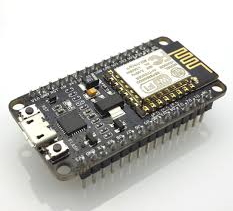

# ESPHome: Flash the config to the ESP


# Introduction



The ESP board is a small mini computer with onboard WiFi. ESPHome makes it easy to program these boards.

You define for each ESP board the connected sensors in a template. In the template, you define your ESP board and which and how the sensors are connected.
The sensor also automatically registers itself to Home Assistant (or sends its data to a MQTT server).


<details markdown="1">
  <summary><b>> Click here to see an example how an ESPHome config file looks like: >></b></summary>

```yaml
# Source code by vdbrink.github.io
# ESPHome example configuration ESP SDC40 CO2 sensor
esphome:
  name: espscd40
  comment: Room CO2 sensor
  platform: ESP8266
  board: nodemcuv2

wifi:
  ssid: "My WiFi network SSID"
  password: "My WiFi password"

# Home Assistant integration
api:

# pin definition
i2c:
  sda: 4
  scl: 5

# Define which sensors are connected to the board
#  and how the look like in Home Assistant.
sensor:
  - platform: scd4x
    co2:
      name: "SCD40 CO2"
    temperature:
      name: "CO2 temperature"
    humidity:
      name: "CO2 humidity"
```
</details>

---

## Detailed info

For more information about installing and flashing your ESP with ESPHome see the [ESPHome website](https://esphome.io/guides/getting_started_command_line.html) or [Peyanski ESPHome Installation Guide](https://peyanski.com/complete-esphome-installation-guide/#How_to_properly_connect_an_ESP_device_for_ESPHome_install).

---

## Command line links

* <a href="https://www.python.org/" target="_blank">Python</a> to run ESPHome
* <a href="https://esphome.io/guides/getting_started_command_line.html#first-uploading" target="_blank">ESPHome</a> to flash the ESP
* <a href="https://github.com/nodemcu/nodemcu-devkit/tree/master/Drivers" target="_blank">Windows driver chp340</a> to recognize the ESP as connected device

> esphome run file.yaml

---

## Docker

With this docker-compose file you can run Esphome.

The file docker-compose.yml:
```yaml
# Source code by vdbrink.github.io
# Docker compose config for ESPHome
# docker-compose.yaml to run ESPHome
version: '2'
services:

    esphome:
        container_name: esphome
        image: esphome/esphome
        environment:
          - TZ=Europe/Amsterdam
        ports:
          - "6052:6052"
          - "6123:6123"
        restart: unless-stopped
        volumes:
          - /etc/localtime:/etc/localtime:ro
          - ./volumes/esphome/config:/config
```

`http://<docker host>:6052/`

---
<!--
## Upload the binary

### ESP web interface
-->


