# Home Assistant dashboard: Useful HACS custom elements

<a href="index">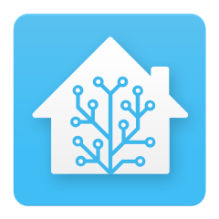</a>

Here you find Home Assistant (Lovelace) dashboard custom elements that are not available by default, but that you can add to your dashboard.
<br><br>

---

## Table of Contents
<!-- TOC -->
  * [Swipe Navigation](#swipe-navigation)
  * [auto-entities](#auto-entities)
  * [Mushroom](#mushroom)
  * [card-mod 3 (lovelace-card-mod)](#card-mod-3-lovelace-card-mod)
  * [slider-entity-row](#slider-entity-row)
  * [multiple-entity-row](#multiple-entity-row)
  * [template-entity-row](#template-entity-row)
  * [Atomic Calendar Revive](#atomic-calendar-revive)
  * [Birthday Reminder Card](#birthday-reminder-card)
  * [Clock Weather Card](#clock-weather-card)
  * [Lovelace animated weather card](#lovelace-animated-weather-card)
  * [Neerslag App](#neerslag-app)
<!-- TOC -->

---

## Swipe Navigation

Swipe left or right to switch to the side Lovelace dashboard on your mobile device.

Repo: [https://github.com/zanna-37/hass-swipe-navigation](https://github.com/zanna-37/hass-swipe-navigation)

Install this integration, via this button, into your own Home Assistant instance.\
[](https://my.home-assistant.io/redirect/hacs_repository/?owner=zanna-37&repository=hass-swipe-navigation&category=integration)

---

## auto-entities

Dynamically show entities based on a variety of sorting and filtering options.

Example: Show all temperature entities, sorted by temperature, rounded to no decimals and colored based on the temperature.

<a href="images_autoentities/temp_round_sorted_color-autoentities.png">
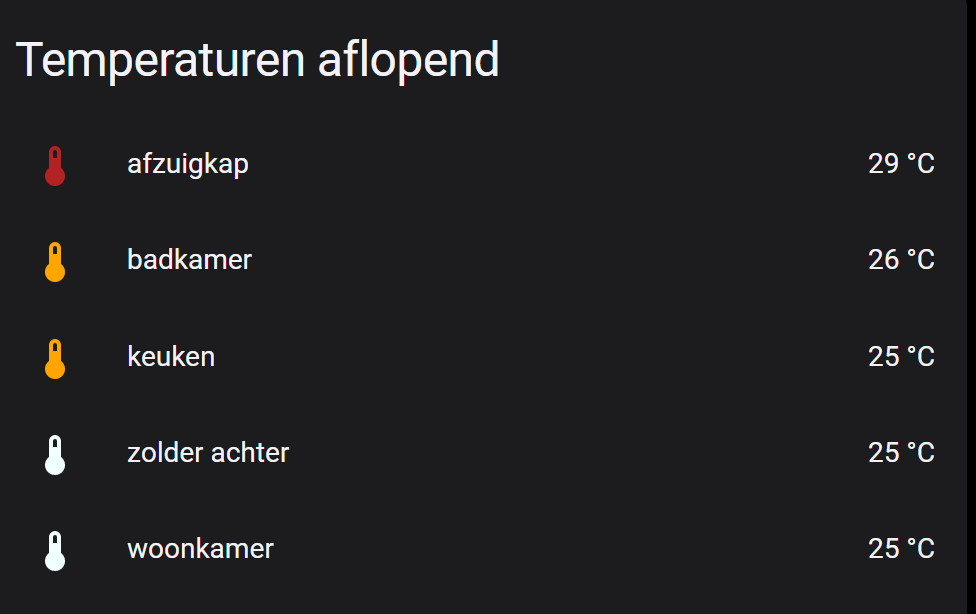
</a>
<em style="display:block; text-align:center">auto-entities example: temperatures rounded, sorted and colored</em>

Repo: [https://github.com/thomasloven/lovelace-auto-entities](https://github.com/thomasloven/lovelace-auto-entities)

Install this integration, via this button, into your own Home Assistant instance.\
[](https://my.home-assistant.io/redirect/hacs_repository/?owner=thomasloven&repository=lovelace-auto-entities&category=integration)

I have a [dedicated page](homeassistant_dashboard_card_auto-entities) with examples and a dashboard with [chores](homeassistant_dashboard_chores) based on this custom element.

```yaml

# Source code by vdbrink.github.io
# Dashboard card code
type: custom:auto-entities
card:
  type: entities
  show_header_toggle: false
  state_color: false
  title: Temperature
filter:
  include:
    - entity_id: sensor.temp*.temperature
      options:
        type: custom:template-entity-row
        state: |
          {{ states(config.entity)|round(0)}} °C
        style: |
          :host {
            --paper-item-icon-color:
             
              firebrick
              orange
              blue
              var(--primary-text-color)
             
             ;
           }
show_empty: false
sort:
  method: state
  reverse: true
  numeric: true

```

---

## Mushroom

With the mushroom element, you can add small elements on top of your dashboard.\
It can be only a colored icon, or also show a state value.\
You can also show them only for a specific state.
For example: rain expected, a CO2 level that is too high, a wrong temperature, or nice weather to sit outside.

Examples:

<div style="display:flex; justify-content:center; gap:10px; flex-wrap:wrap;">
<div>
<a href="images_mushroom/mushroom_examples.png">
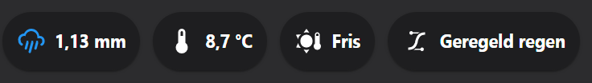
</a>
<em style="display:block; text-align:center">Mushroom examples</em>
</div>
<div>
<a href="images_mushroom/mushroom_co2.png">
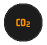
</a>
<em style="display:block; text-align:center">mushroom CO2 indicator</em>
</div>
<div>
<a href="images_mushroom/mushroom_home.png">
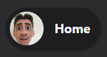
</a>
<em style="display:block; text-align:center">mushroom home indicator</em>
</div>
</div>

Repo: [https://github.com/piitaya/lovelace-mushroom](https://github.com/piitaya/lovelace-mushroom)

Install this integration, via this button, into your own Home Assistant instance.\
[](https://my.home-assistant.io/redirect/hacs_repository/?owner=piitaya&repository=lovelace-mushroom&category=integration)


[My dedicated page about the Mushroom element >>](homeassistant_dashboard_card_mushroom)

---

## card-mod 3 (lovelace-card-mod)

Add custom CSS styling to your dashboard.

Example: Colored icon based on entity state.

<a href="images_styling/colored_icon.png">
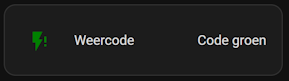
</a>
<em style="display:block; text-align:center">colored icon based on the entity state</em>

I have a [styling page](homeassistant_dashboard_styling) with multiple examples based on this custom element.

Repo: [https://github.com/thomasloven/lovelace-card-mod](https://github.com/thomasloven/lovelace-card-mod)

Install this integration, via this button, into your own Home Assistant instance.\
[](https://my.home-assistant.io/redirect/hacs_repository/?owner=thomasloven&repository=lovelace-card-mod&category=integration)

The entity used here is based on the [KNMI weather alarm scraper](/homeassistant/homeassistant_dashboard_weather_nl#weather-alarm).

```yaml

# Source code by vdbrink.github.io
# Dashboard card code
type: entities
entities:
  - entity: sensor.knmi_weercode
    tap_action:
      action: url
      url_path: https://www.knmi.nl/nederland-nu/weer/waarschuwingen/
    card_mod:
      style: |
        :host {
          --card-mod-icon-color:
          
           #008000;
          
           #CC0000;
          
           #ffd700;
          
           #ffa500;
          
           #44739e
          
         }

```

---

## slider-entity-row

Add a slider for brightness, volume, cover position, speed, number, etc.

<a href="images_hacs/hacs_slider-entity-row.png">
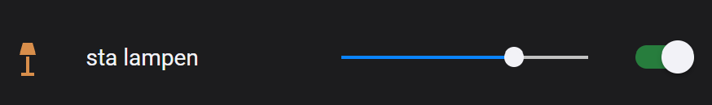
</a>
<em style="display:block; text-align:center">slider-entity-row example</em>

Repo: [https://github.com/thomasloven/lovelace-slider-entity-row](https://github.com/thomasloven/lovelace-slider-entity-row)

Install this integration, via this button, into your own Home Assistant instance.\
[](https://my.home-assistant.io/redirect/hacs_repository/?owner=thomasloven&repository=lovelace-slider-entity-row&category=integration)

```yaml

# Source code by vdbrink.github.io
# Dashboard card code
type: custom:slider-entity-row
entity: light.group_light1
toggle: true

```

---

## multiple-entity-row

Place multiple entities compactly on a single row.


Repo: [https://github.com/benct/lovelace-multiple-entity-row](https://github.com/benct/lovelace-multiple-entity-row)

Install this integration, via this button, into your own Home Assistant instance.\
[](https://my.home-assistant.io/redirect/hacs_repository/?owner=benct&repository=lovelace-multiple-entity-row&category=integration)

---

## template-entity-row

Customize a single row for multiple entities.

In this example, a rounded temperature with an icon that is colored based on the temperature.

<a href="images_hacs/hacs_template-entity-row.png">
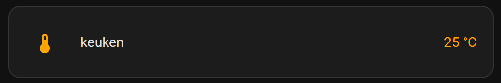
</a>
<em style="display:block; text-align:center">template-entity-row example: rounded temperature with a colored icon</em>

Repo: [https://github.com/thomasloven/lovelace-template-entity-row](https://github.com/thomasloven/lovelace-template-entity-row)

Install this integration, via this button, into your own Home Assistant instance.\
[](https://my.home-assistant.io/redirect/hacs_repository/?owner=thomasloven&repository=lovelace-template-entity-row&category=integration)

```yaml

# Source code by vdbrink.github.io
# Dashboard card code
type: entities
entities:
  - entity: sensor.temp1_temperature
    type: custom:template-entity-row
    state: |
      {{ states(config.entity)|round(0)}} °C
    style: |
      :host {
        --paper-item-icon-color:
         
          firebrick
          orange
          blue
          var(--primary-text-color)
         
         ;
       }
       .state {
         color:
         
          firebrick
          orange
          blue
          var(--primary-text-color)
         
       }

```

---

## Atomic Calendar Revive

A Google calendar overview.

<a href="images_hacs/hacs_atomic-calendar-revive.png">
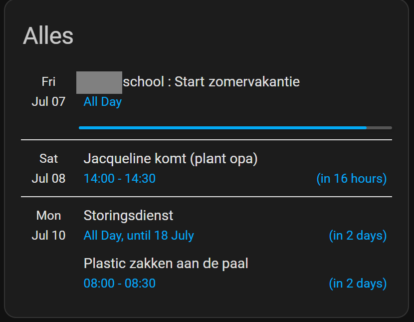
</a>
<em style="display:block; text-align:center">Atomic Calendar Revive overview</em>

Repo: [https://github.com/totaldebug/atomic-calendar-revive#about-the-project](https://github.com/totaldebug/atomic-calendar-revive#about-the-project)

Install this integration, via this button, into your own Home Assistant instance.\
[](https://my.home-assistant.io/redirect/hacs_repository/?owner=totaldebug&repository=atomic-calendar-revive&category=integration)

---

## Birthday Reminder Card

A birthday and wedding day overview.

<a href="https://github.com/erlsta/homeassistant-lovelace-birthday-reminder-card/raw/master/birthday-card.png">

</a>
<em style="display:block; text-align:center">Birthday Reminder Card</em>

Repo: [https://github.com/erlsta/homeassistant-lovelace-birthday-reminder-card](https://github.com/erlsta/homeassistant-lovelace-birthday-reminder-card)

Install this integration, via this button, into your own Home Assistant instance.\
[](https://my.home-assistant.io/redirect/hacs_repository/?owner=vdbrink&repository=homeassistant-lovelace-birthday-reminder-card&category=plugin)

To add your own dates, edit the `birthday-reminder-card.js` file.
You can find it in the `www` folder of your Home Assistant installation.

```yaml

# Source code by vdbrink.github.io
# Dashboard card code
type: custom:birthday-card
title: "Birthdays"
numberofdays: 30

```

---

## Clock Weather Card

A clock and weather forecast in one card.

<a href="images_hacs/clock-weather-card.gif">
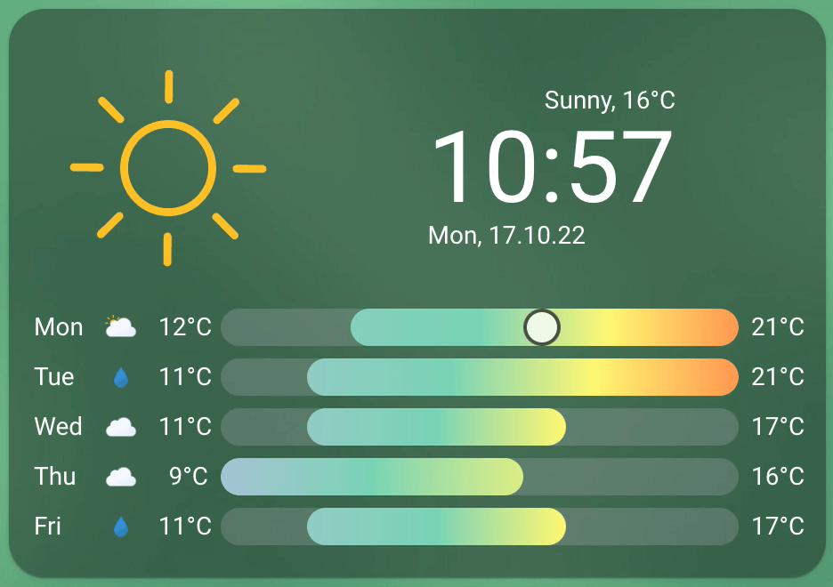
</a>
<em style="display:block; text-align:center">Clock Weather Card</em>

Repo: [https://github.com/pkissling/clock-weather-card](https://github.com/pkissling/clock-weather-card)

Install this integration, via this button, into your own Home Assistant instance.\
[](https://my.home-assistant.io/redirect/hacs_repository/?owner=pkissling&repository=clock-weather-card&category=integration)

You can also minimize the card so it only shows the weather forecast.
<a href="images_hacs/my_clock_weather_card.png">
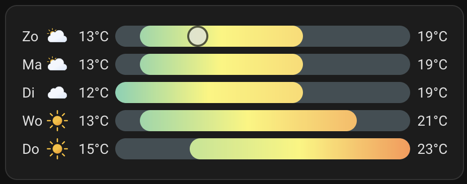
</a>
<em style="display:block; text-align:center">Clock Weather Card minimized to the weather forecast</em>

```yaml

# Source code by vdbrink.github.io
# Dashboard card code
type: custom:clock-weather-card
entity: weather.forecast_home
forecast_days: 5
locale: nl
time_format: 24
hide_clock: true
date_pattern: ''
hide_today_section: true
hide_forecast_section: false

```

[See also another presentation with the weather per hour >](/homeassistant/homeassistant_dashboard_weather#clock-weather-card-per-hour)

BeardedTinker made a YouTube video about this card.
[](https://www.youtube.com/watch?v=jHgnO3JryCM "Clock Weather Card HA installation")

---

## Lovelace animated weather card

Current weather conditions and the predictions for the coming days.

<a href="https://raw.githubusercontent.com/bramkragten/custom-ui/master/weather-card/weather-card.gif">

</a>
<em style="display:block; text-align:center">Lovelace animated weather card</em>

Repo: [https://github.com/bramkragten/weather-card](https://github.com/bramkragten/weather-card)

Install this integration, via this button, into your own Home Assistant instance.\
[](https://my.home-assistant.io/redirect/hacs_repository/?owner=bramkragten&repository=weather-card&category=integration)

```yaml

# Source code by vdbrink.github.io
# Dashboard card code
type: custom:weather-card
entity: weather.yourweatherentity
current: true
details: false
forecast: true
hourly_forecast: false
number_of_forecasts: 5

```

---

## Neerslag App

Show expected rain from the Dutch sources Buienalarm and Buienradar.

<a href="https://github.com/aex351/home-assistant-neerslag-app/raw/main/documentation/example.png">

</a>
<em style="display:block; text-align:center">Neerslag App</em>

Repo: [https://github.com/aex351/home-assistant-neerslag-app](https://github.com/aex351/home-assistant-neerslag-app)

Install this integration, via this button, into your own Home Assistant instance.\
[](https://my.home-assistant.io/redirect/hacs_repository/?owner=aex351&repository=home-assistant-neerslag-app&category=integration)

```yaml

# Source code by vdbrink.github.io
# Dashboard card code
type: custom:neerslag-card
title: Neerslag
entities:
- sensor.neerslag_buienalarm_regen_data
- sensor.neerslag_buienradar_regen_data

```

---

## Related articles

<div class="hp-tiles hp-options hp-full">
<a class="hp-card hp-tile" href="index">

<div class="hp-tile-body"><span class="hp-chip">Home Assistant</span><strong>Home Assistant dashboards</strong><p>See also my other Home Assistant tips and tricks.</p></div>
</a>
<a class="hp-card hp-tile" href="homeassistant_dashboard_card_auto-entities">

<div class="hp-tile-body"><span class="hp-chip">Custom element</span><strong>Auto-entities</strong><p>Dynamically show entities based on sorting and filtering options.</p></div>
</a>
<a class="hp-card hp-tile" href="homeassistant_dashboard_card_mushroom">

<div class="hp-tile-body"><span class="hp-chip">Dashboard card</span><strong>Mushroom</strong><p>Add small elements on top of your dashboard.</p></div>
</a>
</div>
