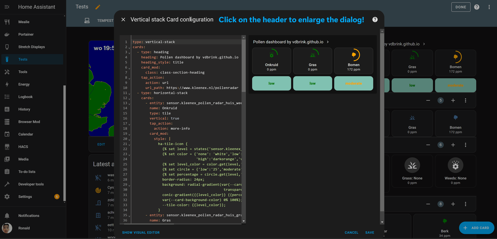
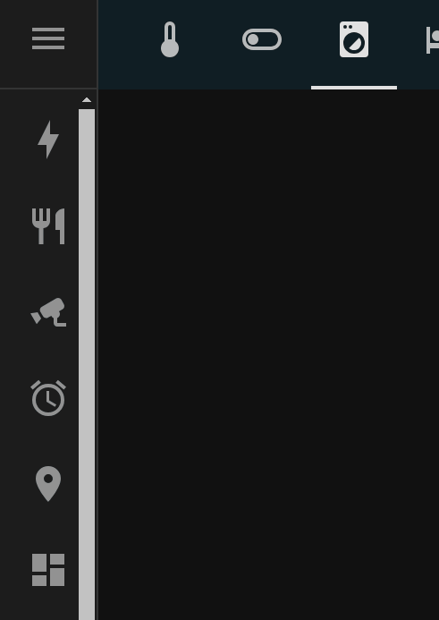
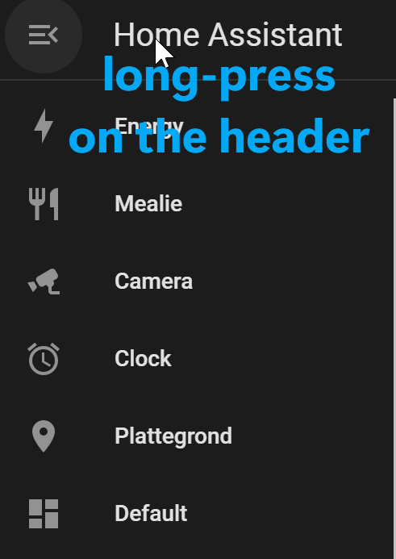
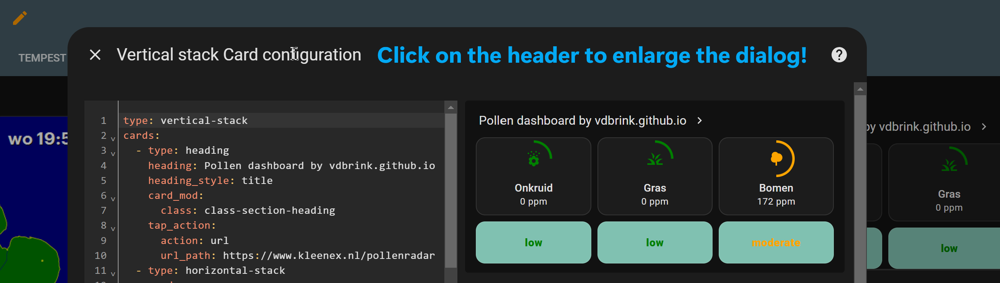
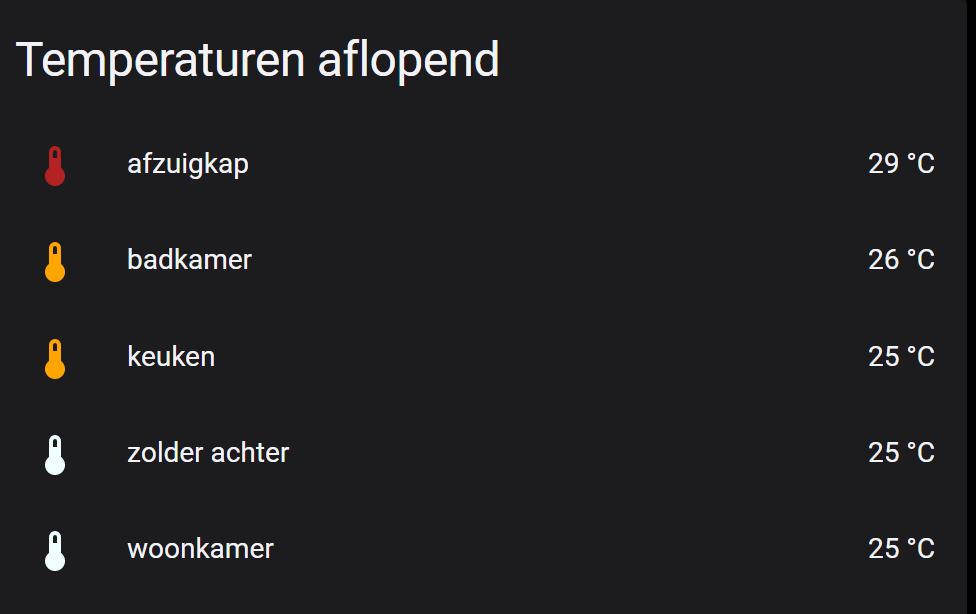
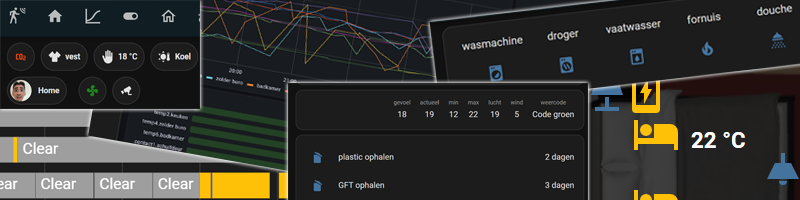

# Home Assistant - Tips & Tricks

Home Assistant useful (hidden) features!

---
## Dashboard edit dialog enlarger

On a bigger screen, the dashboard edit dialog uses by default only half of the screen width.\
But you can click on the dialog header text to enlarge this dialog!

---
## Dashboard side menu rearrange

You can rearrange the items in the side menu by opening the side menu and long-pressing on the side menu header.\
Now you can drag and drop the items or remove them by clicking on the cross.\
Click on the `done` button to confirm.

&nbsp; &nbsp; &nbsp; &nbsp;

---

> Do you know more cool features, like these which everybody should know, let me know!

---
## Related articles

<a class="hp-card hp-tile" href="/homeassistant/homeassistant_tips_tricks">

Home Assistant<strong>Home Assistant - Tips &amp; Tricks</strong>
Useful and hidden tips in Home Assistant.

</a>
<a class="hp-card hp-tile" href="/homeassistant/homeassistant_dashboard_hacs">

Home Assistant<strong>Awesome HA Marketplace custom elements</strong>
Many custom integration cards for your dashboard, with install buttons and YAML examples.

</a>
<a class="hp-card hp-tile" href="/homeassistant/">

Home Assistant<strong>Home Assistant - Many dashboard examples</strong>
All Home Assistant pages with copy-paste code.

</a>

