# Home Automation Ideas
*to make your home smart*

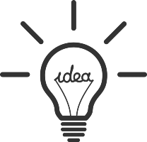

Below is a list of automation ideas, based on devices and locations in and around the house.   
For a few years now, I have followed various forums, newsgroups and videos for new ideas, which I then incorporate into my own automations.

This is a constantly growing list. I'll add new ideas now and then.

I hope I can inspire you with some new home automation ideas that you can integrate into your home.

---

## Table of Contents
<!-- TOC -->
  * [Introduction](#introduction)
  * [Devices and locations to be automated](#devices-and-locations-to-be-automated)
    * [Mailbox](#mailbox)
    * [Package box](#package-box)
    * [Washing machine / dryer](#washing-machine--dryer)
    * [Living room](#living-room)
    * [Christmas lights](#christmas-lights)
    * [Mechanical ventilation](#mechanical-ventilation)
    * [Laundry room](#laundry-room)
    * [(Bed)rooms](#bedrooms)
    * [Bathroom](#bathroom)
    * [Kitchen](#kitchen)
      * [Lights](#lights)
      * [Dishwasher](#dishwasher)
      * [Oven](#oven)
      * [Refrigerator](#refrigerator)
      * [Stove](#stove)
      * [Sink](#sink)
      * [Coffee machine](#coffee-machine)
    * [Home office](#home-office)
    * [Closet / pantry / storage / stairs](#closet--pantry--storage--stairs)
    * [Drawer](#drawer)
    * [Aquarium](#aquarium)
    * [Garage](#garage)
    * [Outside](#outside)
      * [Gate](#gate)
      * [Front yard](#front-yard)
      * [Car](#car)
      * [Putting out the bin](#putting-out-the-bin)
      * [Battery powered devices powered by an outlet](#battery-powered-devices-powered-by-an-outlet)
<!-- TOC -->

---

## Introduction
I've started with a few automations for lights in the living room, the mailbox, and the washing machine.
And I've continually expanded by adding more and more sensors and actuators, which result in 100+ automation flows running in my home.

Criteria for my own automations are:
* Runs locally, without the cloud; 
* Can also be controlled the traditional way with "old-fashioned" buttons, so everyone in the house can operate everything, even without an app and when the smart server is down;
* Works regardless of who is present (no extra trackers or apps needed).

---

## Devices and locations to be automated

### Mailbox
* Notification when mail is delivered. ([contact sensor](../buy/zigbee_contact_sensor) with a separate magnet on the flap)\
  
  <em style="display:block; text-align:center">notification when mail is delivered</em>
* Notification if mail is sticking out of the mailbox. (if the [contact sensor](../buy/zigbee_contact_sensor) doesn't make contact anymore, and is not closed again after 1 minute)
* Send a picture of the mailbox after something is delivered. (Raspberry Pi Zero W with camera)
 

<a href="images/mailbox.jpg">
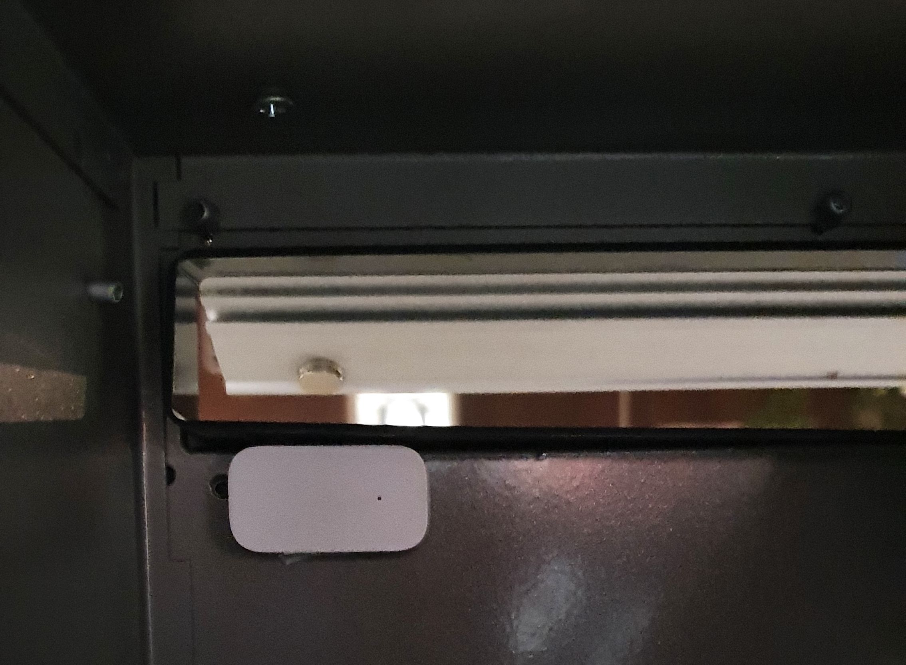
</a>
<em style="display:block; text-align:center">mailbox</em>

<em style="display:block; text-align:center">mailbox with contact sensor</em>

See my [dedicated](/projects/smart_mailbox) page about how I made my mailboxes smart!

---

### Package box
* Notification when a package is delivered. ([contact sensor](../buy/zigbee_contact_sensor) with a separate magnet on the flap)

  See my [dedicated](/projects/packages-mailbox-allux-600) page about how I made this package box smart!
 

<em style="display:block; text-align:center">package box made smart with a contact sensor</em>

---

### Washing machine / dryer
* Notification when the washing machine/dryer is finished. (based on a [smart plug](../buy/zigbee_smart_socket) with energy meter)
* Measure how long the machine is running. (based on a [smart plug](../buy/zigbee_smart_socket) with energy meter)
* Measure the costs. (based on a [smart plug](../buy/zigbee_smart_socket) with energy meter)
* Notification when the machine is not emptied yet after X time. ([contact sensor](../buy/zigbee_contact_sensor) on the door)
 
<a href="images/washing_machine_grafana.png">
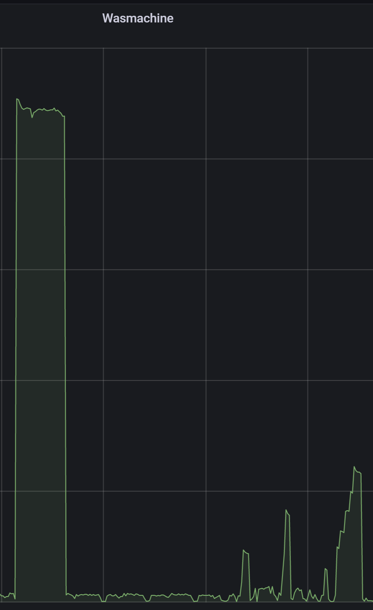
</a>
<em style="display:block; text-align:center">energy consumption of the washing machine in Grafana</em>

---

### Living room
* Close the curtains in the evening. (smart curtains, [lux sensor](../buy/zigbee_light_sensor))
* Open the curtains in the morning. (smart curtains, [lux sensor](../buy/zigbee_light_sensor))
  * See my [dedicated](/projects/slide_smart_curtains) page about the Slide Pro curtains.
* Lights fading in and out, according to twilight. ([smart lights](../buy/zigbee_lights) + [lux sensor](../buy/zigbee_light_sensor) to detect brightness from inside and outside)
* Lights automatically turning off at bedtime. ([smart lights](../buy/zigbee_lights) + [button](../buy/zigbee_buttons#portable-button) near the bed)
* Lights are automatically turned off when no one is in the living room anymore. ([presence detection with mmWave sensor](../buy/zigbee_presence_sensor))
* Dimming lights after a few minutes when the movie player is on.
Brightness increases again when someone is detected in the kitchen. ([smart plug](../buy/zigbee_smart_socket) + [motion sensor](../buy/zigbee_motion_sensor))
  <a href="../buy/zigbee_motion_sensor">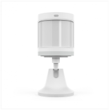</a>

---

### Christmas lights

I have a [dedicated page](/projects/automate_christmas_decorations) about how I automated my Christmas decorations.

* Connecting battery-operated Christmas decorations to the power outlet. (equipped with [battery eliminators](../buy/batteries#battery-eliminators) and multiple connected to a [USB adapter switch](../buy/zigbee_usb_adapter_switch), powered by a [smart plug](../buy/zigbee_smart_socket) for automation)
* Christmas tree lights. (replace the default [power socket with always on mode switch](/buy/esphome_diy#christmas-light-adapter) and add a [smart plug](../buy/zigbee_smart_socket) to control it)
  

<em style="display:block; text-align:center">battery-powered decoration lights and the Christmas tree</em>

---

### Mechanical ventilation

I have a [dedicated page](/esphome/orcon_mechanic_ventilation) about how I automated my mechanical ventilation.

* Depends on which areas the ventilation system is connected to.
  In my case, my bathroom humidity/temperature, kitchen humidity/temperature,
  kitchen/bathroom temperature/humidity difference, duration of a toilet visit.
  ([lux](../buy/zigbee_light_sensor) value above threshold x for time Y,  [temperature sensor](../buy/zigbee_temperature_sensor),
[MV control via an additional remote linked to an ESP](../esphome/orcon_mechanic_ventilation))
 
<a href="images/ventilation_socket.jpg">
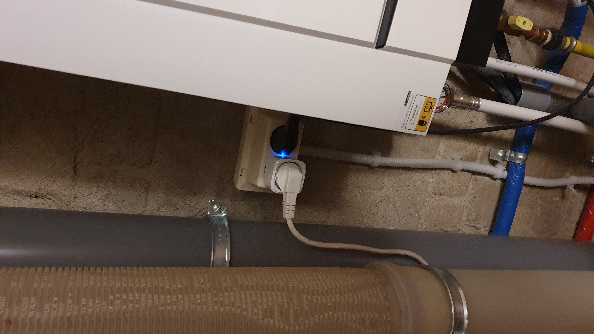
</a>
<em style="display:block; text-align:center">ventilation socket</em>

---

### Laundry room
* Lights on/off when entering/leaving. ([door contact sensor](../buy/zigbee_contact_sensor) + [smart light](../buy/zigbee_lights))
* Dehumidifier on based on humidity. ([humidity sensor](../buy/zigbee_temperature_sensor) + dehumidifier also turned on with a [smart plug](../buy/zigbee_smart_socket))
* Notification if the water tank of the dehumidifier is full. ([leak sensor](../buy/zigbee_leak_sensor) in the dehumidifier)

---

### (Bed)rooms
* Light on when entering (and no one is already in bed). ([door contact sensor](../buy/zigbee_contact_sensor) + [smart light](../buy/zigbee_lights))
* LED strip turns on at just a few percent when going out of bed during the night. ([LED strip](../buy/zigbee_lights#led-strip))
* Dehumidifier on in the evening if the humidity is too high. ([humidity sensor](../buy/zigbee_temperature_sensor) + dehumidifier also turned on with a [smart plug](../buy/zigbee_smart_socket))
* Notification if windows can be opened in summer when it's cooler outside than inside. (indoor + outdoor [temperature sensor](../buy/zigbee_temperature_sensor))
* Notification to open a window if the CO2 level is too high ([ESP CO2 sensor](../esphome/co2_senseair_s8_sensor))
* Notification to open a window if the inside humidity is too high compared to the outside humidity. ([humidity sensor](../buy/zigbee_temperature_sensor) + [contact sensor](../buy/zigbee_contact_sensor) on the window)
* Notification to close a window if heavy rain is expected within 10 minutes. (API weather forecast + [contact sensor](../buy/zigbee_contact_sensor) on the window)

---

### Bathroom
* Notification when someone takes a shower. ([humidity sensor](../buy/zigbee_temperature_sensor) or water usage measuring)
  * ... Detect when the door is opened again afterward. Now the next one can take a shower!
* Detect if someone is in the bathroom. ([presence detection with mmWave sensor](../buy/zigbee_presence_sensor))
* Water consumption. (water meter reader)
* Dimmed light during night visits.
* Change light color when someone stays too long in the shower. (Water consumption, [presence](../buy/zigbee_presence_sensor), [LED strip](../buy/zigbee_lights#led-strip))

---

### Kitchen

In the kitchen there are a lot of peripherals, and these can be made smart.
Sometimes by adding a sensor outside the device.

See also my dedicated page about [smart kitchen appliances](/projects/retrofit_kitchen_appliances).

#### Lights
* Lights on, based on presence + light intensity. ([motion sensor](../buy/zigbee_motion_sensor) + [lux sensor](../buy/zigbee_light_sensor) + normal LED strip with a [smart plug](../buy/zigbee_smart_socket) or smart [LED strip](../buy/zigbee_lights#led-strip))
  
 <a href="images/kitchen_lights.jpg">
 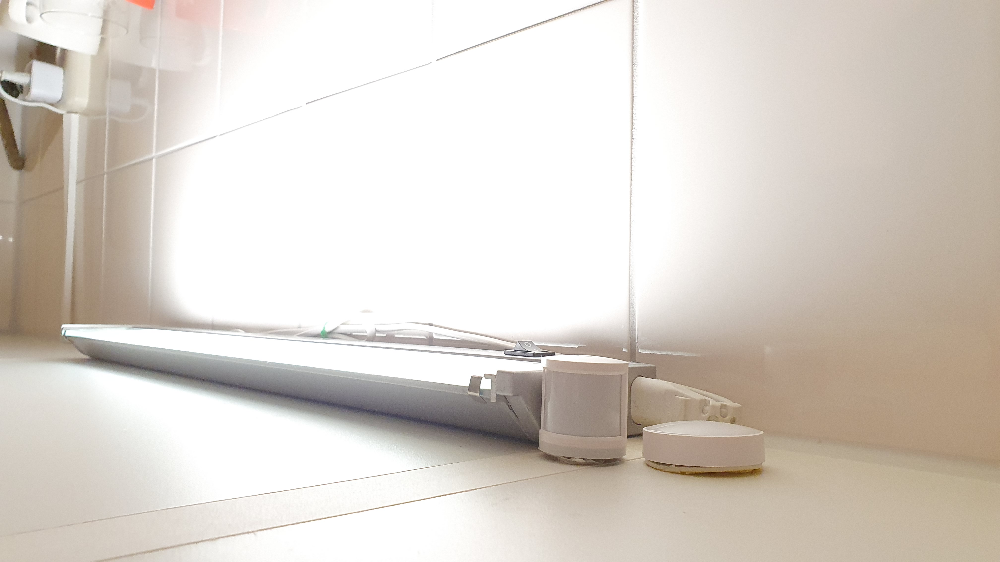
 </a>
 <em style="display:block; text-align:center">kitchen lights, switched by presence and light intensity</em>

#### Dishwasher
* Notification when the dishwasher is finished. (based on a [smart plug](../buy/zigbee_smart_socket) with energy meter)
* Notification when the dishwasher is not emptied yet after X time. ([contact sensor](../buy/zigbee_contact_sensor) on the door)
   
* Notification when the dishwasher didn't start its cycle at X o'clock. (based on a [smart plug](../buy/zigbee_smart_socket) with energy meter to detect if it runs)

<a href="../buy/zigbee_contact_sensor">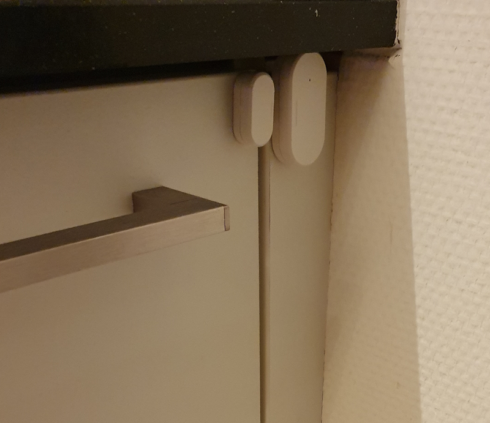</a>

#### Oven
* Notification when the oven reaches its preset temperature. (based on a [smart plug](../buy/zigbee_smart_socket) with energy meter. The power consumption drops when it reaches its temperature)
   
  <a href="images/notification.jpg">
  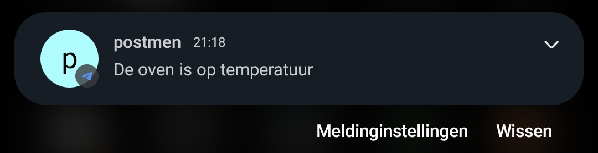
  </a>
  <em style="display:block; text-align:center">oven notification when the preset temperature is reached</em>

#### Refrigerator
* Detect if the door is opened too long. ([temperature sensor](../buy/zigbee_temperature_sensor) inside or door [contact sensor](../buy/zigbee_contact_sensor))
* Detect when the freezer door hasn't been opened before going to bed, so I can take some meat/fish out to defrost for tomorrow's dinner ([contact sensor](../buy/zigbee_contact_sensor) and [Mealie meal planner](/homeassistant/homeassistant_dashboard_mealie#out-of-the-freezer-the-evening-before))

#### Stove
* Detect if someone is cooking. ([temperature sensor](../buy/zigbee_temperature_sensor))
* Exhaust fan on based on temperature/humidity. ([temperature sensor](../buy/zigbee_temperature_sensor) in the cooker hood)
 

<em style="display:block; text-align:center">temperature sensor in the cooker hood</em>

#### Sink
* Leak detector under the sink. ([leak sensor](../buy/zigbee_leak_sensor) or a modified [contact sensor](/zigbee/zigbee_water_leak_sensor))
 
<a href="images/water_leak.jpg">
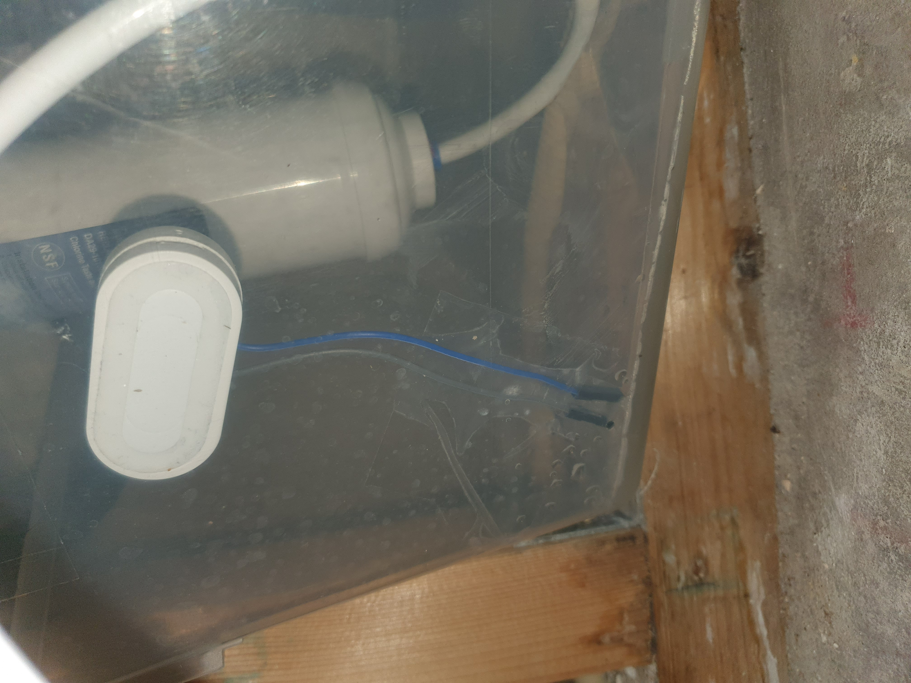
</a>
<em style="display:block; text-align:center">water leak sensor under the sink</em>

#### Coffee machine
* Count the brewed coffees to order new cups. ([vibration sensor](../buy/zigbee_vibration_sensor))

---

### Home office
* Computer screen + lights + phone charger on when you sit in the office chair. ([car seat pressure sensor in the chair](/zigbee/zigbee_chair_occupancy_sensor))
* Computer screen + lights + phone charger on when you enter the office. ([contact sensor](../buy/zigbee_contact_sensor) at the door)
* Office lights only on when it's dark and someone is in the room. ([smart light](../buy/zigbee_lights), [lux sensor](../buy/zigbee_light_sensor), [mmWave sensor](../buy/zigbee_presence_sensor) to detect a person who sits still)
* Extra heater on, based on temperature and presence. ([temperature sensor](../buy/zigbee_temperature_sensor) + [chair occupancy](/zigbee/zigbee_chair_occupancy_sensor))
* On-air light so people at home know you're on a call. (calendar integration + [smart light](../buy/zigbee_lights))
* Notification to open a window if the inside temperature is too high compared to the outside temperature. ([temperature sensor](../buy/zigbee_temperature_sensor))
* Notification to open a window if the CO2 value is too high. ([CO2 sensor](../esphome/co2_senseair_s8_sensor))
* Air conditioning on when it's too hot inside and outside. ([smart plug](../buy/zigbee_smart_socket) + [temperature sensor](../buy/zigbee_temperature_sensor))

---

### Closet / pantry / storage / stairs
* Lights on when you open a closet door. ([battery-powered LED light with a PIR sensor](/buy/smart_home_battery_powered_pir). Not connected, but smart/convenient!)

---

### Drawer
* Notification when the drawer is opened. (Attach a [contact sensor](../buy/zigbee_contact_sensor) to the closet behind the drawer and the magnet to the drawer itself, so that when you open it, the contact breaks and a signal is triggered)
* Notification when the drawer has not been opened yet today at a specific time. For example, if you keep medicine in a drawer that you need to take every day. ([contact sensor](../buy/zigbee_contact_sensor))

---

### Aquarium
* Automatically turn the lights on and off. ([smart plug](../buy/zigbee_smart_socket))
* Turn the lights on when they are fed. ([contact sensor](../buy/zigbee_contact_sensor) at the lid of the aquarium).
* Automatic feeder.
* Water quality check: pH level.
* Temperature warning if water is too hot/cold. (ESP with waterproof temperature sensor)
 
<a href="images/aquarium.jpg">
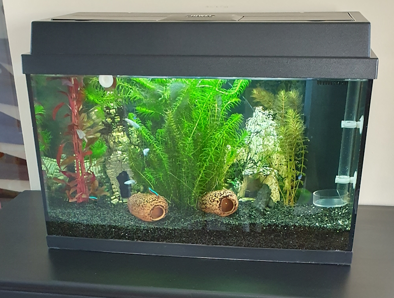
</a>
<em style="display:block; text-align:center">my aquarium</em>

---

### Garage
* Notification when the e-bike charger is not activated at X o'clock. Did I forget to connect it to the charger? (based on a [smart plug](../buy/zigbee_smart_socket) with energy meter)

---

### Outside
* Notification when it's nice weather to sit outside. (based on temperature, [humidity](../buy/zigbee_temperature_sensor), [lux sensor](../buy/zigbee_light_sensor), sun strength from a weather station)
* Notification to close the skylight or another window if it's open and rain is expected within 15 minutes. (skylight/window [contact sensor](../buy/zigbee_contact_sensor) + API weather forecast/weather station)
* Notification to retract parasols if it's too windy. (outdoor temperature and wind speed from a weather station)
* Close the sunscreen if it's too windy. (outdoor temperature and wind speed from a weather station)
* Frost warning for the plants, so you can cover them or move them inside. ([waterproof temperature and humidity sensor](../buy/zigbee_outdoor_temperature_sensor))
* Notification when it's cooler outside than inside, so you can open the windows to cool down the house. ([waterproof temperature and humidity sensor](../buy/zigbee_outdoor_temperature_sensor) + [inside temperature sensor](../buy/zigbee_temperature_sensor))
* Log the outside garden temperature and humidity instead of relying on a weather API from a station kilometers away. ([waterproof temperature and humidity sensor](../buy/zigbee_outdoor_temperature_sensor))
* Turn the lights on when going outside, by opening the door, in the evening or at night. ([contact sensor](../buy/zigbee_contact_sensor), [lux sensor](../buy/zigbee_light_sensor), [smart light](../buy/zigbee_lights))
* Put out the sunscreen when it heats the home too much.
* Close the curtains when it cools or heats the home too much. (controlled curtains, outside temp, [inside temp](/buy/zigbee_temperature_sensor))

#### Gate
* Notification when the gate is opened. ([waterproof contact sensor](../buy/zigbee_outdoor_contact_sensor), which survives rain and frost)
* Notification when the garden gate stays open longer than X minutes. ([waterproof contact sensor](../buy/zigbee_outdoor_contact_sensor))
* Notification when the shed or garden room door is left open. ([waterproof contact sensor](../buy/zigbee_outdoor_contact_sensor))

#### Front yard

I have a [dedicated page](/projects/automate_christmas_decorations#outdoor-lights) about how I automated my outdoor (Christmas) lights.

* Outside lights on when:
  * Someone comes to the door. (webcam or doorcam with person recognition, smart outside light, Google Coral)
  * You connect to your WiFi network. (outside light)
  * You enter the home zone. (Home Assistant Companion app and outside light)
     <a href="images/person_detected.jpg">
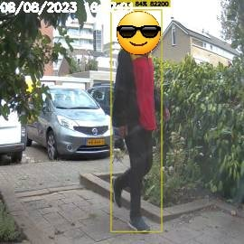
</a>
<em style="display:block; text-align:center">person detected at the front door</em>

#### Car
* Notification to cover the car if the dew point is below -1 in the evening. This increases the chance of not having to scrape in the morning! (weather station)
* Notification to family when I leave work. (location positioning)
* Activate the driveway lights when you arrive home. (When you enter the home zone, or you connect to your local WiFi network AND the phone's Bluetooth is connected to the car)
* Activate the front door lights. (see previous flow)

#### Putting out the bin
I have a [dedicated page](/projects/bin_day_led_strip_reminder) about how I automated my bin day reminders.

* Notification when paper/green/plastic/residual waste bin needs to be put on the street to be emptied tomorrow. (waste calendar integration)
* [Light up an LED strip](../projects/bin_day_led_strip_reminder) in the color of the waste bin which must be put on the street the next day. (waste calendar integration + [LED strip](../buy/zigbee_lights#led-strip))

#### Battery powered devices powered by an outlet

With a battery-to-USB adapter and a USB power plug, you can power a battery-powered device from an outlet.
Check this [dedicated page](/zigbee/zigbee_outlet_sensor) for the examples.

---

See also my:
[Home Automation Videos](home_automation_videos) and [Zigbee Smart home - Best Buy Tips](../buy/smart_home_best_buy_tips) pages.