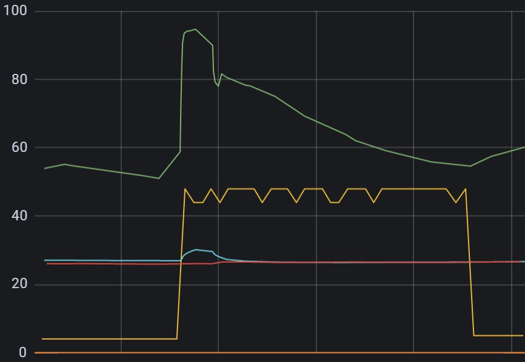
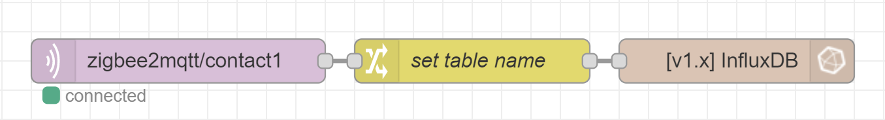
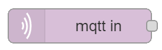
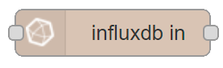

35
# Node-RED Cheat Sheet - Grafana




## Save device data to Grafana
If the InfluxDB is up and running, you can use Node-RED to push every message, which comes from a sensor, directly into the database.

The InfluxDB node converts every JSON entity to a separate column.
Only the table name (in InfluxDB this is called a `measurement`) needs to be set, this can be done in this node but, it's also possible to set it dynamic, this avoids making for every sensor duplicate flows. 

When the node gets this `msg.measurement=contact1` as input it will store the sensor data in `contact1`.


Used nodes:





The content of **change node**:

<div class="nodered">

|                      |                                                                    |          |
|:---------------------|:-------------------------------------------------------------------|:---------|
| zigbee2mqtt/contact1 |   | contact1 |

</div>

```
Set [msg.]measurement
    [expression]msg.topic.$split('/')[1]
```


---
[<< See also my other Node-RED pages](index)
