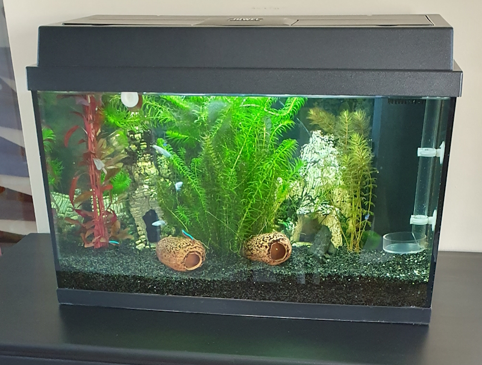
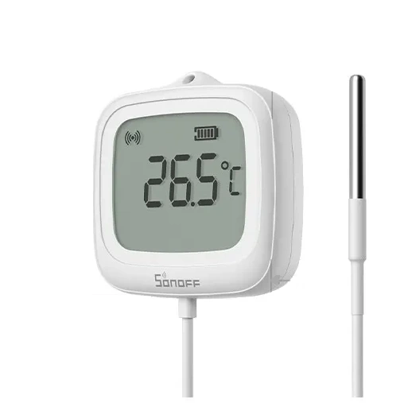
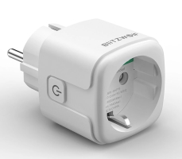
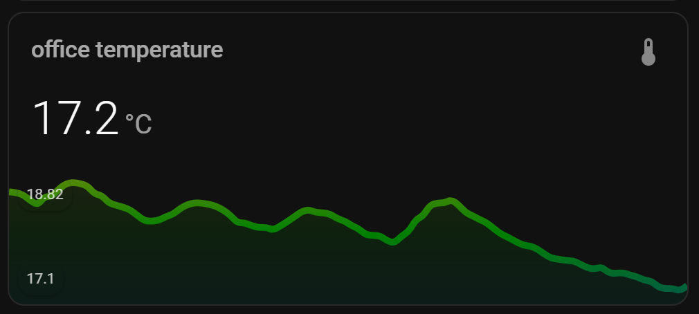
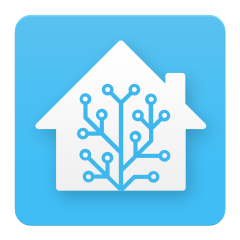
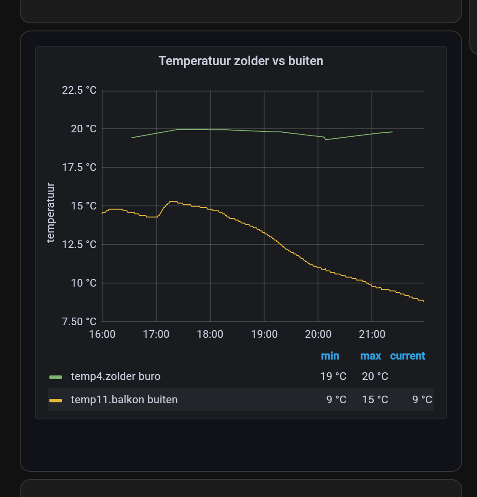

# Smart Aquarium
*Water temperature graphs, alarms and automatic lights*

## Introduction

An aquarium is a perfect candidate for home automation. The fish depend on a stable water temperature, and the lights need a fixed day and night rhythm.
Both are easy to automate with a few cheap Zigbee devices and Home Assistant.

<a href="/ideas/images/aquarium.jpg">

</a>
<em style="display:block; text-align:left">My aquarium</em>

What I automated:

* Measure the water temperature and show it in a graph on my dashboard.
* Get a notification when the water gets too cold or too warm.
* Switch the lights off at night with a smart socket.

---

## Table of Contents
<!-- TOC -->
* [Introduction](#introduction)
* [Table of Contents](#table-of-contents)
* [Temperature monitoring](#temperature-monitoring)
  * [Show the temperature on your dashboard](#show-the-temperature-on-your-dashboard)
    * [History graph card](#history-graph-card)
    * [Statistics graph card](#statistics-graph-card)
    * [Mini graph card (HACS)](#mini-graph-card-hacs)
    * [Grafana](#grafana)
  * [Alarm on a threshold](#alarm-on-a-threshold)
* [Control the lights](#control-the-lights)
* [Future additions](#future-additions)
  * [Feeder](#feeder)
  * [Camera stream](#camera-stream)
* [Related articles](#related-articles)
<!-- TOC -->

---

## Temperature monitoring

Most tropical fish want a stable temperature, usually between 24 and 26 °C. A heater keeps the water warm, but if it breaks or gets stuck, you want to know it before your fish do.

For this I use a water-resistant Zigbee temperature sensor with a probe, which you put in the water.
It runs on a battery and reports to Home Assistant via Zigbee, so no cloud, no extra wires and no ESP to build.

<div class="hp-tiles hp-options">
<div class="hp-card hp-tile hp-tile-stretch">
<a href="/buy/zigbee_temperature_sensor#water-resistant-option" target="_blank"></a>
<div class="hp-tile-body"><span class="hp-chip">Sensor</span><strong>Zigbee water-resistant temperature sensor</strong>
<p>IP65 sensor with a probe and display, for aquarium, pool or bath water. I use it for my aquarium. Battery: CR2477.</p>
<p class="hp-store-links"><a class="hp-stretch-link" href="/buy/zigbee_temperature_sensor#water-resistant-option" target="_blank">Buy tips</a></p></div>
</div>
</div>

Place the probe in the water, away from the heater and the filter outlet, so it measures the average water temperature instead of a hot or cold spot.
After pairing, you get a temperature entity, for example `sensor.aquarium_temperature`. I use this name in the examples below. Replace it with your own entity.

### Show the temperature on your dashboard

Home Assistant keeps the history of your sensors, so a graph is only one card away.

#### History graph card

The default card. Good for the last hours or days.

```yaml
# Source code by vdbrink.github.io
# Aquarium water temperature of the last 24 hours
type: history-graph
title: Aquarium
hours_to_show: 24
entities:
  - entity: sensor.aquarium_temperature
    name: Water temperature
```

#### Statistics graph card

Shows the mean, min and max per hour or day. Good to see the long-term trend, for example if your water gets warmer in summer.

```yaml
# Source code by vdbrink.github.io
# Aquarium water temperature statistics of the last week
type: statistics-graph
title: Aquarium trend
days_to_show: 7
period: hour
stat_types:
  - mean
  - min
  - max
entities:
  - sensor.aquarium_temperature
```

#### Mini graph card (HACS)

A compact graph with the current value on top. Nice for a small spot on your dashboard. Install [mini-graph-card via HACS](/homeassistant/homeassistant_dashboard_hacs) first.

```yaml
# Source code by vdbrink.github.io
# Compact aquarium temperature graph with threshold colors
type: custom:mini-graph-card
name: Aquarium
entities:
  - sensor.aquarium_temperature
hours_to_show: 48
points_per_hour: 2
line_width: 3
show:
  extrema: true
color_thresholds:
  - value: 22
    color: "#3498db"
  - value: 24
    color: "#2ecc71"
  - value: 27
    color: "#e67e22"
```

#### Grafana

Want the history for months or years instead of days? Store it in InfluxDB and embed a Grafana graph, as I explain in [Home Assistant dashboard: Grafana integration](/homeassistant/homeassistant_dashboard_grafana).

### Alarm on a threshold

A graph is nice, but you don't look at it all day. Let Home Assistant send a notification when the temperature leaves the safe range.

Set the thresholds to the species you keep. The values below are an example for a tropical aquarium.

---

## Control the lights

Aquarium lights are often a normal lamp with a power plug, so a [Zigbee smart socket](/buy/zigbee_smart_socket) makes them smart without any modification.
Plug the lamp into the socket, and plug the socket into the wall.

<div class="hp-tiles hp-options">
<div class="hp-card hp-tile hp-tile-stretch">
<a href="/buy/zigbee_smart_socket" target="_blank"></a>
<div class="hp-tile-body"><span class="hp-chip">Socket</span><strong>EU smart power socket</strong>
<p>I use the Zigbee BlitzWolf EU SHP-15, or any other WiFi / Zigbee socket for your country, to switch the aquarium lights.</p>
<p class="hp-store-links"><a class="hp-stretch-link" href="/buy/zigbee_smart_socket" target="_blank">Buy tips</a></p></div>
</div>
</div>

My automation only switches the lights **off**, for example at night or when everybody goes to bed.
I don't switch them on automatically, because the lights on are my signal that someone has to feed the fish.
This way everybody in the house knows that the fish still need food today. Whoever feeds the fish switches on the lights, and the automation turns them off again later.

```yaml
# Source code by vdbrink.github.io
# Switch the aquarium lights off at night, only if they are on
alias: Aquarium - lights off at night
triggers:
  - trigger: time
    at: "22:00:00"
conditions:
  - condition: state
    entity_id: switch.aquarium_lights
    state: "on"
actions:
  - action: switch.turn_off
    target:
      entity_id: switch.aquarium_lights
mode: single
```

The socket still has its physical button, so everyone can still switch the lights by hand, even when Home Assistant is down.

---

## Future additions

Ideas I don't use myself yet, but which are a nice extension.

### Feeder

You can buy an automatic fish feeder, with a timer, to feed the fish when you are away for a few days.
Some feeders are Zigbee or WiFi devices which you can control from Home Assistant, others only have a built-in timer.

If you automate the feeding, you don't need the lights as a reminder anymore. Then the lights can also be switched on automatically in the morning, in the same way as the automation above, with a `switch.turn_on` action at a fixed time.

### Camera stream

Add a small (WiFi) camera in front of the aquarium to see your fish from your phone or dashboard, for example when you are on holiday.
You can also use it to check whether the fish have eaten.

Show the stream with a [picture-entity or webrtc card](/homeassistant/homeassistant_dashboard_fullscreen_camera_stream) on your dashboard.

---

## Related articles

<div class="hp-tiles hp-options">

<a class="hp-card hp-tile" href="/homeassistant/homeassistant_dashboard_stretch_layout">

<div class="hp-tile-body"><span class="hp-chip">Home Assistant</span><strong>Home Assistant dashboard: Stretch Display Layout</strong><p>A dashboard layout with history graphs for a stretched display.</p></div>
</a>

<a class="hp-card hp-tile" href="/homeassistant/homeassistant_dashboard_hacs">

<div class="hp-tile-body"><span class="hp-chip">Home Assistant</span><strong>Home Assistant dashboard: Awesome Marketplace custom elements</strong><p>Install custom cards like mini-graph-card via HACS.</p></div>
</a>

<a class="hp-card hp-tile" href="/buy/zigbee_smart_socket">

<div class="hp-tile-body"><span class="hp-chip">Best Buy Tips</span><strong>Smart socket</strong><p>Zigbee smart sockets to make any plugged-in device smart.</p></div>
</a>

<a class="hp-card hp-tile" href="/homeassistant/homeassistant_dashboard_grafana">

<div class="hp-tile-body"><span class="hp-chip">Home Assistant</span><strong>Home Assistant dashboard: Grafana integration</strong><p>Show long-term graphs from InfluxDB and Grafana in your Home Assistant dashboard.</p></div>
</a>

</div>
