# Stretch display
*A small widescreen display with data from Home Assistant*

---
## Introduction

<a href="index">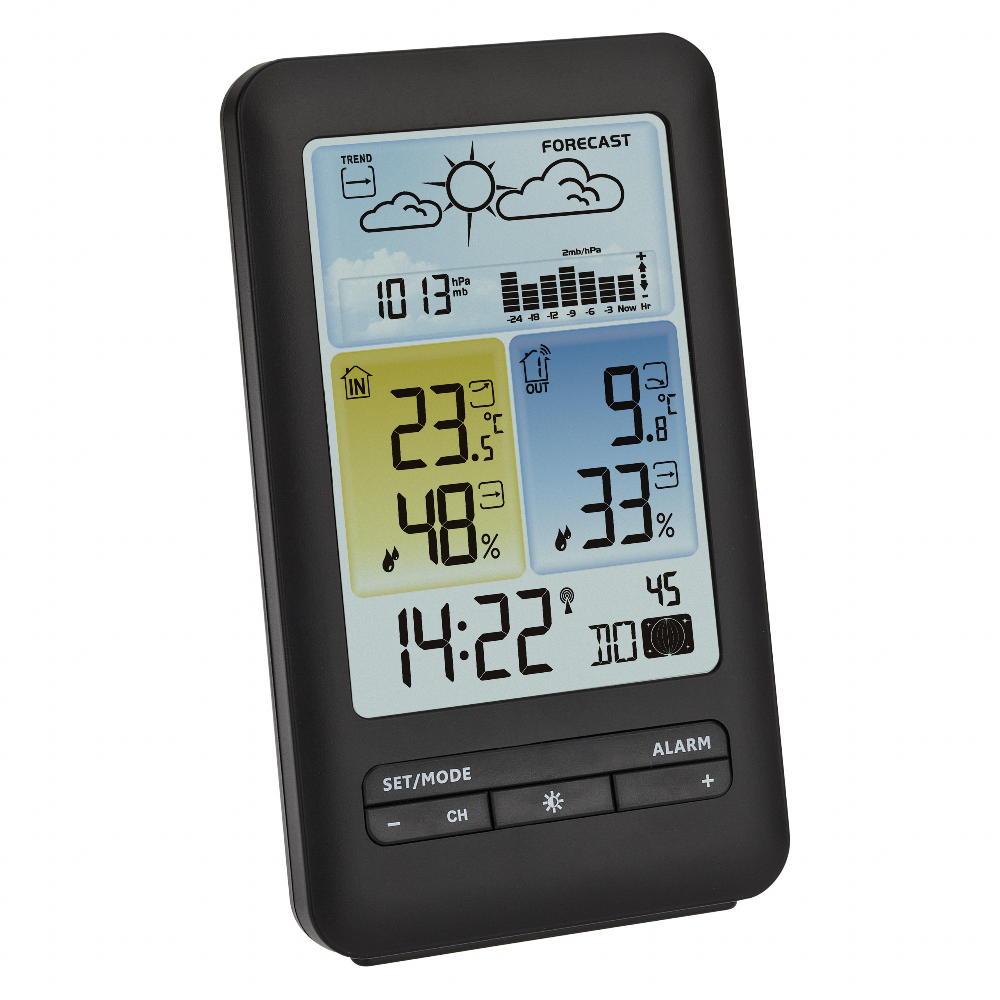</a>
For years I had a basic weather station with a radio receiver to see the indoor and outdoor weather data (temperature, humidity and pressure). Now with Home Assistant and my local weather station, I have so much more weather data available that I want to replace my old weather station display with something new, based on the data in Home Assistant.

I was also looking for a small monitor to show the current CO2 and temperature data in my home office.
I found that when the CO2 is too high and/or the temperature is above 23 degrees, my concentration drops.

---
## My solutions

I use a small stretched display next to my monitor, where I can see my office climate data in a Home Assistant dashboard. The display is controlled by a Raspberry Pi, which runs a web browser in kiosk mode.

<a href="images_stretch_display/office_display_next2monitor.jpg">
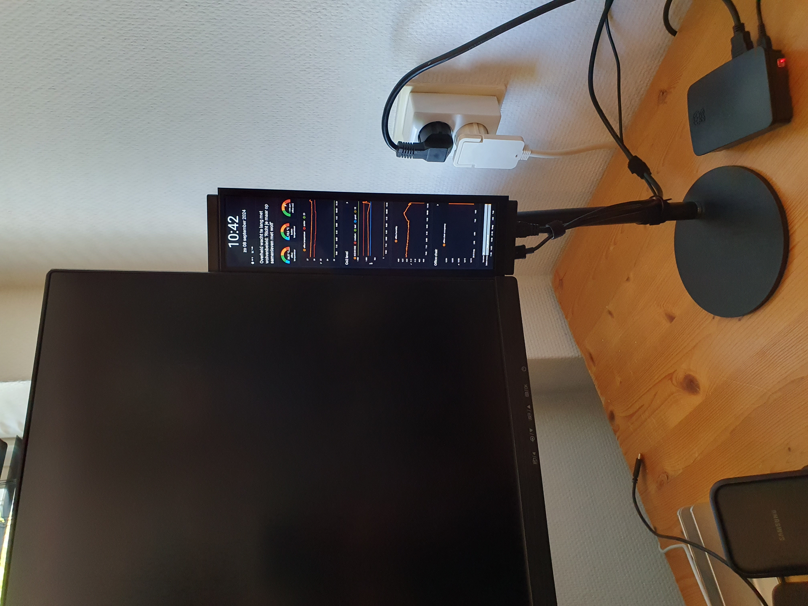
</a>

<a href="images_stretch_display/office_display_closeup.jpg">
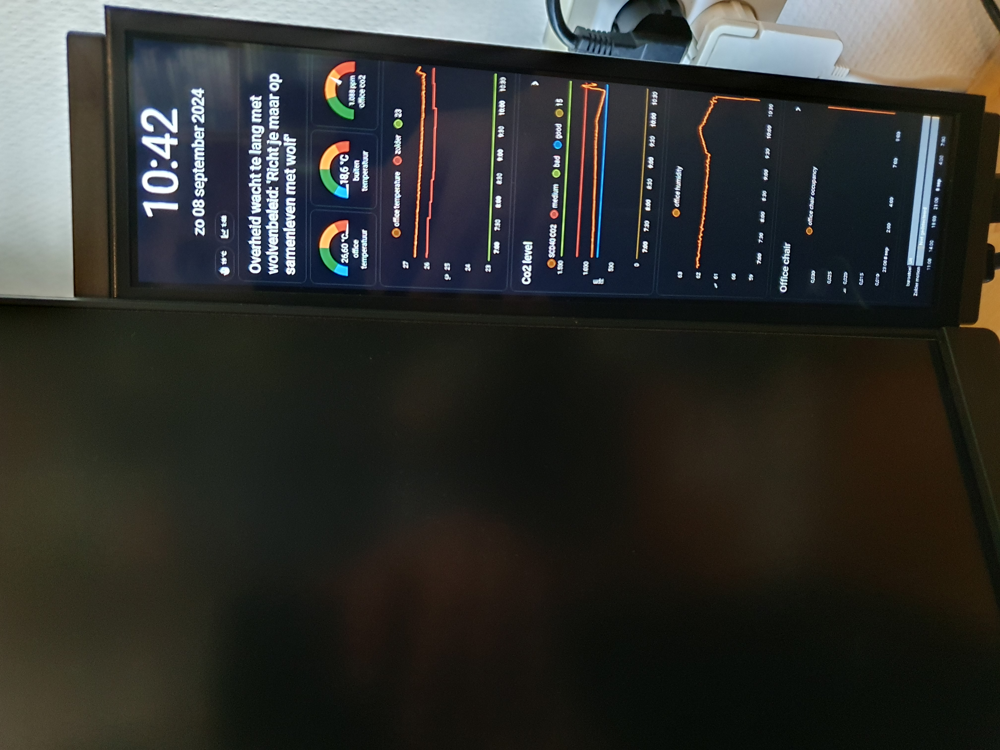
</a>

I created two Home Assistant dashboards: one for my office climate and the other as my weather data display.

<a href="/homeassistant/images_layout_stretch/weather_display1.png">
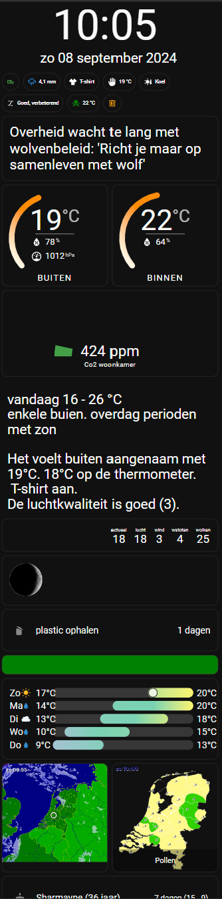</a>
<a href="/homeassistant/images_layout_stretch/office_display1.png">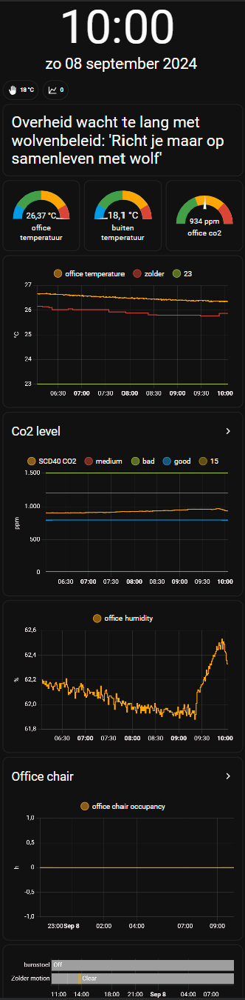</a>
&nbsp;
&nbsp;
<a href="/homeassistant/images_layout_stretch/office_display_dark.jpg">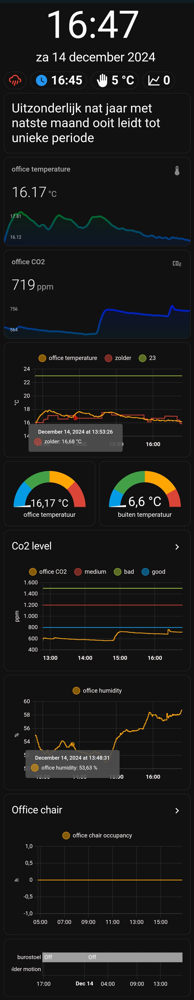</a>
&nbsp;
<a href="/homeassistant/images_layout_stretch/office_display_charamel.jpg">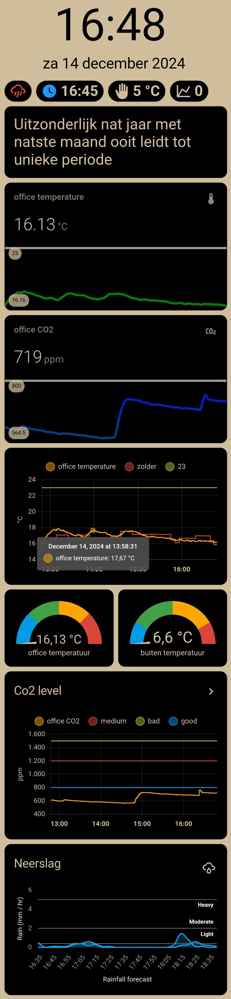</a>

---

## Table of Contents
<!-- TOC -->
  * [Introduction](#introduction)
  * [My solutions](#my-solutions)
  * [Required hardware](#required-hardware)
  * [Required software](#required-software)
  * [Home Assistant dashboard](#home-assistant-dashboard)
    * [Weather station stretch display](#weather-station-stretch-display)
    * [Office stretch display](#office-stretch-display)
  * [Related articles](#related-articles)
<!-- TOC -->

---

## Required hardware

It's always good to use parts which you still have lying around, but otherwise you can buy these products as well to create this project yourself.\
Affiliate links are used here as well.

These hardware components (or alternatives) are required:

### Stretch display

For my project, I use option 1, but there are a lot of displays available on the market!

<div class="hp-tiles hp-options">
<div class="hp-card hp-tile">
<a href="https://s.click.aliexpress.com/e/_c430nNIt" target="_blank">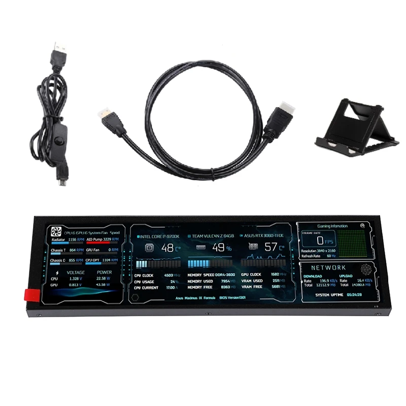</a>
<div class="hp-tile-body"><span class="hp-chip">Option 1 · ~ &euro; 50</span><strong>Stretch Display 1</strong>
<p>8.8 inch, resolution 1920 * 480, NO touchscreen. Comes with power and HDMI cable. This is the one I use.</p>
<p class="hp-store-links"><a href="https://s.click.aliexpress.com/e/_c430nNIt" target="_blank">AliExpress</a></p></div>
</div>
<div class="hp-card hp-tile">
<a href="https://s.click.aliexpress.com/e/_c3mVfj9l" target="_blank">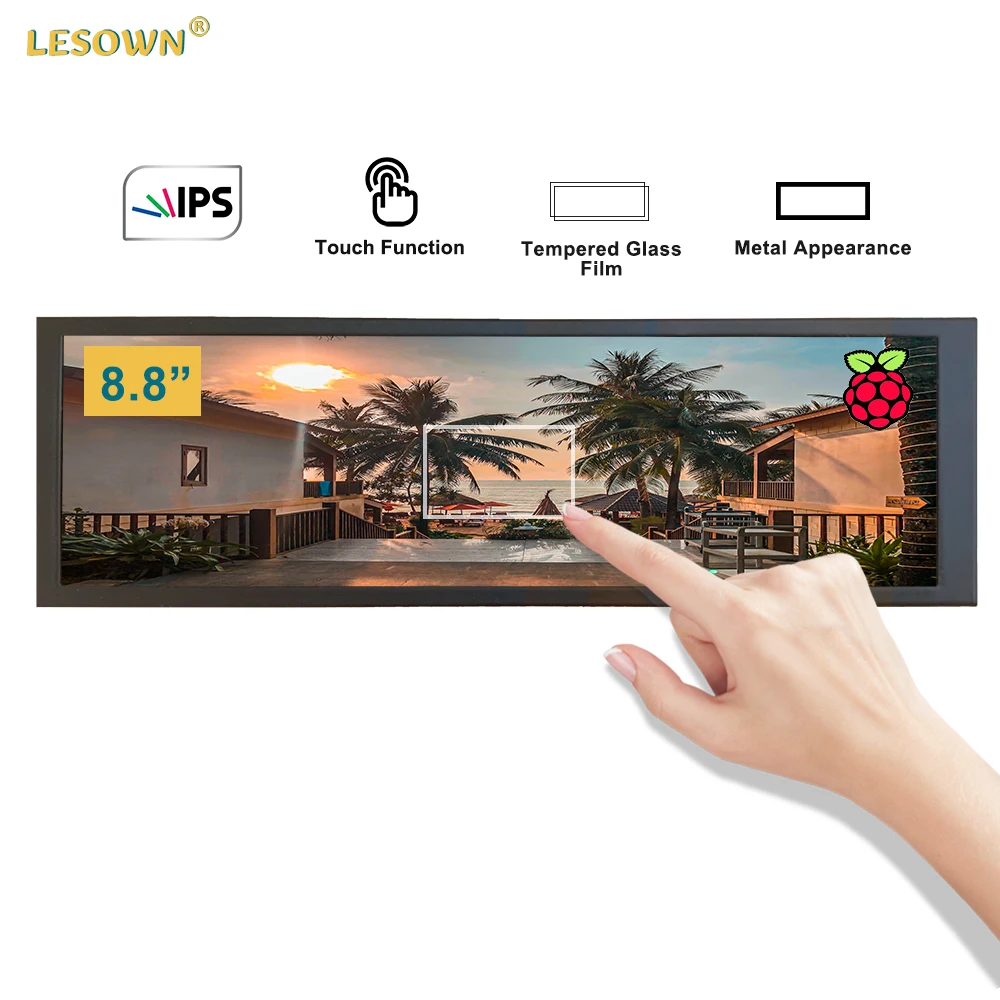</a>
<div class="hp-tile-body"><span class="hp-chip">Option 2 · ~ &euro; 90</span><strong>Stretch Display 2 (touch variant)</strong>
<p>8.8 inch, resolution 1920 * 480. Better version: WITH IPS touchscreen, brighter colors and a Raspberry Pi mount on the back.</p>
<p class="hp-store-links"><a href="https://s.click.aliexpress.com/e/_c3eC255r" target="_blank">AliExpress</a></p></div>
</div>
<div class="hp-card hp-tile">
<a href="https://link.amazon/B0fMLBTba" target="_blank"></a>
<div class="hp-tile-body"><span class="hp-chip">Option 3 · ~ &euro; 250</span><strong>Corsair Xeneon Edge 14.5" touchscreen</strong>
<p>14.5 inch, resolution 2560 * 720, with touchscreen. A much bigger and sharper stretched display.</p>
<p class="hp-store-links"><a href="https://link.amazon/B0fMLBTba" target="_blank">Amazon</a></p></div>
</div>
<div class="hp-card hp-tile">
<div class="hp-tile-body"><span class="hp-chip">Option 4</span><strong>Other sizes</strong>
<p>Stretch displays are also available in all different sizes, like an 11.3". Of course, any other display can also be used!</p>
<p class="hp-store-links"><a href="https://nl.aliexpress.com/w/wholesale-stretch-monitor.html?g=y&SearchText=stretch+monitor&sortType=price_asc" target="_blank">All stretch displays</a> | <a href="https://s.click.aliexpress.com/e/_olMnE0P" target="_blank">11.3"</a></p></div>
</div>
</div>

### Display holder

A stretched display has no stand of its own, so you need a holder to place it upright on your desk. I use this adjustable one.

<div class="hp-tiles hp-options">
<div class="hp-card hp-tile">
<a href="https://s.click.aliexpress.com/e/_Dek5V2b" target="_blank">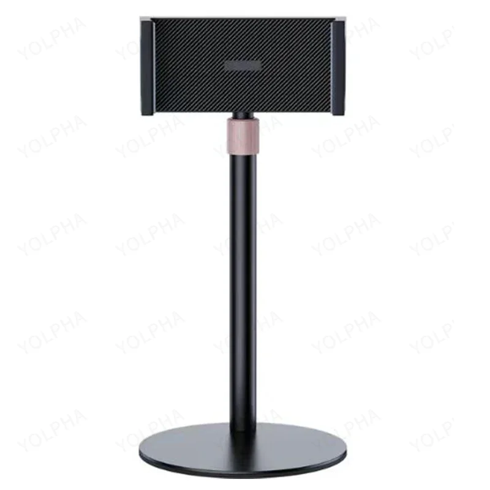</a>
<div class="hp-tile-body"><span class="hp-chip">Holder</span><strong>Display holder</strong>
<p>The mount can stretch to hold devices in a range of 4.7" - 17.3".</p>
<p class="hp-store-links"><a href="https://s.click.aliexpress.com/e/_Dek5V2b" target="_blank">AliExpress</a></p></div>
</div>
</div>

<br>

The stand can be adjusted in height and angle to place the display in the right position.
The display fits perfectly between the claws, and the cables go through the bottom and connect directly to the ports, which gives it a clean look.
The big, round, heavy feet keep it stable.

<a href="images_stretch_display/holder.webp">

</a>

<a href="images_stretch_display/holder_side.jpg">
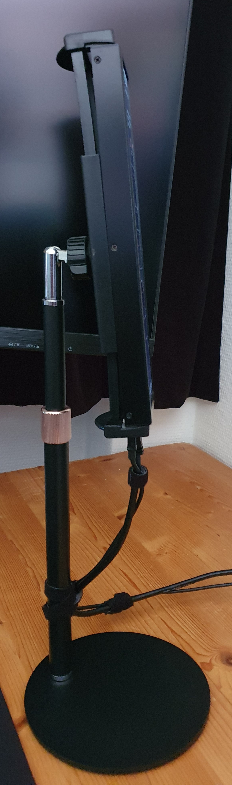
</a>

<a href="images_stretch_display/holder_cables.jpg">
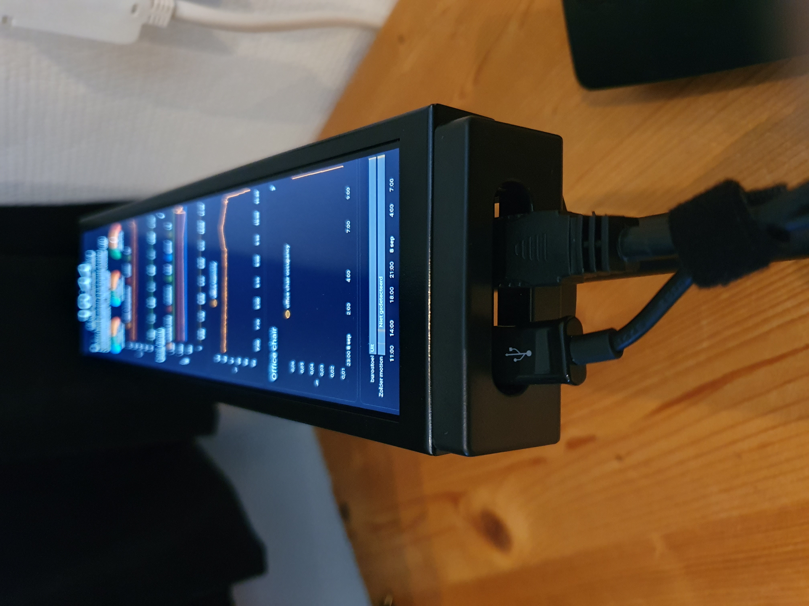
</a>

### Device with a web browser

A small device with an OS which can run a web browser on it.

<div class="hp-tiles hp-options">
<div class="hp-card hp-tile">
<a href="https://s.click.aliexpress.com/e/_oDWgdri" target="_blank">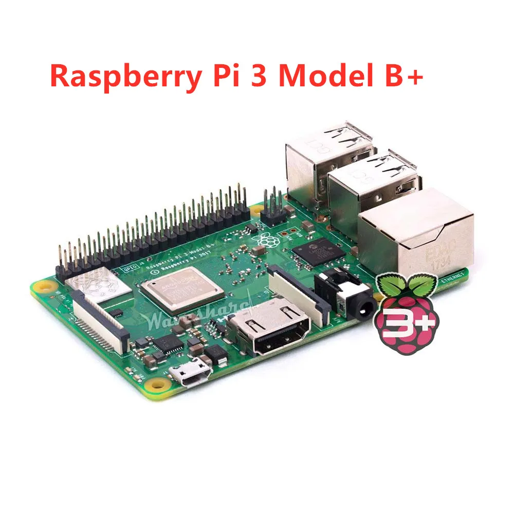</a>
<div class="hp-tile-body"><span class="hp-chip">Device</span><strong>Raspberry Pi 3B</strong>
<p>I had one lying around which I could use.</p>
<p class="hp-store-links"><a href="https://s.click.aliexpress.com/e/_oDWgdri" target="_blank">AliExpress</a></p></div>
</div>
<div class="hp-card hp-tile">
<a href="https://s.click.aliexpress.com/e/_Dd3Z9UJ" target="_blank">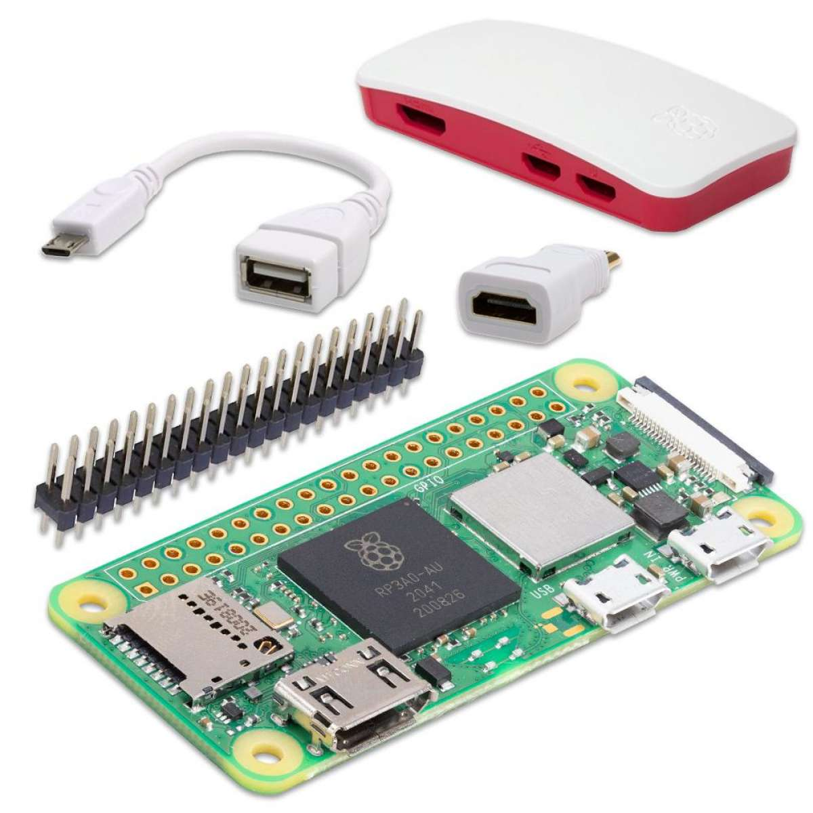</a>
<div class="hp-tile-body"><span class="hp-chip">Device</span><strong>Raspberry Pi Zero W / Zero 2 W</strong>
<p>A cheaper alternative (Zero W) or a faster one (Zero 2 W).</p>
<p class="hp-store-links"><a href="https://s.click.aliexpress.com/e/_Dd3Z9UJ" target="_blank">Zero W</a> | <a href="https://s.click.aliexpress.com/e/_c3XxyiuD" target="_blank">Zero 2 W</a></p></div>
</div>
<div class="hp-card hp-tile">
<a href="https://s.click.aliexpress.com/e/_c3XdiZGV" target="_blank">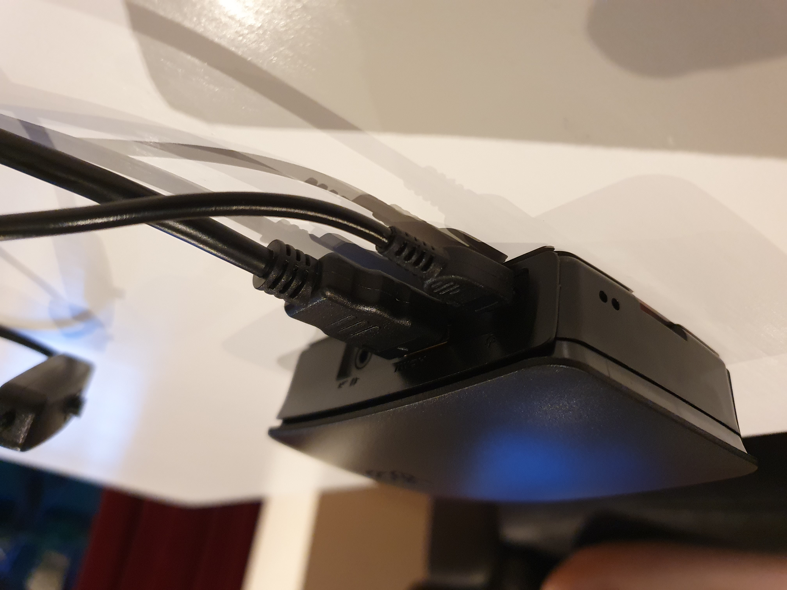</a>
<div class="hp-tile-body"><span class="hp-chip">Case</span><strong>Raspberry Pi 3B case</strong>
<p>I bought a black case for my Raspberry.</p>
<p class="hp-store-links"><a href="https://s.click.aliexpress.com/e/_c3XdiZGV" target="_blank">AliExpress</a></p></div>
</div>
<div class="hp-card hp-tile">

<div class="hp-tile-body"><span class="hp-chip">Alternative</span><strong>Old mobile phone</strong>
<p>Or use an old mobile phone. For a mobile phone, I recommend removing the battery and hacking a USB power plug into it.</p>
</div>
</div>
<div class="hp-card hp-tile">
<a href="https://s.click.aliexpress.com/e/_oFKX7oZ" target="_blank">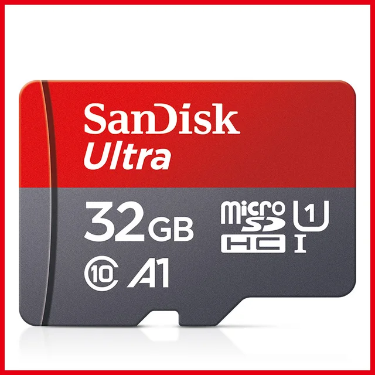</a>
<div class="hp-tile-body"><span class="hp-chip">Storage</span><strong>Micro SD card</strong>
<p>To install the OS on, such as Raspberry Pi OS desktop. A minimum of 8 GB is already enough. Speed is not an issue; it only boots and then doesn't need to read and write.</p>
<p class="hp-store-links"><a href="https://s.click.aliexpress.com/e/_oFKX7oZ" target="_blank">AliExpress</a></p></div>
</div>
<div class="hp-card hp-tile">
<a href="https://s.click.aliexpress.com/e/_c32Nxdc7" target="_blank"></a>
<div class="hp-tile-body"><span class="hp-chip">Power</span><strong>USB A to micro USB cable</strong>
<p>The Raspberry Pi 3B requires at least 5V with 3A, otherwise you get the message "Low voltage warning" in Raspberry OS.</p>
<p class="hp-store-links"><a href="https://s.click.aliexpress.com/e/_c32Nxdc7" target="_blank">AliExpress</a></p></div>
</div>
</div>

### Extras

These extra items are not strictly required, but they make the setup easier to configure, smarter and more useful.

<div class="hp-tiles hp-options">
<div class="hp-card hp-tile">
<a href="../buy/zigbee_smart_socket" target="_blank">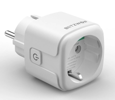</a>
<div class="hp-tile-body"><span class="hp-chip">Socket</span><strong>Zigbee smart EU plug</strong>
<p>Use it to run the PC and display only when someone is nearby. Otherwise, they can be turned off automatically to save energy.</p>
<p class="hp-store-links"><a href="../buy/zigbee_smart_socket" target="_blank">Buy tips</a></p></div>
</div>
<div class="hp-card hp-tile">
<a href="https://s.click.aliexpress.com/e/_c3TpPCQV" target="_blank">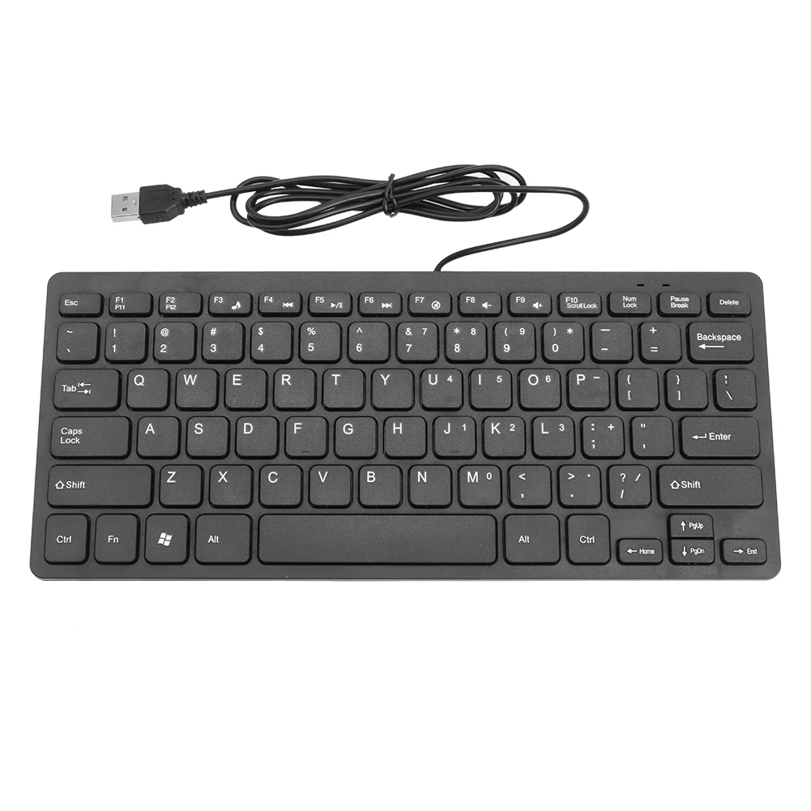</a>
<div class="hp-tile-body"><span class="hp-chip">Optional</span><strong>USB keyboard</strong>
<p>Needed to set up the Raspberry Pi. Keyboards are available with different layouts. Once installed, it can be controlled via SSH.</p>
<p class="hp-store-links"><a href="https://s.click.aliexpress.com/e/_c3TpPCQV" target="_blank">AliExpress</a></p></div>
</div>
<div class="hp-card hp-tile">
<a href="/esphome/co2_scd40" target="_blank">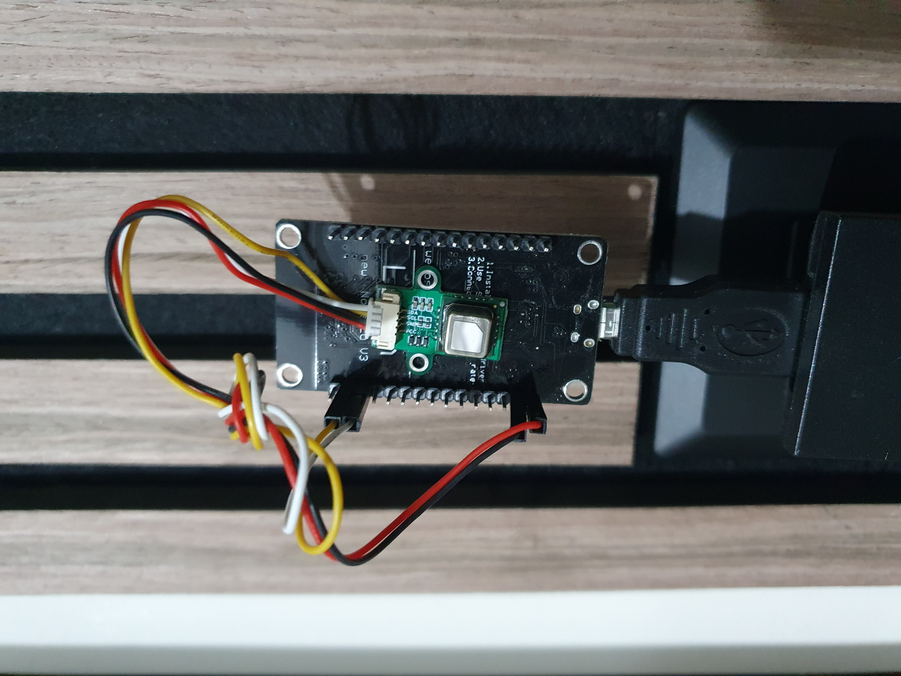</a>
<div class="hp-tile-body"><span class="hp-chip">Sensor</span><strong>CO2 sensor</strong>
<p>I have a project page that explains how to build a cheap CO2 sensor yourself.</p>
<p class="hp-store-links"><a href="/esphome/co2_scd40" target="_blank">Project page</a></p></div>
</div>
<div class="hp-card hp-tile">
<a href="/buy/zigbee_temperature_sensor" target="_blank">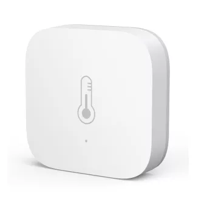</a>
<div class="hp-tile-body"><span class="hp-chip">Sensor</span><strong>Temperature sensor</strong>
<p>An example of a temperature sensor is this Aqara Zigbee sensor.</p>
<p class="hp-store-links"><a href="/buy/zigbee_temperature_sensor" target="_blank">Buy tips</a></p></div>
</div>
</div>

<br>

Found a dead link? [Please let me know](https://github.com/vdbrink/vdbrink.github.io/issues)

---

## Required software

I installed [Raspberry Pi OS](https://www.raspberrypi.com/software/operating-systems/) with desktop, on which a web browser runs.

I created an auto-boot script that loads the Home Assistant dashboard in kiosk mode on boot.

(Later I'll describe and add the example code here)

<!--

---

## Display PC configuration

<a href="images_stretch_display/setup_wip2.jpg">
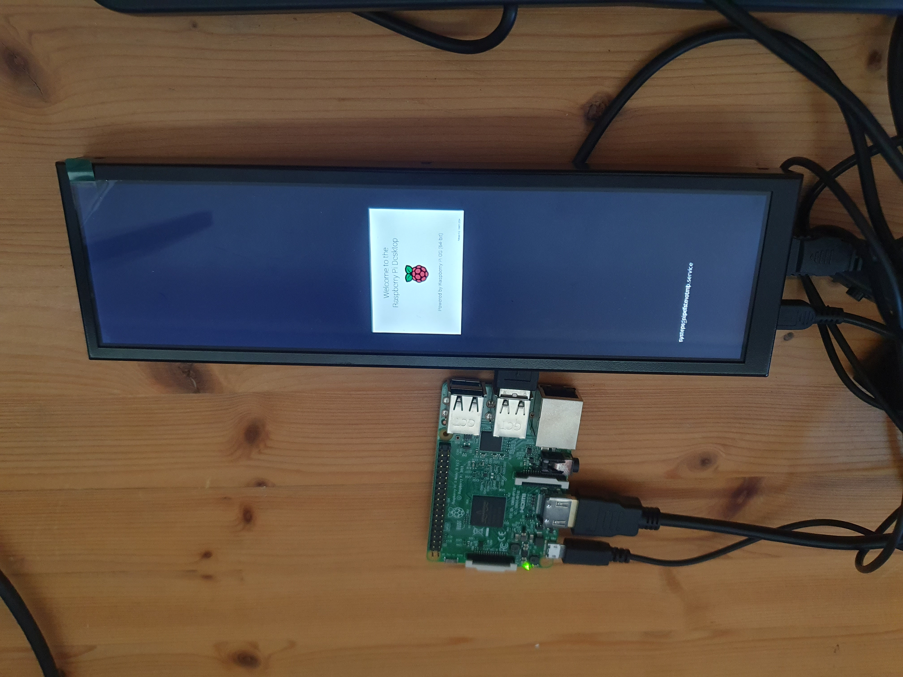
</a>

<a href="images_stretch_display/setup_wip1.jpg">
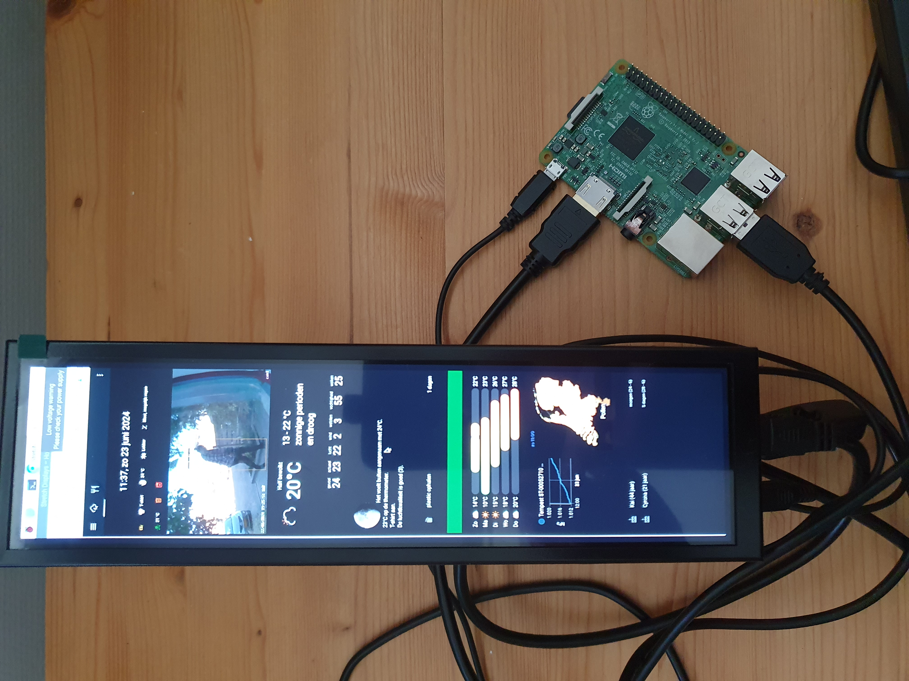
</a>

### Install Raspberry OS Desktop

### Auto load browser in kiosk mode on boot

### Home Assistant auto login user

### Home Assistant hide header toolbar

https://github.com/NemesisRE/kiosk-mode

### Energy saving - auto boot/shutdown
-->

---

## Home Assistant dashboard

See [this separate page](/homeassistant/homeassistant_dashboard_stretch_layout) where I describe the different elements on the dashboard.
I created a new theme and increased font sizes to make it easily readable from a distance.

### Weather station stretch display

This is what my weather overview looks like:

From top to bottom it shows:

* big clock and date ([time and date](/homeassistant/homeassistant_dashboard_stretch_layout#time-and-date))
* a row of small status chips: rain, clothing advice, feels-like temperature, air quality, bin day ([Mushroom chips](/homeassistant/homeassistant_dashboard_stretch_layout#mushrooms))
* a news headline ([news headline](/homeassistant/homeassistant_dashboard_stretch_layout#news-headline), [latest news](/homeassistant/homeassistant_dashboard_latest_news))
* two gauges with the outside and inside temperature and humidity, and air pressure outside ([flexible horseshoe card](/homeassistant/homeassistant_dashboard_stretch_layout#flexible-horseshoe-card))
* the CO2 level in the living room in ppm ([CO2](/homeassistant/homeassistant_dashboard_stretch_layout#co2))
* a text forecast for today with a clothing and air quality tip ([welcome text and weather forecast for today](/homeassistant/homeassistant_dashboard_card_mushroom#welcome-text-and-weather-forecast-for-today-dutch))
* the current, air, wind, gust and cloud values (local weather station)
* the moon phase ([moon image based on state](/homeassistant/homeassistant_templates#moon-image-based-on-state))
* the next bin collections ([HACS Afvalbeheer](/homeassistant/homeassistant_hacs_afvalbeheer), [bin day countdown](/homeassistant/homeassistant_templates#trash-bin-day-countdown))
* a 5 day forecast with the minimum and maximum temperature per day ([Clock Weather Card](/homeassistant/homeassistant_dashboard_weather#clock-weather-card))
* the rain radar and the pollen map of the Netherlands ([rain radar](/homeassistant/homeassistant_dashboard_weather_nl#rain-radar-animated), [pollen](/homeassistant/homeassistant_dashboard_weather_nl#pollen))
* the next birthday at the bottom ([Birthday Reminder Card](/homeassistant/homeassistant_dashboard_hacs#birthday-reminder-card))

<br>
<a href="/homeassistant/homeassistant_dashboard_stretch_layout">

</a>

---

### Office stretch display

This is what my office overview looks like:

From top to bottom it shows:

* big clock and date ([time and date](/homeassistant/homeassistant_dashboard_stretch_layout#time-and-date))
* a small row of status chips ([Mushroom chips](/homeassistant/homeassistant_dashboard_stretch_layout#mushrooms))
* a news headline ([news headline](/homeassistant/homeassistant_dashboard_stretch_layout#news-headline))
* three gauges: office temperature, outside temperature and office CO2 ([gauge](/homeassistant/homeassistant_dashboard_stretch_layout#gauge))
* a graph of the office temperature, compared with the attic ([room temperature](/homeassistant/homeassistant_dashboard_stretch_layout#room-temperature))
* a graph of the CO2 level, with the medium, bad and good thresholds ([CO2](/homeassistant/homeassistant_dashboard_stretch_layout#co2))
* a graph of the office humidity ([humidity](/homeassistant/homeassistant_dashboard_stretch_layout#humidity))
* a graph of the office chair occupancy ([DIY chair occupancy status](/homeassistant/homeassistant_templates#diy-chair-occupancy-status), [room occupancy sensors](/projects/sensors_room_occupancy))
* a timeline of the office chair and the motion sensor ([chair occupancy time line](zigbee/zigbee_chair_occupancy_sensor#occupied-in-time-as-graph)

<br>
<a href="/homeassistant/homeassistant_dashboard_stretch_layout">

</a>

[//]: # (---)

[//]: # (## Future improvements)

[//]: # ()
[//]: # (* Auto switch tabs )

[//]: # (* Custom boot logo)

[//]: # (* Nice casing)

[//]: # ()
[//]: # (---)

[//]: # ()
[//]: # (RPI OS 64 bit )

[//]: # (activate wifi)

[//]: # ()
[//]: # (activate SSH)

[//]: # ()
[//]: # (Raspberry Pi Kiosk mode)

[//]: # ()
[//]: # (Auto boot with full screen Home Assistant url in a Chrome window.)

[//]: # ()
[//]: # (sudo raspi-config)

[//]: # ()
[//]: # (wayland RPI 4 + 5)

[//]: # (https://www.raspberrypi.com/tutorials/how-to-use-a-raspberry-pi-in-kiosk-mode/)

[//]: # ()
[//]: # (X11 RPI 3)

[//]: # (sudo apt-get install matchbox-window-manager xautomation unclutter)

[//]: # ()
[//]: # ()
[//]: # (vim /home/pi/.config/lxsession/LXDE-pi/autostart)

[//]: # ()
[//]: # (```yaml)

[//]: # ()

[//]: # (@xset s off)

[//]: # (@xset -dpms)

[//]: # (@xset s noblank)

[//]: # (@chromium-browser --kiosk -disable-translate --hide-scrollbars -enable-features=OverlayScrollbar,OverlayScrollbarFlashAfterAnyScrollUpdate,OverlayScrollbarFlashWhenMouseEnter --app=http://192.168.1.100:8123/stretch-display/0)

[//]: # (@unclutter -idle 0)

[//]: # ()

[//]: # (```)

[//]: # ()
[//]: # (https://www.espboards.dev/blog/raspberry-lcd-screen-homeassistant/)

[//]: # (ander 3 maanden actieve login )

[//]: # ()
[//]: # (---)

[//]: # ()

---

## Related articles

<div class="hp-tiles hp-options hp-full">
<a class="hp-card hp-tile" href="/homeassistant/homeassistant_dashboard_stretch_layout">

<div class="hp-tile-body"><span class="hp-chip">Home Assistant</span><strong>Home Assistant dashboard: Stretch Display Layout</strong><p>Explanation of the dashboard layout for a long, stretched widescreen display.</p></div>
</a>
<a class="hp-card hp-tile" href="/homeassistant/homeassistant_dashboard_tablet_in_kiosk_mode">
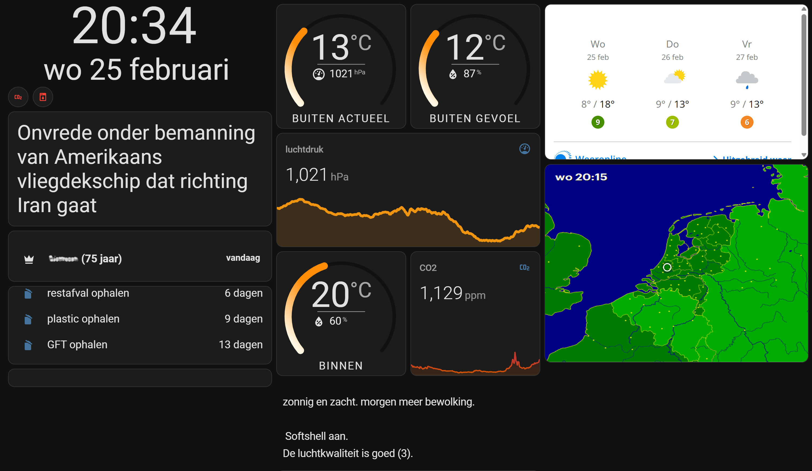
<div class="hp-tile-body"><span class="hp-chip">Home Assistant</span><strong>Home Assistant Kiosk mode on a tablet with Fully Kiosk Browser</strong><p>Show your Home Assistant dashboard on a wall tablet in kiosk mode with Fully Kiosk Browser: setup, settings and tips.</p></div>
</a>
<a class="hp-card hp-tile" href="/esphome/co2_scd40">

<div class="hp-tile-body"><span class="hp-chip">ESPHome</span><strong>ESPHome SCD40 CO2 sensor</strong><p>Create your own ESPHome CO2 sensor based on the SCD40 sensor for Home Assistant</p></div>
</a>
<a class="hp-card hp-tile" href="/buy/zigbee_temperature_sensor">

<div class="hp-tile-body"><span class="hp-chip">Best buy tips</span><strong>Temperature sensor - Best Buy Tips</strong><p>Zigbee temperature and humidity sensors for every room, for automations like a shower fan or heating control in Home Assistant.</p></div>
</a>
</div>

