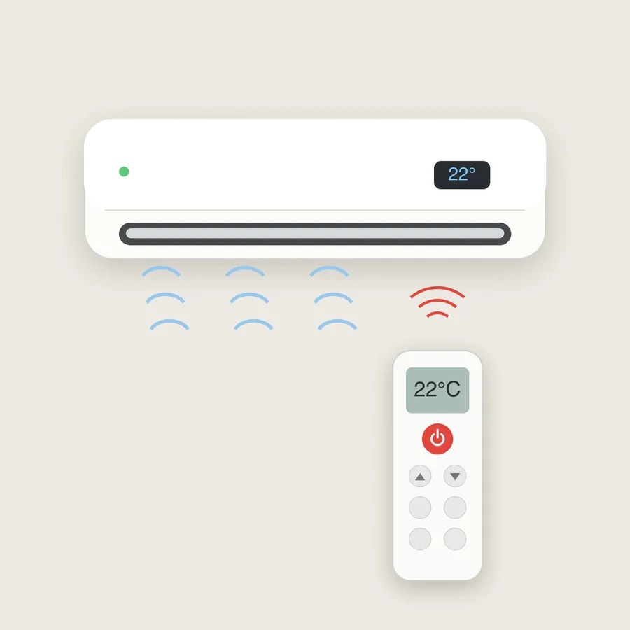
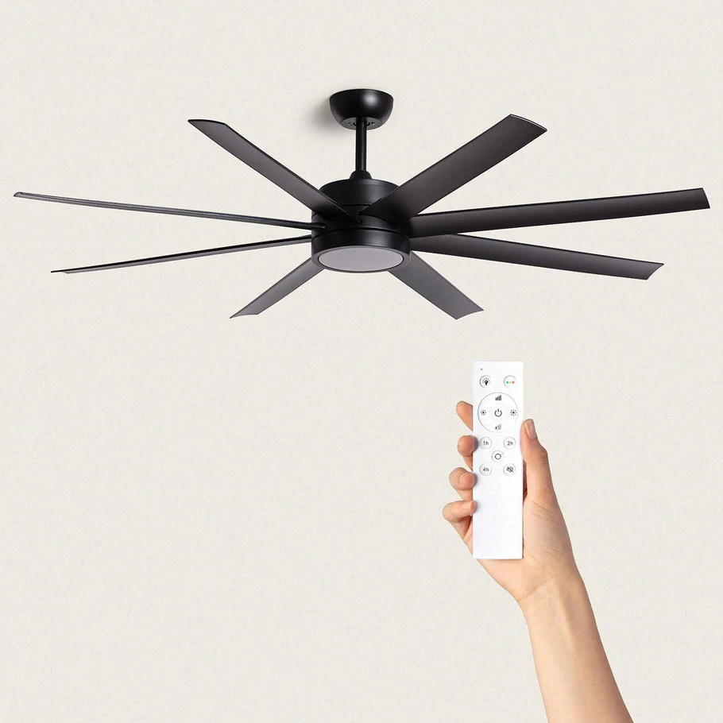
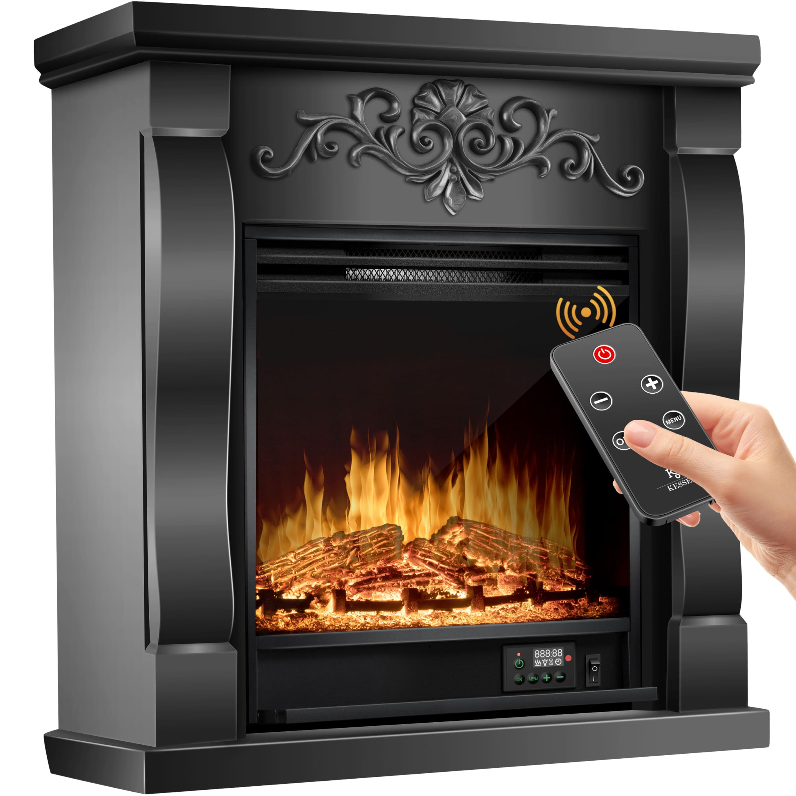
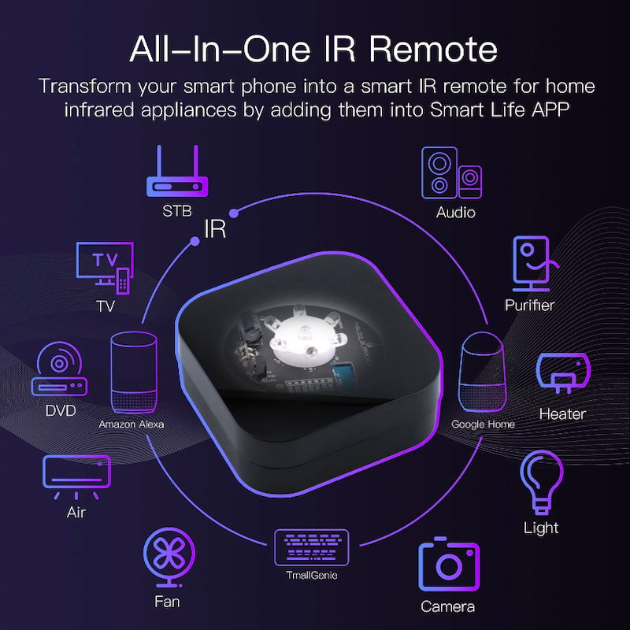
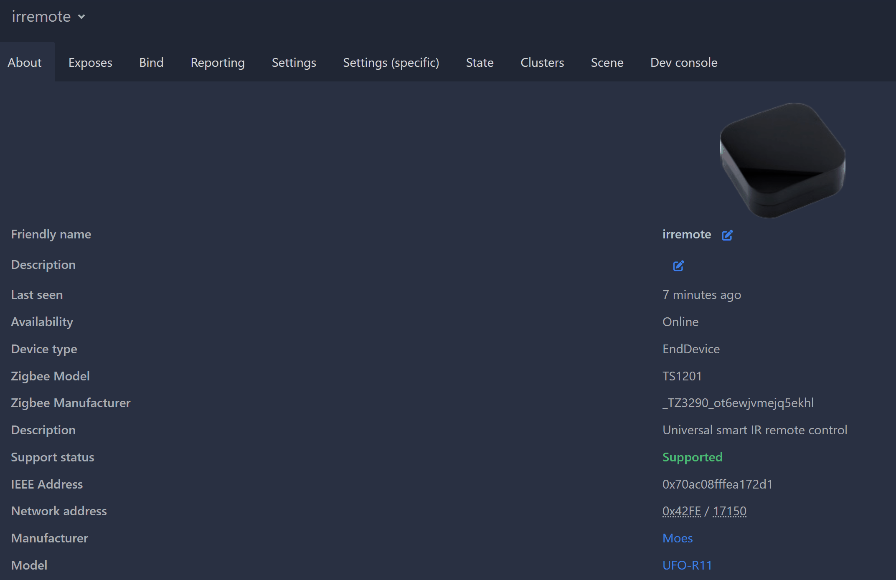
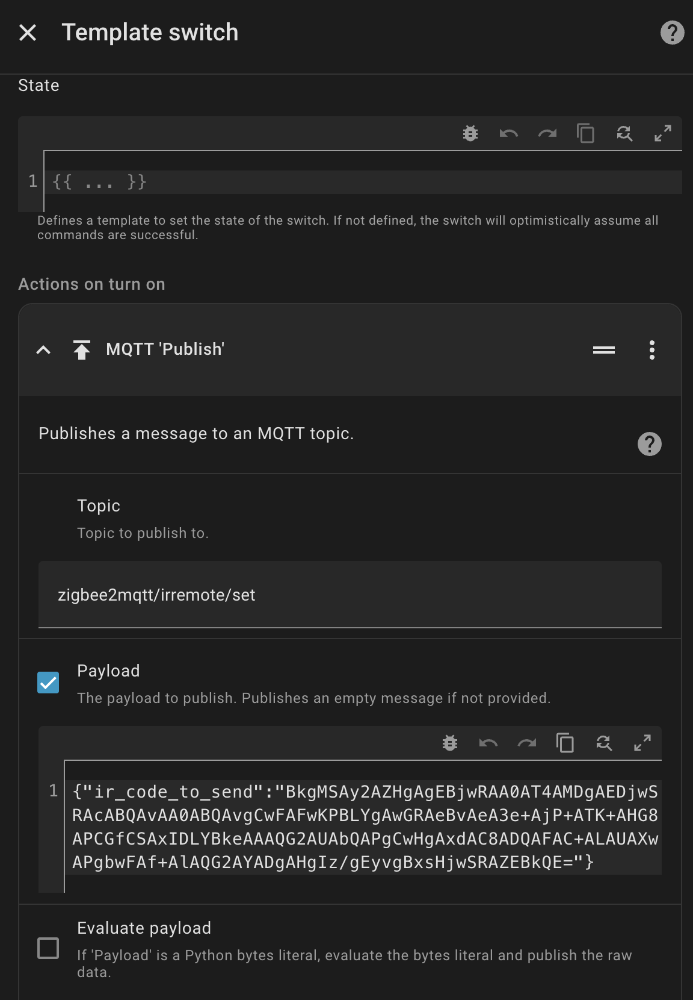
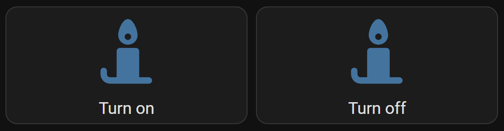
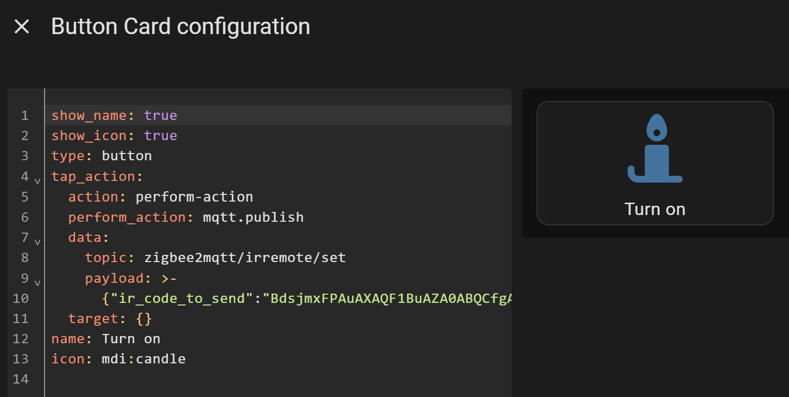


 | 

# Automate infrared devices
*In Home Assistant*

## Introduction

With an infrared transmitter and receiver device, you can automate all your infrared infrared-controlled devices!

There are a lot of devices that have a remote that works via infrared.
Like a TV, air conditioner, (ceiling) fans, fireplace, screens, lights and electric candles.
The signal of an infrared remote has no encryption and is always the same.
This makes it easy to capture, store and resend the signal.

<div style="display:flex; justify-content:center; gap:10px; flex-wrap:wrap;">
<div>
<a href="images_infrared/airco_remote.webp">

</a>
<em style="display:block; text-align:center">air conditioner</em>
</div>
<div>
<a href="images_infrared/ceiling_fan_remote.webp">

</a>
<em style="display:block; text-align:center">ceiling fan</em>
</div>
<div>
<a href="../projects/images_christmas_decorations/tea_lights_with_ir_remote.avif">

</a>
<em style="display:block; text-align:center">tea lights</em>
</div>
<div>
<a href="images_infrared/fireplace_with_remote.jpg">

</a>
<em style="display:block; text-align:center">fireplace</em>
</div>
<div>
<a href="../projects/images_christmas_decorations/candles3_with_ir_remote.avif">

</a>
<em style="display:block; text-align:center">candles</em>
</div>
<div>
<a href="images_infrared/light_string.avif">

</a>
<em style="display:block; text-align:center">light curtains</em>
</div>
</div>
<br>

Read further to learn how to create a switch helper or buttons on your **Home Assistant dashboard**, to control your infrared devices!

Now I can also control my dumb infrared-controlled air conditioner via my [Stream Deck](/elgato_stream_deck/stream_deck_home_assistant) with the Home Assistant integration as well!

<div style="display:flex; justify-content:center; gap:10px; flex-wrap:wrap;">
<div style="text-align:center">
<a href="/elgato_stream_deck/stream_deck_home_assistant">

</a>
<em style="display:block; text-align:center">Stream Deck keypad to control dumb infrared device next to your computer</em>
</div>
</div>

<br>
<br>

> **_NOTE:_** If you want to know more about the Home Assistant Infrared integration (since 2026.4) check out the [Home Assistant's own blog site](https://www.home-assistant.io/blog/2026/04/01/release-20264/#infrared-becoming-a-first-class-citizen-of-home-assistant).

> **_NOTE:_** Affiliate links are used on this page. You sponsor my work and still pay the original price.

---
## Video: control tea lights via Home Assistant

In this video, you see the infrared receiver/transmitter in action.\
Now I can control the tea lights via the original remote and also from my Home Assistant dashboard.

<video controls height="400px">
    <source src="images_infrared/ir_reel_720p.mp4" type="video/mp4">
    Your browser does not support the video tag.
</video>

---
## Smart infrared transmitter / receiver

<a href="/buy/images_zigbee/zigbee_ir_remote.webp"></a>
For this project I used the <a href="https://s.click.aliexpress.com/e/_DEUWZ73" target="_blank">Zigbee IR remote control - Moes (AliExpress)</a>
<a href="https://amzn.to/4rm0u4v#ad" target="_blank">(Amazon US)</a>
<a href="https://amzn.to/495yrxA#ad" target="_blank">(Amazon NL)</a>
<a href="https://www.zigbee2mqtt.io/devices/UFO-R11.html" target="_blank" title="TS0003">{{imgZ2M}}UFO-R11</a>
With this small black box, battery powered, you can control any infrared device.

An infrared sender needs to be in a direct line with the receiver.
If you have more devices to control, you may need multiple smart devices to control them all.

There are also similar
[WiFi versions (AliExpress)](https://s.click.aliexpress.com/e/_c3xtCnnz)
[(Amazon US)](https://amzn.to/3UzxCGU#ad)
[(Amazon NL)](https://amzn.to/41b3nJU#ad)  available for this device.

Another popular WiFi IR remote control is the **Broadlink - RM4 Mini**
<a href="https://s.click.aliexpress.com/e/_c3K9kvNX" target="_blank">(AliExpress)</a>
<a href="https://amzn.to/4p2FC0q#ad" target="_blank">(Amazon US)</a>
<a href="https://amzn.to/4lbgPoa#ad" target="_blank">(Amazon NL)</a>

<a href="images_infrared/purposes_ir.png" target="_blank">

</a>
<em style="display:block; text-align:center">examples of devices you can control with infrared</em>

You can set the device in learning mode to copy signals and store the signal on the device.\
When you trigger the device with a code, it sends the stored signals, but now from this box.
You can save many signals on this box, for each button on multiple remotes.

> I also used this solution for my Christmas paper star,
see my dedicated page about my [automated Christmas lights and decorations](/projects/automate_christmas_decorations#infrared-lights).

> I also used this solution for my air conditioner.

---
## Learning mode

There are multiple ways to put the device in learning mode to receive the IR codes, for example via ZHA or Zigbee2MQTT.

### Option 1: via ZHA

This device is also [compatible with ZHA](https://zigbee.blakadder.com/Moes_UFO-R11.html).

This YouTube video explains how to integrate the UFO-R11 with ZHA.

[](https://www.youtube.com/watch?v=d1kkJpolE1w "IR blaster (UFO-R11) integration to Home Assistant with ZHA")

### Option 2: via Zigbee2MQTT

If the device is paired with Zigbee2MQTT, you can go to the frontend and in the `Exposes` tab you can enable the learning mode.\
When you point the original remote at the device and press a single button, the code will be visible in the second row.\
You can test the code by copying it to the input field and pressing the `Enter` key; the device then sends the cloned signal.

<a href="images_infrared/z2m_animation.gif">

</a>
<em style="display:block; text-align:center">learn IR codes in Zigbee2MQTT</em>

### Option 3: via MQTT
It's also possible via MQTT.

To learn a new signal, set the device in learning mode by sending this payload to the MQTT topic of the device `zigbee2mqtt/irremote/set`.

```json

{
  "learn_ir_code": "ON"
}

```
Now an LED light turns on in front of the device.\
Now you can hold the original remote in front of the device and press a single button.

The response is sent to the MQTT topic `zigbee2mqtt/irremote` and contains the infrared code.
You need this code to resend the signal via this same device.
```json

{
  "battery" : 11,
  "last_seen" : "2024-11-03T09:21:03.343Z",
  "learn_ir_code" : null,
  "learned_ir_code" : "Bb8jphFIAuAXAQF9BuAVA0ABwCPgAwFAE0ABwAdAAUALwANAAUALCcqdvyPBCEgC///gAgcCCEgC",
  "linkquality" : 43,
  "voltage" : 1200
}

```

## Resend signal

To resend the signal, send this payload to the MQTT topic `zigbee2mqtt/irremote/set`. It resends the same signal as the original remote sent.

Make sure the signal is aimed at the device, because the infrared signal is an invisible light beam.
In my experience the signal can still control devices within a range of 5 meters.
Because it runs on batteries, you are free to position the device.

```json

{
  "ir_code_to_send": "Bb8jphFIAuAXAQF9BuAVA0ABwCPgAwFAE0ABwAdAAUALwANAAUALCcqdvyPBCEgC///gAgcCCEgC"
}

```

If all goes well, the device now also responds to your box!

Now you can also add other buttons from the remote to the box, and clone the signals of other remotes as well.

Now the fun continues with automating the commands!
Turn the candles or fireplace on when you enter the room in the evening, or any other scenario you can think of!
Enjoy home automation!

---
## Home Assistant

In Home Assistant there are different methods to send the infrared signal over MQTT to the Zigbee IR transmitter.
This can be done by creating a helper on/off switch, or with a button card.

### Via a helper switch

<a href="images_infrared/airco_control_switch.png">

</a>
<em style="display:block; text-align:center">helper switch to control the IR air conditioner</em>

You can define a helper in the [graphical interface](/homeassistant/homeassistant_templates#via-the-frontend), then you only need to define the turn on and turn off mqtt.publish action with the topic and payload.
See this `configuration.yaml` definition for how it can also be defined in code.
The graphical interface does not allow the `state` template and `assumed_state` to be defined.

```yaml

# Source code by vdbrink.github.io
# configuration.yaml
template:
  - switch:
      - name: "AC"
        unique_id: ac_ir
        icon: mdi:air-conditioner
        turn_on:
          action: mqtt.publish
          data:
            topic: zigbee2mqtt/irremote/set
            payload: '{"ir_code_to_send":"<ON_CODE_HERE>"}'
        turn_off:
          action: mqtt.publish
          data:
            topic: zigbee2mqtt/irremote/set
            payload: '{"ir_code_to_send":"<OFF_CODE_HERE>"}'
        state: "{{ is_state('input_boolean.ac_state', 'on') }}"
        assumed_state: true

```
<em style="display:block; text-align:center">helper switch defined in configuration.yaml in HA</em>
<div style="text-align:center">
<a href="images_infrared/helper_switch_config.png">

</a>
</div>
<em style="display:block; text-align:center">helper switch frontend configuration in HA</em>

#### Via Button Card
From Home Assistant, you can create buttons on your dashboard and send a MQTT events with a specific copied infrared signal to the infrared device topic.

<a href="images_infrared/ha_mqtt_button.png">

</a>
<em style="display:block; text-align:center">Home Assistant button sending an MQTT event</em>

```yaml

# Source code by vdbrink.github.io
# Dashboard button card code
show_name: true
show_icon: true
type: button
tap_action:
  action: perform-action
  perform_action: mqtt.publish
  data:
    topic: zigbee2mqtt/irremote/set
    payload: >-
      {"ir_code_to_send":"BdsjmxFPAuAXAQF1BuAZA0ABQCfgAwHgAw/AC0AHwANAAUALCdma2yO3CE8C///gEgcCCE8C"}
name: Turn on
icon: mdi:candle

```

You can also create a script which contains the MQTT event and call this script from an automation.\
For readability, I place it here directly on the dashboard as an action for a button.

<a href="images_infrared/ha_card.png">

</a>
<em style="display:block; text-align:center">Home Assistant button card on the dashboard</em>

---
## Hardware

These hardware devices are examples of what you need and can use in your own infrared automations.

### Infrared transmitter / receiver

Some examples of Zigbee and WiFi devices that act as programmable infrared remotes. They can learn signals from the original remote, and via WiFi or Zigbee you can resend the copied signal via an automation. There are also devices that support RF signals as well.

<div class="hp-tiles hp-options">
<div class="hp-card hp-tile">
<a href="/buy/zigbee_infrared_remote" target="_blank"></a>
<div class="hp-tile-body"><span class="hp-chip">Transmitter</span><strong>Programmable infrared remote</strong>
<p>In these examples I use the <a href="https://s.click.aliexpress.com/e/_DEUWZ73" target="_blank">Zigbee Moes UFO-R11</a>.</p>
<p class="hp-store-links"><a href="/buy/zigbee_infrared_remote" target="_blank">Buy tips</a> | <a href="https://s.click.aliexpress.com/e/_DEUWZ73" target="_blank">Moes UFO-R11</a></p></div>
</div>
</div>

### Infrared controlled devices

As mentioned in the introduction, there are a lot of devices that can be controlled via infrared.
Here are some links to products that all work via infrared, and that can be controlled via the above-mentioned infrared transmitter / receiver.

<div class="hp-tiles hp-options">
<div class="hp-card hp-tile">
<a href="https://s.click.aliexpress.com/e/_c3RXIAPn" target="_blank"></a>
<div class="hp-tile-body"><span class="hp-chip">LEDs</span><strong>Colored LED lights (1 - 6)</strong>
<p>LED lights with different colors and brightness, controlled by a remote.</p>
<p class="hp-store-links"><a href="https://s.click.aliexpress.com/e/_c3RXIAPn" target="_blank">AliExpress</a> | <a href="https://amzn.to/4fE8qsa#ad" target="_blank">Amazon US</a></p></div>
</div>
<div class="hp-card hp-tile">
<a href="https://s.click.aliexpress.com/e/_oF8f3Kd" target="_blank"></a>
<div class="hp-tile-body"><span class="hp-chip">Light curtains</span><strong>Light curtains</strong>
<p>Light curtains controlled by an infrared remote.</p>
<p class="hp-store-links"><a href="https://s.click.aliexpress.com/e/_oF8f3Kd" target="_blank">AliExpress</a> | <a href="https://amzn.to/3JkKUVi#ad" target="_blank">Amazon US</a> | <a href="https://amzn.to/4ptf1JO#ad" target="_blank">Amazon NL</a></p></div>
</div>
<div class="hp-card hp-tile">
<a href="https://s.click.aliexpress.com/e/_c3XADbJt" target="_blank"></a>
<div class="hp-tile-body"><span class="hp-chip">Tea lights</span><strong>Tea lights</strong>
<p>Tea lights controlled by an infrared remote.</p>
<p class="hp-store-links"><a href="https://s.click.aliexpress.com/e/_c3XADbJt" target="_blank">AliExpress</a> | <a href="https://amzn.to/3JfJxY1#ad" target="_blank">Amazon US</a> | <a href="https://amzn.to/4rlFN8z#ad" target="_blank">Amazon NL</a></p></div>
</div>
<div class="hp-card hp-tile">
<a href="https://s.click.aliexpress.com/e/_EwbMZuk" target="_blank"></a>
<div class="hp-tile-body"><span class="hp-chip">Candles</span><strong>Candle lights</strong>
<p>Candle lights controlled by an infrared remote.</p>
<p class="hp-store-links"><a href="https://s.click.aliexpress.com/e/_EwbMZuk" target="_blank">AliExpress</a></p></div>
</div>
<div class="hp-card hp-tile">
<a href="https://s.click.aliexpress.com/e/_c4Bjicxn" target="_blank"></a>
<div class="hp-tile-body"><span class="hp-chip">Candles</span><strong>Other candle lights</strong>
<p>Candle lights controlled by an infrared remote.</p>
<p class="hp-store-links"><a href="https://s.click.aliexpress.com/e/_c4Bjicxn" target="_blank">AliExpress</a> | <a href="https://amzn.to/3V76EX7#ad" target="_blank">Amazon US</a> | <a href="https://amzn.to/4p5iu1u#ad" target="_blank">Amazon NL</a></p></div>
</div>
<div class="hp-card hp-tile">
<a href="https://s.click.aliexpress.com/e/_oDcngfL" target="_blank"></a>
<div class="hp-tile-body"><span class="hp-chip">Candles</span><strong>Long candle lights</strong>
<p>Long candle lights controlled by an infrared remote.</p>
<p class="hp-store-links"><a href="https://s.click.aliexpress.com/e/_oDcngfL" target="_blank">AliExpress</a> | <a href="https://amzn.to/41M9fJR#ad" target="_blank">Amazon US</a> | <a href="https://amzn.to/44mdDk4#ad" target="_blank">Amazon NL</a></p></div>
</div>
</div>
<br>
Also, some Christmas decorations have an infrared remote, see my [dedicated page](/projects/automate_christmas_decorations#infrared-lights) on how I used this project for them.


**Physical stores**

<div class="hp-tiles hp-options">
<div class="hp-card hp-tile">
<a href="https://www.hema.nl/wonen-slapen/wonen/kaarsen/led-kaarsen/oplaadbare-theelichtjes---4-stuks-13550076.html" target="_blank"></a>
<div class="hp-tile-body"><span class="hp-chip">Physical store</span><strong>Hema rechargeable tea lights</strong>
<p>The Dutch Hema sells 4 rechargeable tea lights with a remote.</p>
<p class="hp-store-links"><a href="https://www.hema.nl/wonen-slapen/wonen/kaarsen/led-kaarsen/oplaadbare-theelichtjes---4-stuks-13550076.html" target="_blank">Hema</a></p></div>
</div>
</div>
<br>

**Online models**

[Here](/buy/zigbee_infrared_remote) you find a list of different infrared remote control devices.

---

What do you use the infrared transmitter / receiver for in your smart home?

---

## Related articles

<div class="hp-tiles hp-options hp-full">
<a class="hp-card hp-tile" href="/ideas/home_automation_ideas">

<div class="hp-tile-body"><span class="hp-chip">Ideas</span><strong>Home Automation Ideas</strong><p>More ideas to make your home smart.</p></div>
</a>
<a class="hp-card hp-tile" href="/projects/automate_christmas_decorations#infrared-lights">

<div class="hp-tile-body"><span class="hp-chip">Projects</span><strong>Automate Christmas decorations</strong><p>How I used this infrared project for my Christmas lights and decorations.</p></div>
</a>
</div>
